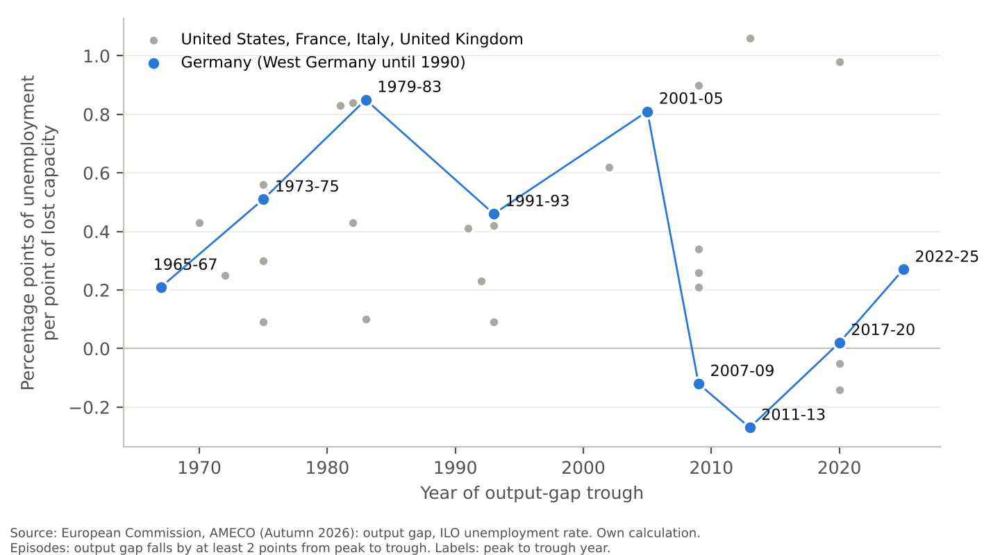

# Lost in Transmission

## How Germany buys time with demography and a hiring freeze

## Buying time, again

In September 2023, Renate Köcher of the Allensbach Institute reported a number her institute had not seen at this level before. Only seven percent of people in work worried that their job might not be secure. During the long slump between 2000 and 2005, the same question had drawn shares of up to 38 percent.[^n1] The country's mood in the press could hardly have been further from that reading. Germany was once again "the sick man of Europe", its industry in structural decline, its growth model exhausted. But in 2005, registered unemployment had stood at 11.7 percent. In 2023 it was 5.7 percent.[^n2] Worry has risen since, but from a historic low. In a survey at the end of 2025, one German in six described their job as insecure, against more than one in five in 2009.[^n3]

Wolfgang Streeck has described how democratic capitalism, from the 1970s onwards, bought time. When growth no longer delivered what voters had been promised, governments filled the gap first with inflation, then with public debt, then with private credit, each time postponing a distributional conflict they could not resolve.[^n4] This essay argues that Germany is buying time again, but with a different currency. It is paying with demography and with the jobs it does not create.

Start with what has, and has not, happened. Real GDP fell in 2023 and 2024 and barely grew in 2025. Registered unemployment rose from 5.3 percent in 2022 to 6.3 percent in 2025.[^n5] That is a real increase, and it is not far from what Germany's own history would predict. Economists measure a downturn by the output gap: the distance between what an economy produces and what it could produce with its existing workers and machines, its potential output. The European Commission estimates that the German economy moved from running slightly above its potential in 2022 to running 1.7 percent below it in 2025.[^n6] In earlier German recessions, each point of lost capacity added between a third of a point and a full point to unemployment. By that yardstick, a rise of about one point is what one would expect, and it is roughly what happened.[^n7] The German labour market has been cushioned, but far less than in 2009 or 2020.

The striking number lies elsewhere. In 2025, German output was almost ten percent below the path it had followed between 2014 and 2019. Only about three points of that shortfall show up as idle capacity. About five points have been written off as lost potential output: the Commission now assumes that the German economy simply cannot produce what it was once expected to produce.[^n8] No other large Western economy shows a comparable write-down. In France, Italy and the United States, potential output is at or above its pre-pandemic trend; only the United Kingdom comes close. 

A permanent loss of industrial capacity normally announces itself as structural unemployment. It did so in Britain, where unemployment more than doubled between 1979 and 1984, and in eastern Germany, where registered unemployment stayed between 13 and 19 percent from 1994 to 2006.[^n9] In Germany today it produces a far shorter queue at the employment office than the output loss would once have, because firms keep most of the workers they have and stop hiring new ones. Had employment kept growing as it did before 2019, about five percent more people would be in work today. The gap reflects a labour force that has stopped growing and firms that have stopped hiring, not shorter working hours.[^n10] The adjustment has happened mainly at the hiring gate; dismissals have risen, but far less than the output loss would once have produced. Those already inside experience the hiring freeze as calm. Those trying to get in experience it as the recession.

This essay makes three claims. First, an ageing workforce, expensive energy and Chinese competition have hit Germany's export industries, and three buffers keep the blow from households. Second, the buffers protect skilled industrial insiders, while those outside carry the adjustment and send their signal to politics in the wrong currency, as votes for the AfD. Third, the reforms that do pass discipline the unprotected and leave the insiders' institutions untouched.

What is missing is the one thing that bought time is supposed to finance: a transition. Growth models rest on growth coalitions, the social groups that benefit from them and defend them politically.[^n11] The 500-billion-euro infrastructure fund agreed in March 2025 supplies money for a shift towards an investment-led model. It does not supply a growth coalition to carry one. The buffers hold the old growth coalition together; this essay argues that, in doing so, they make a new one harder to form. Streeck's bought time ended when the bill came due. In Germany, the bill is coming due as well. It is not arriving as a fiscal crisis. Increasingly, it is arriving as a political one.

## Germany has done this before

Germany has buffered recessions before. What is new is not mainly the size of the unemployment response but where the rest of the loss ends up.

Table 1 measures every German recession since the 1960s in the same way: how much capacity was lost, how far registered unemployment rose over the same years, and how many points of unemployment each point of lost capacity produced.

*Table 1: German recessions, lost capacity and unemployment, 1965-2025*

| Episode | Lost capacity (points of potential output) | Unemployment, before → after (%) | Rise in unemployment per point of lost capacity |
|---|---|---|---|
| 1966/67 | 4.8 | 0.7 → 2.1 | 0.3 |
| 1974/75 | 4.9 | 1.2 → 4.7 | 0.7 |
| 1981/82 | 4.9 | 3.8 → 9.1 | 1.1 |
| 1992/93 | 4.8 | 7.3 → 9.8 | 0.5 |
| 2008/09 | 6.4 | 8.7 → 9.1 | 0.1 |
| 2020 | 4.8 | 5.5 → 6.5 | 0.2 |
| 2022-25 | 2.6 | 5.8 → 6.8 | 0.4 (German nationals only: 0.3) |

*Lost capacity: fall in the output gap from peak to trough. Sources: European Commission,[^n12] West Germany until 1990; Bundesagentur für Arbeit.[^n13] Own calculation.[^n14]*

Before 2009, every recession pushed unemployment up sharply, and the level rarely fell back to where it had been. The 1966/67 recession, mild by later standards, helped bring down Ludwig Erhard's government and tripled registered unemployment; by June 1967 the new grand coalition had passed the Stability and Growth Act. The 1992/93 downturn fed a rise that peaked at 11.4 percent in 1997 and was answered, a decade later, by the Hartz reforms. The link between recession and reform was never tight. It ran through coalition arithmetic and party competition. But the labour market reliably carried the signal.

2009 broke the pattern. Output fell by more than five percent, the largest contraction in the history of the Federal Republic, yet unemployment barely moved. Short-time work absorbed about a third of the adjustment. Under it, the state pays part of the wages of workers whose hours are cut. Working-time accounts, in which workers bank overtime in good years and draw it down in bad ones, absorbed a further sixth.[^n15] 2020 repeated the pattern in starker form, with close to six million people on short-time work in April.[^n16] In both episodes, buffering was a bet that the shock would pass, and the bet paid off. By 2011, German output was back above its 2008 level, and the economy's capacity had barely been dented.[^n17] Firms that had kept their skilled workers restarted at full strength while competitors rebuilt their workforces. Economists called it the German labour market miracle.

Measured this way, 2022-25 is no miracle. The rise in unemployment sits at the lower edge of the old recessions, but above 2009 and 2020, and in line with what other rich economies have seen in theirs (Figure 1). The outliers in the German record are the crisis years of 2009 and 2020, when the state paid firms to keep workers, not the slow slump of the past four years.

*Figure 1: How much unemployment each recession produced. Each point is one recession in one country: the rise in the unemployment rate per point of lost capacity. Germany in blue, the United States, France, Italy and the United Kingdom in grey. Source: European Commission,[^n18] own calculation.[^n19]*

So the labour market has responded, if more softly than it used to. What differs is the shock it has been responding to. In 2009, almost all of the loss was cyclical, and almost all of it came back. Today, idle capacity explains only about three of the ten points by which German output trails its pre-2019 path. The rest has been written off as lost potential: roughly half because the labour force is ageing and has stopped growing, a quarter because investment did not happen, and only a fifth because productivity has stalled, which is where a hidden industrial decline would show up.[^n20] Germany is no longer buffering a recession. It is buffering the industrial part of a decline whose demographic part no buffer can hide, and a decline does not end with a recovery that rewards the firms that waited.

## How a supply shock stays invisible

Ludwigshafen, on the Rhine, is home to BASF's headquarters and, by the company's own account, the world's largest integrated chemical site. In February 2023, the company announced that it would close one of its two ammonia plants there, along with the plants for caprolactam and TDI, intermediate products for nylon and foam. The closures took out about a tenth of the site's asset base. They cost about 700 production jobs, on a site where tens of thousands work.[^n21] Higher energy costs, mostly for gas, had added 3.2 billion euros to the company's costs in 2022, most of it in Europe. A tenth of the site's plant went; a far smaller share of its workforce did.

That is the pattern of the past four years in miniature. The shock itself is not hidden. It is visible in every industrial statistic. What is hidden is its passage to households, and the mechanism that hides it.

Start with the shock. Russia's war cut off the cheap pipeline gas on which German energy-intensive industry had been built. Prices fell back from their 2022 peak but settled at a new level: in 2024, German industry paid around 13 cents per kilowatt hour for electricity, against 8 cents in the United States and China.[^n22] At the same time, Chinese producers moved into the sectors where Germany had been strongest, chemicals, machinery and cars. By August 2025, Chinese export prices stood 17 percent below their 2022 average, while euro-area export prices had risen by 14 percent.[^n23] Neither change is cyclical. Neither will be reversed by a pick-up in demand.

The industries at the centre of the shock show it. Between February 2022 and March 2026, output in Germany's energy-intensive branches, chemicals, metals, paper, glass and ceramics, fell by 15 percent. Employment in the same branches fell by six percent, from 848,000 to 794,000.[^n24] Across manufacturing as a whole, real value added fell by almost seven percent between 2022 and 2025, and employment by three.[^n25] Since 2022, output has fallen roughly twice as fast as jobs.[^n26] The economy-wide picture is clearer still. German output trails its pre-2019 trend by ten points. More than five of them are jobs that were never created, and about four are weaker output per hour worked. Shorter working hours account for almost nothing.[^n27] Germany has not adjusted by cutting hours. It has adjusted by not hiring.

This is labour hoarding, keeping workers a firm does not currently need, in its quiet form: keep most of the workforce you have, let it shrink through retirement, replace few. Its cost lands in two places other than the payroll. The first is productivity. A firm that keeps its workers while producing less produces less per hour, and the statistics read part of that stall as lost capacity rather than idle labour. The effect is real but limited: only about one of the five points of lost potential comes through productivity.[^n28] The second place the cost lands is outside the firm: on the young people, the migrants and the workers of insolvent suppliers who would have filled the jobs that were not created (section 4).

Three buffers make this possible. They operate in a hierarchy, and the order matters for what happens when they weaken. The ranking is a hypothesis: the aggregate data are consistent with it, but they cannot prove it.

### Demographic scarcity

The first and strongest buffer is demographic. Over the next fifteen years, 13.4 million people, almost a third of the labour force, will reach retirement age; they are the baby-boom cohorts.[^n29] For a firm deciding whether to let a trained 50-year-old go, the relevant question is not whether demand will recover next year. It is whether anyone will be available to hire when it does. Under these conditions, hoarding is rational even against a shock that may not pass. The firm-level evidence fits. Vacancies have almost halved since late 2022, from almost two million to about one million, and there are now almost three unemployed people for every vacancy.[^n30] Firms have stopped searching, and they are dismissing far fewer workers than the output loss would once have produced. Dismissals have not stopped: the number of unemployed in the insurance system, most of whom have recently lost a job, has still risen by more than a third since 2022.[^n31] Short-time work, the instrument the state used in 2009 and 2020, has played a minor role, at around 320,000 people on average in 2024, against close to six million at the peak in 2020.[^n32] Firms are hoarding on their own account.

Demography appears on both sides of the ledger, and the objection deserves a direct answer. The same shrinking labour force that makes hoarding rational also lowers potential growth and is thus part of the decline being hidden. Both are true, but they run on different clocks. As a buffer, demography works immediately, through each firm's retention decision. As a drag on growth, it works slowly, through the supply of labour over a decade. That is why the buffer can hold now and give way later.

### A narrow shock

The second buffer is the narrowness of the shock. Energy-intensive industry and the car industry with its suppliers are concentrated in a few regions. Services, public employment and much of the rest of manufacturing have not contracted. A narrow shock leaves most of the labour market intact, so workers who do leave the affected sectors can be absorbed elsewhere, and firms in the affected sectors can hoard without being dragged down by a general collapse in demand. The contrast is 1992/93, when the contraction ran across the whole economy and even scarce labour did not stay on payrolls. A narrow shock also has a political geography. It is acute in Ludwigshafen, Salzgitter, Zwickau and Bitterfeld and barely felt in Munich, Hamburg or Berlin.

### The welfare backstop

The third buffer is the one most discussed in public and, so far, the least used. The number of people receiving the *Bürgergeld*, Germany's basic income support, fell by about four percent during 2025 rather than rising.[^n33] Public employment grew by almost 100,000 in the year to mid-2024.[^n34] The unemployment insurance fund ran a deficit of more than four billion euros in 2025 and had to borrow from the federal budget.[^n35] But the welfare state has not been absorbing a wave of displaced industrial workers, because there has been no wave. Its role is different: it makes the alternatives to dismissal credible. Firms can negotiate long, socially agreed reduction paths, Volkswagen until 2030, Audi until 2029,[^n36] because early retirement, transfer companies and insurance benefits stand behind them. The backstop shapes behaviour before it pays out.

### How the buffers work together

The buffers form a chain rather than three separate walls. Demographic scarcity makes hoarding rational. The narrowness of the shock keeps hoarding affordable, because most of the economy still runs. The welfare backstop turns the dismissals that do come into scheduled, negotiated exits. Break the first link and firms return to dismissing at the old rate. Broaden the shock and hoarding becomes unaffordable. Remove the backstop and the negotiated exits become contested ones. As long as all three hold, a structural decline reaches households as a hiring freeze and a trickle of dismissals, and reaches the statistics as lost potential. It does not reach them as a recession.

## Whom the buffers protect

The buffers are not neutral. Hoarding protects the workers firms most want to keep: skilled, long-tenured, covered by collective agreements and represented by works councils. They are the core constituency of Germany's export model, the industrial insiders on whose cooperation that model was built. Adjustment, where it happens, runs through the margins first: fixed-term contracts that are not renewed, agency workers who are sent back, school leavers who are not hired.

The data show the pattern. Between 2022 and 2025, registered unemployment rose by about a fifth. Among people under 25 it rose by a third, from 203,000 to 273,000, and the youth unemployment rate climbed from 4.4 to 5.7 percent.[^n37] Part of that rise, as with the overall figure, reflects young refugees entering the statistics. A hiring freeze is a buffer for those already inside. For those trying to get in, it is the recession. Foreign nationals carry an even larger share. They make up about one in six employees, but account for half of the increase in unemployment between 2022 and 2025. Partly, refugees from Ukraine entered the statistics; partly, migrants are over-represented in the jobs that go first.[^n38]

The negotiated reduction paths in the car industry show the same logic in contractual form. Volkswagen has agreed to cut more than 35,000 jobs in Germany by 2030 without compulsory redundancies, and Audi up to 7,500 in indirect areas by 2029, with employment protection at its German sites extended to the end of 2033.[^n39] These agreements protect the people already on the payroll. They do not protect the supplier firms, where the shock lands without a works agreement to soften it. Corporate insolvencies reached their highest level in ten years in 2025 and rose by almost another seven percent in the first eight months of 2026.[^n40]

None of this is new to students of German political economy. The literature on dualisation describes how Germany protected its industrial core in the 1990s and 2000s by shifting flexibility onto a growing periphery of part-time, temporary and low-wage work.[^n41] Hassel[^n42] argued that this dualism was not a failure of the German model but the condition of its recovery. The current episode extends the pattern. The core is protected through hoarding and negotiated exits; the margin absorbs the adjustment. What has changed is the direction of travel. In the 2000s, dualisation bought competitiveness for an expanding export sector. Today it buys time for a contracting one.

The geography compounds the contractual divide. The unprotected margin is concentrated in the regions of energy-intensive industry and car suppliers, often outside the large cities, often in the east. That is where the political signal comes from, and where it takes a form the old channel was not built to carry.

## The signal in the wrong currency

Macroeconomic weakness used to reach German politics through the labour market. Rising unemployment made economic policy the dominant electoral issue, weakened incumbents and gave reformers a mandate. In 1982 and again in 2005, rising unemployment was central to the fall of the government. This channel requires a large group of voters who experience the downturn as their own, personal economic crisis.

The buffers have removed that group. The median voter is employed and does not expect to lose their job. The electoral return on promising to fix the economy is low. But the slump has not gone politically unnoticed. The AfD doubled its vote share between 2021 and 2025, from 10.4 to 20.8 percent.[^n43][^n44] If the signal has not vanished, the question is what form it has taken.

The district data offer a first answer. Across Germany's 400 districts, the AfD's gain between the 2021 and 2025 federal elections is unrelated to the rise in local unemployment. It is related to the share of local employment in industry, both in the energy-intensive branches and in metalworking, cars and machinery. The link holds when one compares districts that are alike in income, settlement type, region and earlier AfD support, but it is modest: half a point of extra gain for a markedly more industrial district, against an average gain of more than eleven points. Income and earlier AfD strength matter far more, and a comparison across districts cannot establish cause.[^n45] What it does show is that where the signal comes through, it comes through industrial exposure rather than unemployment, and it arrives as a vote for a party that offers cultural grievance rather than an economic programme. That is the wrong currency.

Meanwhile the institutions through which economic distress used to be converted into policy have become harder to move. The debt brake ties fiscal policy to constitutional majorities. In November 2023, the Constitutional Court voided the reallocation of 60 billion euros in unused credit to the climate fund, removing the government's fiscal room at a stroke.[^n46] The governing coalition collapsed a year later. The election of February 2025 produced a Bundestag in which the AfD and Die Linke together hold a blocking minority on constitutional amendments. The largest fiscal change in decades came in March 2025. A constitutional amendment exempted defence spending above one percent of GDP from the debt brake and created a 500-billion-euro fund for infrastructure and climate investment. It was passed by the outgoing Bundestag, by 512 votes to 206, before the new one convened.[^n47] It was an elite manoeuvre against the clock, not the answer to a mandate.

Ordinary politics has not been idle since. Within fourteen months of taking office, the new government had passed four laws.[^n48] One replaces the *Bürgergeld* with a stricter basic income support. Another gives pensioners tax incentives to keep working. Two speed up public procurement and infrastructure planning. The replacement of the *Bürgergeld*, promised in the CDU/CSU programme, passed with an ordinary majority in the first half of the term. By the test this essay originally set itself, that is a structural reform delivered by electoral politics, and the essay has to concede it.

What the concession reveals is the direction of reform. The measure that passed tightens the conditions for the unprotected: the long-term unemployed, people at the margin of the labour market. It leaves the institutions of the protected untouched. Wage-setting, short-time work, employment protection and the negotiated reduction paths in industry have not been touched. The labour-law package the cabinet adopted in November 2026 confirms the pattern. It extends fixed-term contracts without objective reason until 2030, which adds flexibility at the margin, and eases dismissal protection only for top earners.[^n49] The one planned change to the working-time rules of insiders, a weekly instead of a daily limit, had been tied to collective agreements in a ministry draft of mid-2026.[^n50] The bill the cabinet adopted does not contain it at all; its only change to working-time law extends Sunday work in bakeries and public libraries.[^n51] Reform has not stopped. It has been routed onto the people who carry the adjustment already.

## A growth model without a coalition

For three decades, Germany grew on exports. Baccaro and Pontusson[^n52] describe the German growth model as one in which wage restraint, coordinated by unions and employers, kept manufacturing competitive while domestic demand lagged behind. A growth model is not only an economic arrangement. It rests on a growth coalition: the groups whose interests it serves and who defend it politically. In Germany, that growth coalition united export firms, their skilled workforces and the unions that represented them, with the state as guarantor.[^n53]

The shock of 2022 hit the engine of that model. Cheap energy and a growing Chinese market for German machinery and cars will not return. The buffers described in section 3 are the institutions of the export model running in reverse. The same coordinated bargaining, works councils and welfare guarantees that once organised expansion now organise an orderly retreat. They do it well. Insiders keep their jobs, exits are negotiated, households stay calm.

Time bought this way could be used for a transition. The 500-billion-euro infrastructure fund provides the money for a shift towards a model driven more by public and private investment and domestic demand. The money is flowing slowly: 14 billion euros were spent in 2025, and 48 billion are budgeted for 2026.[^n54] Even fully spent, the fund covers less than the public investment gap of just under 600 billion euros over ten years that economists from both the employer-funded and the union-funded institutes estimated in 2024.[^n55]

Money is not the binding constraint. A new growth model needs a growth coalition that wants it: firms, workers and regions whose future depends on its success and who will defend it politically. This essay's reading is that the buffers work against the formation of such an alliance. They hold the old one together by protecting its members from the decline of the industries that sustained it. The workers who might gain most from a new model are the young, the precariously employed and the people in regions without a future in energy-intensive industry. They are exactly those whom the buffers leave exposed. Their votes are increasingly going to a party that campaigns for the debt brake and against the energy transition, not for an investment-led model.[^n56]

Eastern Germany shows what transfers can and cannot do. Net transfers from west to east between 1991 and 2013 are estimated at close to two trillion euros.[^n57] They have sustained incomes and infrastructure, yet output per head in the eastern states remains at about 72 percent of the western level, almost unchanged since 2020.[^n58] In 2023, 43 percent of eastern Germans described themselves as second-class citizens,[^n59] and the AfD is strongest there. Money preserved the standard of living. It did not build a new productive base, and it did not build political attachment to the order that provided it.

The analogy with Streeck has a limit, and the limit matters. In his cases, governments chose to buy time. Here no one chose it: the time is bought by firms' retention decisions and by the age structure of the workforce, which is why it appears in no budget and why no one is accountable for spending it. Streeck's account of bought time ended with the bill coming due: inflation, then debt, then a financial crisis. In Germany, the bill is not fiscal. The state can still borrow, and demography is a currency that is spent gradually. The bill comes as a political cost: a growing share of voters who experience the decline as their own but see no economic programme that speaks to them, and who answer in the currency available.

## Three clocks

The buffers will not last indefinitely, and they wear out on different timetables.

The demographic clock runs longest and most predictably. Retirements peak in the early 2030s, when the largest post-war cohort, the 1.36 million born in 1964, reaches 67.[^n60] Hoarding works as long as firms expect to need their workers later. Once retirements outrun what firms can retain, production adjusts to the labour available or wages rise sharply enough to pull workers out of declining sectors. Either way, the failure of this buffer will not show up as unemployment. When labour becomes scarce, unemployment falls. It will show up as lower output and slower income growth. The classic chain, from recession to unemployment to electoral pressure, may not merely be weakened; in its old form it may be gone.

The fiscal clock is shorter. The unemployment insurance fund has exhausted its reserves and runs on federal loans. Pensions, health care, long-term care and defence all claim a growing share of the budget at the moment the welfare backstop would be needed at scale. The infrastructure fund expands the space for investment, not for social spending.

The capability clock is the shortest, and it moves in steps rather than gradually. When a supplier cluster loses its engineers, when a chemical complex closes a plant rather than mothballing it, when a regional toolmaking network falls below the size at which it can sustain itself, rebuilding costs a multiple of preserving. The negotiated reduction paths at Volkswagen and Audi are hoarding with an expiry date. Insolvencies bypass the retention decision altogether: a firm that exits does not hoard.

The three clocks set the deadline for a transition. If a new growth model has not found its growth coalition by the time the buffers wear out, the decline will arrive without one.

## How this argument could be wrong

The argument can fail on two counts.

The economic test: if the Commission and other forecasters revise German potential output upwards over the next few years, so that the output gap widens and the missing output reappears as slack, then the shock was cyclical after all. The buffers will then have bridged a recession, as in 2009, and the case that Germany is buffering a decline falls.

The political test had to be restated after its first version failed. The claim that the buffers block a new growth coalition is wrong if one of two things happens before the federal election due in 2029 or in the term after it. Either a government changes the institutions that protect the insiders: wage-setting, short-time work, employment protection or the support regimes for declining industries. Or it assembles a durable alliance for an investment-led growth model. In both cases, this would have to happen without a crisis and without a constitutional detour. Reforms that tighten the rules for the unprotected would not refute the argument, but the essay concedes that it identified this pattern only after the fact.

Which returns the essay to Köcher's seven percent. The calmest reading of job security in the history of German survey research is not a sign that the crisis has been avoided. It is what this crisis looks like: a decline absorbed so completely by those who are protected that the people who carry it cannot recognise themselves as a group, and answer in a currency that buys them nothing.

[^n1]: Renate Köcher, "Halbzeitbilanz," *Frankfurter Allgemeine Zeitung*, September 21, 2023; Institut für Demoskopie Allensbach, FAZ-Monatsbericht September 2023, table A 11, <https://www.ifd-allensbach.de/fileadmin/kurzberichte_dokumentationen/FAZ_Sept2023_Halbzeitbilanz.pdf>.

[^n2]: Statistik der Bundesagentur für Arbeit, *Arbeitslosigkeit im Zeitverlauf*, reporting month October 2026 (Nuremberg, 2026); regional series as compiled in the author's data repository, <https://statistik.arbeitsagentur.de/DE/Navigation/Statistiken/Fachstatistiken/Arbeitsuche-Arbeitslosigkeit-Unterbeschaeftigung/Produkte/Zeitreihen-Arbeitslose-Arbeitsuchende-Arbeitslosenquoten/Zeitreihen-Arbeitslose-Arbeitsuchende-Arbeitslosenquoten-Nav.html>.

[^n3]: EY, "EY-Verbraucherumfrage 2025/2026," press release, January 2026, <https://www.ey.com/de_de/newsroom/2026/01/ey-verbraucherumfrage-2025-2026>.

[^n4]: Wolfgang Streeck, *Buying Time: The Delayed Crisis of Democratic Capitalism* (London: Verso, 2014), <https://www.versobooks.com/products/14-buying-time>.

[^n5]: Bundesagentur für Arbeit, *Arbeitslosigkeit im Zeitverlauf*.

[^n6]: European Commission, Directorate-General for Economic and Financial Affairs, *AMECO database*, autumn 2026 forecast vintage (Brussels, November 17, 2026), <https://economy-finance.ec.europa.eu/economic-research-and-databases/economic-databases/ameco-database_en>.

[^n7]: About half of the rise in the number of unemployed reflects foreign nationals, including refugees from Ukraine who entered the statistics from 2022. Among German nationals, the unemployment rate rose by 0.7 points (Bundesagentur für Arbeit, *Arbeitslosigkeit im Zeitverlauf*).

[^n8]: European Commission, *AMECO*.

[^n9]: European Commission, *AMECO*; Bundesagentur für Arbeit, *Arbeitslosigkeit im Zeitverlauf*.

[^n10]: European Commission, *AMECO*.

[^n11]: Lucio Baccaro and Jonas Pontusson, "Rethinking Comparative Political Economy: The Growth Model Perspective," *Politics & Society* 44, no. 2 (2016): 175-207, <https://doi.org/10.1177/0032329216638053>.

[^n12]: European Commission, *AMECO*.

[^n13]: Bundesagentur für Arbeit, *Arbeitslosigkeit im Zeitverlauf*.

[^n14]: Lost capacity is the fall in the output gap, the distance between actual and potential output, from its last peak to its trough; an episode requires a fall of at least two points. The ratio is the change in the registered unemployment rate of the Federal Employment Agency, measured on dependent civilian employees, over the same years, divided by that fall. Before 2009 it ranged from 0.29 to 1.08; for 2022-25 it is 0.38 for all registered unemployed and 0.27 for German nationals only. Code and data are available from the author.

[^n15]: Michael C. Burda and Jennifer Hunt, "What Explains the German Labor Market Miracle in the Great Recession?," *Brookings Papers on Economic Activity* (Spring 2011): 273-319, <https://www.brookings.edu/wp-content/uploads/2011/03/2011a_bpea_burda.pdf>.

[^n16]: Bernd Fitzenberger and Christian Kagerl, "Viele Dienstleistungsbranchen nutzten Kurzarbeit in der Corona-Krise zeitweise stärker als das Produzierende Gewerbe," *IAB-Forum*, March 20, 2023, <https://iab-forum.de/viele-dienstleistungsbranchen-nutzten-kurzarbeit-in-der-corona-krise-zeitweise-staerker-als-das-produzierende-gewerbe/>.

[^n17]: European Commission, *AMECO*.

[^n18]: European Commission, *AMECO*.

[^n19]: Same method as Table 1, but with the ILO unemployment rate, which is available for all five countries and runs below the German registered rate. Negative German values around 2009 and 2013 reflect the fall in unemployment after the Hartz reforms, which overlaid the cycle.

[^n20]: The split approximates the Commission's production-function method: potential output as trend productivity times capital (weight 0.35) and potential labour (weight 0.65). Against its 2014-19 trend, German potential output in 2025 is 5.1 points lower: labour force −1.4, structural unemployment −1.1, hours −0.3, capital −1.2, trend productivity −1.0. The decomposition is indicative, not the Commission's own. Karel Havik, Kieran Mc Morrow, Fabrice Orlandi, Christophe Planas, Rafal Raciborski, Werner Roeger, Alessandro Rossi, Anna Thum-Thysen and Valerie Vandermeulen, *The Production Function Methodology for Calculating Potential Growth Rates & Output Gaps*, European Economy Economic Papers 535 (Brussels: European Commission, 2014), <https://ec.europa.eu/economy_finance/publications/economic_paper/2014/ecp535_en.htm>.

[^n21]: BASF, "BASF Shows Resilience in a Challenging Market Environment and Implements Measures to Strengthen Competitiveness," press release P-23-131, Ludwigshafen, February 24, 2023, <https://www.basf.com/global/en/media/news-releases/2023/02/p-23-131.html>.

[^n22]: vbw Vereinigung der Bayerischen Wirtschaft and FfE, *Internationaler Energiepreisvergleich für die Industrie*, presentation (Munich, November 10, 2025), 6, <https://www.vbw-bayern.de/Redaktion/Frei-zugaengliche-Medien/Abteilungen-GS/Wirtschaftspolitik/2025/Downloads/vbw-Studie-Internationaler-Energiepreisvergleich.pdf>.

[^n23]: Sachverständigenrat zur Begutachtung der gesamtwirtschaftlichen Entwicklung, *Perspektiven für morgen schaffen, Chancen nicht verspielen: Jahresgutachten 2025/26* (Wiesbaden, November 2025), chap. 1, para. 14, and summary, para. 4, <https://www.sachverstaendigenrat-wirtschaft.de/fileadmin/dateiablage/gutachten/jg202526/JG202526_Gesamtausgabe.pdf>.

[^n24]: Statistisches Bundesamt, "Energieintensive Industriezweige mit Produktionsrückgang um 15,2 % von Februar 2022 bis März 2026," press release no. N032, Wiesbaden, May 15, 2026, <https://www.destatis.de/DE/Presse/Pressemitteilungen/2026/05/PD26_N032_42.html>.

[^n25]: European Commission, *AMECO*.

[^n26]: In manufacturing as a whole, real value added fell by almost seven percent between 2022 and 2025 and employment by three percent. Over the longer period since 2019, manufacturing employment has fallen faster than output (European Commission, *AMECO*).

[^n27]: Real GDP in 2025 compared with its 2014-19 trend, in log points: employment −5.4, hours per worker −0.5, output per hour −4.3. Own calculation from European Commission, *AMECO*.

[^n28]: Trend productivity accounts for about one of the five points of lost potential; see the decomposition of potential output in the note above.

[^n29]: Statistisches Bundesamt, "13,4 Millionen Erwerbspersonen erreichen in den nächsten 15 Jahren das gesetzliche Rentenalter," press release, Wiesbaden, September 3, 2025, <https://www.destatis.de/DE/Presse/Pressemitteilungen/2025/08/PD25_N048_13.html>.

[^n30]: Institut für Arbeitsmarkt- und Berufsforschung, "Mit rund 1 Million offenen Stellen bleibt die Personalnachfrage schwach," press release, Nuremberg, November 2025, <https://iab.de/presseinfo/mit-rund-1-million-offenen-stellen-bleibt-die-personalnachfrage-schwach/>.

[^n31]: Bundesagentur für Arbeit, *Arbeitslosigkeit im Zeitverlauf*.

[^n32]: Bundesagentur für Arbeit, "Jahresrückblick 2024: Wirtschaftliche Stagnation hinterlässt deutliche Spuren am Arbeitsmarkt," press release, Nuremberg, January 3, 2025, <https://www.arbeitsagentur.de/presse/2025-02-jahresrueckblick-2024>; Fitzenberger and Kagerl, "Viele Dienstleistungsbranchen.".

[^n33]: Statistik der Bundesagentur für Arbeit, *Grundsicherung für Arbeitsuchende (SGB II): Bedarfsgemeinschaften und Regelleistungsberechtigte* (Nuremberg, April 28, 2026), <https://statistik.arbeitsagentur.de/Statistikdaten/Detail/202511/arbeitsmarktberichte/monatsbericht-monatsbericht/monatsbericht-d-0-202511-pdf.pdf?__blob=publicationFile>.

[^n34]: Statistisches Bundesamt, "Öffentlicher Dienst 2024: Mehr Beschäftigte für Bildung und Kinderbetreuung," press release no. 212, Wiesbaden, June 17, 2025, <https://www.destatis.de/DE/Presse/Pressemitteilungen/2025/06/PD25_212_741.html>.

[^n35]: Bundesagentur für Arbeit, *Geschäftsbericht 2025* (Nuremberg, 2026), 34, <https://www.arbeitsagentur.de/datei/geschaeftsbericht-2025_ba056572.pdf>.

[^n36]: Volkswagen AG, "Einigung erzielt: Volkswagen AG stellt sich wettbewerbsfähig für die Zukunft auf," press release, Wolfsburg, December 20, 2024, <https://www.volkswagen-group.com/de/pressemitteilungen/einigung-erzielt-volkswagen-ag-stellt-sich-wettbewerbsfaehig-fuer-die-zukunft-auf-18911>; Audi AG, "Management and Works Council Enter Agreement for the Future," press release, Ingolstadt, March 17, 2025, <https://www.audi-mediacenter.com/en/press-releases/management-and-works-council-enter-agreement-for-the-future-16579>.

[^n37]: Bundesagentur für Arbeit, *Arbeitslosigkeit im Zeitverlauf*.

[^n38]: Bundesagentur für Arbeit, *Arbeitslosigkeit im Zeitverlauf*.

[^n39]: Volkswagen, "Einigung erzielt."; Audi, "Agreement for the Future.".

[^n40]: Creditreform Wirtschaftsforschung, *Insolvenzen in Deutschland, Jahr 2025* (Neuss, December 8, 2025), <https://www.creditreform.de/aktuelles-wissen/pressemeldungen-fachbeitraege/news-details/show/insolvenzen-in-deutschland-jahr-2025>; Statistisches Bundesamt, *Insolvenzstatistik: beantragte Unternehmensinsolvenzen*, monthly, reporting month August 2026, GENESIS-Online (Wiesbaden, 2026), <https://genesis.destatis.de/datenbank/online/statistic/52411/table/52411-0001>.

[^n41]: Bruno Palier and Kathleen Thelen, "Institutionalizing Dualism: Complementarities and Change in France and Germany," *Politics & Society* 38, no. 1 (2010): 119-148, <https://doi.org/10.1177/0032329209357888>; Patrick Emmenegger, Silja Häusermann, Bruno Palier and Martin Seeleib-Kaiser, eds., *The Age of Dualization: The Changing Face of Inequality in Deindustrializing Societies* (New York: Oxford University Press, 2012), <https://academic.oup.com/book/8478>.

[^n42]: Anke Hassel, "The Paradox of Liberalization: Understanding Dualism and the Recovery of the German Political Economy," *British Journal of Industrial Relations* 52, no. 1 (2014): 57-81, <https://doi.org/10.1111/j.1467-8543.2012.00913.x>.

[^n43]: Die Bundeswahlleiterin, "Bundestagswahl 2025: Endgültiges Ergebnis," press release, Wiesbaden, March 14, 2025, <https://www.bundeswahlleiterin.de/info/presse/mitteilungen/bundestagswahl-2025/29_25_endgueltiges-ergebnis.html>.

[^n44]: The Federal Returning Officer compares the 2025 result with the 2021 result as recalculated after the partial repeat election in Berlin in 2024 (10.4 percent); the originally published 2021 figure was 10.3 percent.

[^n45]: Regression across 400 districts of the change in the AfD's second-vote share, 2021-25, on the change in the registered unemployment rate, 2022-25, the shares of employment in energy-intensive manufacturing and in metal, car and machinery production (March 2026), and controls for east, city districts, income per head and the AfD share in 2021, with robust standard errors. With controls, unemployment has no effect; one standard deviation more energy-intensive or metal employment adds 0.3 or 0.5 points. Employment shares are measured after the shock, so the estimate is descriptive. Election data: Vincent Heddesheimer, Hanno Hilbig, Florian Sichart and Andreas Wiedemann, "GERDA: The German Election Database," *Scientific Data* 12, article 618 (2025), <https://doi.org/10.1038/s41597-025-04811-5>.

[^n46]: Bundesverfassungsgericht, "Zweites Nachtragshaushaltsgesetz 2021 ist nichtig," press release on the judgment of November 15, 2023, 2 BvF 1/22, Karlsruhe, <https://www.bundesverfassungsgericht.de/SharedDocs/Pressemitteilungen/DE/2023/bvg23-101.html>.

[^n47]: Deutscher Bundestag, "Mehrheit für Reform der Schuldenbremse: 512 Abgeordnete stimmen mit Ja," Textarchiv, Berlin, March 18, 2025, <https://www.bundestag.de/dokumente/textarchiv/2025/kw12-de-sondersitzung-1056916>.

[^n48]: Deutscher Bundestag, Gesetzesbeschluss zur Aktivrente, Bundesrat printed paper 726/25, December 5, 2025, <https://dserver.bundestag.de/brd/2025/0726-25.pdf>; Deutscher Bundestag, Gesetzesbeschluss zur Grundsicherung für Arbeitsuchende, Bundesrat printed paper 116/26, March 5, 2026, <https://dserver.bundestag.de/brd/2026/0116-26.pdf>; Deutscher Bundestag, Gesetzesbeschluss zum Vergabebeschleunigungsgesetz, Bundesrat printed paper 225/26, April 23, 2026, <https://dserver.bundestag.de/brd/2026/0225-26.pdf>; Deutscher Bundestag, Gesetzesbeschluss zum Infrastruktur-Zukunftsgesetz, Bundesrat printed paper 390/26, June 26, 2026, <https://dserver.bundestag.de/brd/2026/0390-26.pdf>.

[^n49]: Bundesministerium für Arbeit und Soziales, "Kabinett beschließt Arbeitsrechtspaket," press release, Berlin, November 18, 2026, <https://www.bmas.de/DE/Service/Presse/Pressemitteilungen/2026/kabinett-beschliesst-arbeitsrechtspaket.html>.

[^n50]: Deutscher Bundestag, "Arbeitszeit," Textarchiv, week 21 (Berlin, 2026), <https://www.bundestag.de/dokumente/textarchiv/2026/kw21-de-arbeitszeit-1178888>.

[^n51]: BMAS, "Kabinett beschließt Arbeitsrechtspaket.".

[^n52]: Baccaro and Pontusson, "Rethinking Comparative Political Economy.".

[^n53]: Lucio Baccaro, Mark Blyth and Jonas Pontusson, eds., *Diminishing Returns: The New Politics of Growth and Stagnation* (New York: Oxford University Press, 2022), <https://doi.org/10.1093/oso/9780197607855.001.0001>.

[^n54]: Bundesministerium der Finanzen, *Bundeshaushalt*: Haushaltsrechnung 2025, Haushaltsplan 2026 and Regierungsentwurf 2027, Sondervermögen Infrastruktur und Klimaneutralität (Berlin, 2026), <https://www.bundeshaushalt.de/DE/SVIK/sondervermoegen-infrastruktur-klimaneutralitaet.html>.

[^n55]: Sebastian Dullien, Simon Gerards Iglesias, Michael Hüther and Katja Rietzler, *Herausforderungen für die Schuldenbremse: Investitionsbedarfe in der Infrastruktur und für die Transformation*, IMK Policy Brief 168 / IW-Policy Paper 2/2024 (Düsseldorf and Cologne, May 2024), <https://www.imk-boeckler.de/fpdf/HBS-008864/p_imk_pb_168_2024.pdf>.

[^n56]: Bundeszentrale für politische Bildung, "Die Programmatik der AfD," dossier *Parteien in Deutschland* (Bonn, 2025), <https://www.bpb.de/themen/parteien/parteien-in-deutschland/afd/273132/die-programmatik-der-afd/>.

[^n57]: Leibniz-Institut für Wirtschaftsforschung Halle, "Auf welche Frage sind zwei Billionen die Antwort?," press release 17/2014, Halle, June 26, 2014, <https://www.iwh-halle.de/fileadmin/user_upload/press/press_releases/17-14.pdf>.

[^n58]: Klaus-Heiner Röhl, "35 Jahre Wiedervereinigung: Was wurde in Ostdeutschland erreicht und wo liegen die größten ökonomischen Probleme?," *IW-Trends* 52, no. 3 (2025): 61-80, <https://doi.org/10.2373/1864-810X.25-03-04>.

[^n59]: Infratest dimap, "33 Jahre Wiedervereinigung," survey for ARD, fieldwork August 28-30, 2023 (Berlin, 2023), <https://www.infratest-dimap.de/umfragen-analysen/bundesweit/umfragen/aktuell/33-jahre-wiedervereinigung/>.

[^n60]: Statistisches Bundesamt, "Lebendgeborene insgesamt," table (Wiesbaden, 2026), <https://www.destatis.de/DE/Themen/Gesellschaft-Umwelt/Bevoelkerung/Geburten/Tabellen/lebendgeborene-insgesamt.html>.
