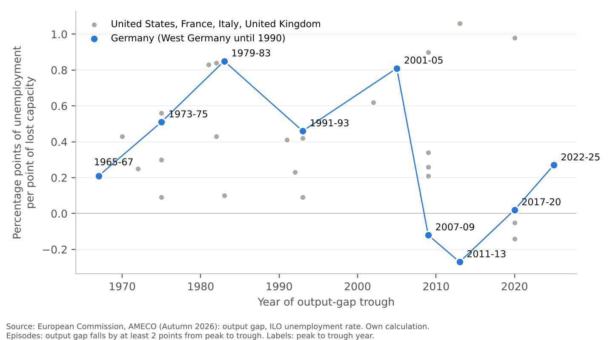

# Lost in Transmission

## How Germany buys time with demography and working hours, and why its growth model has no coalition left to change it

## 1. Buying time, again

In September 2023, Renate Köcher of the Allensbach Institute reported a number her institute had not seen at this level before. Only seven percent of people in work worried that their job might not be secure. During the long slump between 2000 and 2005, the same question had drawn shares of up to 38 percent (Köcher 2023). The country's mood in the press could hardly have been further from that reading. Germany was once again "the sick man of Europe", its industry in structural decline, its growth model exhausted. But in 2005, registered unemployment had stood at 11.7 percent. In 2023 it was 5.7 percent (Bundesagentur für Arbeit 2026). Worry has risen since, as unemployment has crept up, but from a historic low: in 2025, one employee in six described their job as insecure, against more than one in five in 2009 (EY 2026).

Wolfgang Streeck has described how democratic capitalism, from the 1970s onwards, bought time. When growth no longer delivered what voters had been promised, governments filled the gap first with inflation, then with public debt, then with private credit, each time postponing a distributional conflict they could not resolve (Streeck 2014). This essay argues that Germany is buying time again, but with a different currency. It is paying with demography and with working hours.

Start with what has, and has not, happened. Real GDP fell in 2023 and 2024 and barely grew in 2025. Registered unemployment rose from 5.3 percent in 2022 to 6.3 percent in 2025 (Bundesagentur für Arbeit 2026). That is a real increase, and it is about what Germany's own history predicts. The European Commission estimates that the German economy moved from running slightly above its potential in 2022 to running 1.7 percent below it in 2025 (European Commission 2026). In every German recession before 2009, unemployment rose by between 0.3 and 1.1 percentage points for each point of lost capacity (section 2); the international rule of thumb is similar (Ball, Leigh and Loungani 2017). On that basis one expects unemployment to rise by about one percentage point. That is what it did. Measured against the economy's current capacity, the German labour market has not been unusually insulated.

The striking number lies elsewhere. In 2025, German output was almost ten percent below the path it had followed between 2014 and 2019. Only about three points of that shortfall show up as idle capacity. About five points have been written off as lost potential output: the Commission now assumes that the German economy simply cannot produce what it was once expected to produce (European Commission 2026). No other large Western economy shows a comparable write-down. In France, Italy and the United States, potential output is at or above its pre-pandemic trend; only the United Kingdom comes close. Part of the German write-down may be an artefact of measurement: when firms keep workers they do not need, the Commission's method reads the idle labour as lower productivity, and lower productivity as lower potential. The true loss is probably smaller than five points. It is not small.

A permanent loss of industrial capacity normally announces itself as structural unemployment. It did so in Britain, where unemployment more than doubled between 1979 and 1984, and in eastern Germany, where registered unemployment stayed between 13 and 19 percent from 1994 to 2006 (European Commission 2026; Bundesagentur für Arbeit 2026). In Germany today it produces no queue at the employment office, because firms that expect to need their workers later keep them and cut hours instead. German employment has grown by only 1.5 percent since 2019, far less than in France or Italy, and hours worked per person, already drifting down with the spread of part-time work, have fallen almost twice as fast since 2019 as in the six years before, while in France and Italy they have held steady or risen (European Commission 2026). The adjustment has happened inside firms, not on the labour market. What households experience is shorter weeks, cancelled overtime and a hiring freeze. They do not experience a recession.

This essay makes three claims. First, the shock behind the write-down is real and largely supply-side, an energy-price level shift and Chinese competition in the industries on which Germany's export-led growth model rests, and three buffers keep it from households: demographic scarcity, the narrowness of the shock and a welfare state behind both. Second, the buffers protect the core of the export model's coalition, skilled and unionised industrial insiders; those outside it carry the adjustment, and their signal reaches politics in the wrong currency, as cultural grievance and a vote for the AfD. Third, ordinary politics does reform, but in one direction: it disciplines the unprotected, as the 2026 law replacing the *Bürgergeld* with a stricter basic income support does, and leaves the institutions of the protected untouched.

What is missing is the one thing that bought time is supposed to finance: a transition. Growth models rest on social coalitions (Baccaro and Pontusson 2016). The 500-billion-euro infrastructure fund agreed in March 2025 supplies money for a shift towards an investment-led model. It does not supply a coalition to carry one. The buffers hold the old coalition together; this essay argues that, in doing so, they make a new one harder to form. Streeck's bought time ended when the bill came due. In Germany, the bill is coming due as well. It is not arriving as a fiscal crisis. Increasingly, it is arriving as a political one.

## 2. Not new, intensified

Germany has buffered recessions before. What is new is not the size of the unemployment response but where the rest of the loss ends up.

Table 1 measures every German recession since the 1960s in the same way. It takes the fall in the output gap from its last peak to its trough, the rise in registered unemployment over the same years, and the ratio of the two: how many points of unemployment each point of lost capacity produced. To keep the series comparable, the unemployment rate is the one the Federal Employment Agency has published for the longest time, measured against dependent civilian employees.

*Table 1: German recessions, lost capacity and unemployment, 1965-2025*

| Episode | Output gap, peak → trough (% of potential) | Fall in gap (points) | Registered unemployment, peak → trough (%) | Rise (points) | Rise per point of lost capacity |
|---|---|---|---|---|---|
| 1966/67 | 1965: +1.1 → 1967: −3.7 | 4.8 | 0.7 → 2.1 | 1.4 | 0.29 |
| 1974/75 | 1973: +2.5 → 1975: −2.5 | 4.9 | 1.2 → 4.7 | 3.5 | 0.71 |
| 1981/82 | 1979: +3.2 → 1983: −1.7 | 4.9 | 3.8 → 9.1 | 5.3 | 1.08 |
| 1992/93 | 1991: +4.0 → 1993: −0.8 | 4.8 | 7.3 → 9.8 | 2.5 | 0.52 |
| 2008/09 | 2008: +1.6 → 2009: −4.9 | 6.4 | 8.7 → 9.1 | 0.4 | 0.06 |
| 2020 | 2019: +1.3 → 2020: −3.5 | 4.8 | 5.5 → 6.5 | 1.0 | 0.21 |
| 2022-25 | 2022: +0.9 → 2025: −1.7 | 2.6 | 5.8 → 6.8 | 1.0 | 0.38 |

*Sources: European Commission (2026), output gap, West Germany until 1990; Bundesagentur für Arbeit (2026), annual averages, rate on dependent civilian labour force. Own calculation.*

Before 2009, every point of lost capacity cost between a third of a point and a full point of unemployment, and the level rarely fell back to where it had been. The 1966/67 recession, mild by later standards, helped bring down Ludwig Erhard's government and tripled registered unemployment; by June 1967 the new grand coalition had passed the Stability and Growth Act. The 1992/93 downturn fed a rise that peaked at 12.7 percent in 1997 and was answered, a decade later, by the Hartz reforms. The link between recession and reform was never tight. It ran through coalition arithmetic and party competition. But the labour market reliably carried the signal.

2009 broke the pattern. Output fell by more than five percent, the largest contraction in the history of the Federal Republic, yet registered unemployment barely moved. Short-time work peaked at 1.44 million people in May 2009, and working-time accounts absorbed even more of the adjustment (Burda and Hunt 2011). 2020 repeated the pattern in starker form, with close to six million workers on short-time work in spring (IAB 2022). In both episodes, buffering was a bet that the shock would pass, and the bet paid off. By 2011, German output was back above its 2008 level, and the Commission's estimate of potential output had barely been dented, at less than two percent below its pre-crisis trend (European Commission 2026). Firms that had kept their skilled workers restarted at full strength while competitors rebuilt their workforces. Economists called it the German labour market miracle.

Measured this way, 2022-25 is not a miracle. A rise of 0.38 points per point of lost capacity sits inside the range of the old recessions, well above 2009 and 2020. The same holds internationally (Figure 2). The German response to the recent downturn is unremarkable next to the American, French, Italian and British responses to theirs. The outliers in the German series are the crisis episodes of 2009 and 2020, when the state paid firms to keep workers, not the slow slump of the past four years.

*Figure 2: Rise in unemployment per point of lost capacity, by recession. Each point is one recession in one country: the rise in the ILO unemployment rate from the peak to the trough of the output gap, divided by the fall in the gap. Germany in blue, the United States, France, Italy and the United Kingdom in grey. Source: European Commission (2026), own calculation.*

The ILO measure in Figure 2 differs from the registered count in Table 1. It is a survey measure and runs well below the German administrative figure, which is the one voters and politicians see. The two tell the same story here. The negative German values around 2009 and 2013 also reflect the long decline in unemployment after the Hartz reforms, which overlaid the cycle.

So the labour market has responded as it used to. What differs is the shock that it has been responding to. In 2009, almost all of the loss was cyclical, and almost all of it came back. Today, the output gap explains only about three of the ten points by which German output trails its pre-2019 path. The remainder has been written off as potential output that will not return. Germany is no longer buffering a recession. It is buffering a decline, and a decline does not end with a recovery that rewards the firms that waited.

<!-- References used in section 1 (to be merged into the final list):
Ball, L., D. Leigh and P. Loungani (2017): Okun's Law: Fit at 50? Journal of Money, Credit and Banking 49(7), pp. 1413-1441.
Baccaro, L. and J. Pontusson (2016): Rethinking Comparative Political Economy: The Growth Model Perspective. Politics & Society 44(2), pp. 175-207.
Bundesagentur für Arbeit (2026): Arbeitslosigkeit im Zeitverlauf, Berichtsmonat Oktober 2026. Nuremberg.
EY (2026): Jobstudie 2026 (16 percent rate their job insecure in 2025, 22 percent in 2009). Only secondary reports seen so far (Welt, retail-news.de); check against the EY original before submission.
European Commission (2026): AMECO database, Autumn 2026 Economic Forecast vintage, released 17 November 2026.
Köcher, R. (2023): Halbzeitbilanz. Frankfurter Allgemeine Zeitung, 21 September 2023, p. 8.
Streeck, W. (2014): Buying Time: The Delayed Crisis of Democratic Capitalism. Verso, London.
Section 2 adds: Burda, M. C. and J. Hunt (2011): What Explains the German Labor Market Miracle in the Great Recession? Brookings Papers on Economic Activity, Spring 2011, pp. 273-335. IAB (2022): Kurzarbeit in der Corona-Krise. IAB-Forum, Nuremberg (check exact title and figure, about six million in April 2020).
Numbers: results/befund1_output_gap.md, results/potential_evidence.md, results/pruefungen_offen.md -->
