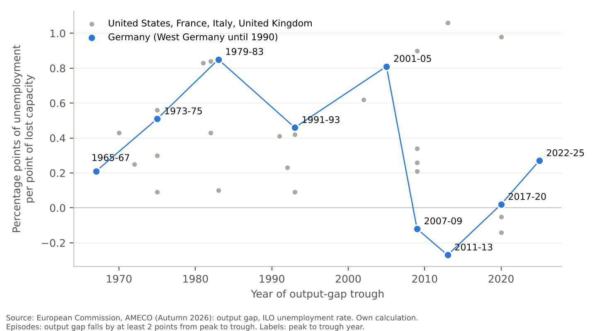

# Lost in Transmission

## How Germany buys time with demography and a hiring freeze, and why its growth model has no coalition left to change it

## 1. Buying time, again

In September 2023, Renate Köcher of the Allensbach Institute reported a number her institute had not seen at this level before. Only seven percent of people in work worried that their job might not be secure. During the long slump between 2000 and 2005, the same question had drawn shares of up to 38 percent (Köcher 2023). The country's mood in the press could hardly have been further from that reading. Germany was once again "the sick man of Europe", its industry in structural decline, its growth model exhausted. But in 2005, registered unemployment had stood at 11.7 percent. In 2023 it was 5.7 percent (Bundesagentur für Arbeit 2026).

Households were not untouched. The energy shock reached them through prices: real pay per employee was three percent lower in 2023 than in 2019 (European Commission 2026). What stayed calm was the job. And even that calm has begun to fade. In a survey at the end of 2025, one German in six described their job as insecure, against more than one in five in 2009 (EY 2026).

Wolfgang Streeck has described how democratic capitalism, from the 1970s onwards, bought time. When growth no longer delivered what voters had been promised, governments filled the gap first with inflation, then with public debt, then with private credit, each time postponing a distributional conflict they could not resolve (Streeck 2014). This essay argues that Germany is buying time again. Part of the price was paid in Streeck's first currency, inflation. The rest is being paid in a new one: demography and the jobs that are not created.

Start with what has, and has not, happened. Real GDP fell in 2023 and 2024 and barely grew in 2025. Registered unemployment rose from 5.3 percent in 2022 to 6.3 percent in 2025 (Bundesagentur für Arbeit 2026). Economists measure a downturn by the output gap: the distance between what an economy produces and what it could produce with its existing workers and machines, its potential output. The European Commission estimates that the German economy moved from running slightly above its potential in 2022 to running 1.7 percent below it in 2025 (European Commission 2026). In earlier German recessions, each point of lost capacity added between a third of a point and a full point to unemployment. By that yardstick, a rise of about one point is roughly what one would expect.[^refugees]

The striking number lies elsewhere. Had German potential output kept growing at its pre-2019 pace, and had the economy run at full capacity, output in 2025 would be about seven percent higher than it is. Less than two of those seven points are idle capacity. About five have been written off as lost potential (see the methods note). The write-down does not depend on how the trend is drawn: measured against the Commission's own forecast of autumn 2019, potential output in 2025 is five percent lower than expected (European Commission 2019, 2026). No other large Western economy shows a comparable write-down; only the United Kingdom comes close.

A loss of this kind normally announces itself as structural unemployment. It did so in Britain, where unemployment more than doubled between 1979 and 1984, and in eastern Germany, where registered unemployment stayed between 13 and 19 percent from 1994 to 2006 (European Commission 2026; Bundesagentur für Arbeit 2026). In Germany today the queue at the employment office is shorter than the loss would once have produced, and the flows show why. The risk of losing a job and becoming unemployed was no higher in 2025 than in 2019. The chance of leaving unemployment for a job, by contrast, fell by a quarter, to the lowest level on record; for people under 25 it fell from 14 to 10 percent a month (Bundesagentur für Arbeit 2025). The adjustment has happened mainly at the hiring gate. Those already inside experience it as calm. Those trying to get in experience it as the recession.

This essay makes three claims, with decreasing confidence. First, and on firm ground: Germany is absorbing a mainly supply-side decline, from an ageing workforce, expensive energy and Chinese competition, by keeping most of its workers and hiring few new ones. Second, the burden falls on those outside the protected core: the young, migrants and the workers of supplier firms. Third, and as a hypothesis rather than a finding: this distribution changes what reaches politics. The reforms that pass discipline the unprotected, the signal from those exposed arrives as votes for the AfD more than as demands for economic change, and the alliance that a new growth model would need does not form.

## 2. Germany has done this before

Germany has buffered recessions before. What is new is not mainly the size of the unemployment response but where the rest of the loss ends up.

Table 1 measures every German recession since the 1960s in the same way: how much capacity was lost, how far registered unemployment rose over the same years, and how many points of unemployment each point of lost capacity produced.

*Table 1: German recessions, lost capacity and unemployment, 1965-2025*

| Episode | Lost capacity (points of potential output) | Unemployment, before → after (%) | Rise in unemployment per point of lost capacity |
|---|---|---|---|
| 1966/67 | 4.8 | 0.7 → 2.1 | 0.3 |
| 1974/75 | 4.9 | 1.2 → 4.7 | 0.7 |
| 1981/82 | 4.9 | 3.8 → 9.1 | 1.1 |
| 1992/93 | 4.8 | 7.3 → 9.8 | 0.5 |
| 2008/09 | 6.4 | 8.7 → 9.1 | 0.1 |
| 2020 | 4.8 | 5.5 → 6.5 | 0.2 |
| 2022-25 | 2.6 | 5.8 → 6.8 | 0.4 (German nationals only: 0.3) |

*Lost capacity: fall in the output gap from peak to trough. Unemployment: registered rate on dependent civilian employees, which runs about half a point above the headline rate used in the text. Sources: European Commission (2026), West Germany until 1990; Bundesagentur für Arbeit (2026). Own calculation; see the methods note.*

Before 2009, every recession pushed unemployment up sharply, and the level rarely fell back to where it had been. The 1966/67 recession, mild by later standards, helped bring down Ludwig Erhard's government and tripled registered unemployment; by June 1967 the new grand coalition had passed the Stability and Growth Act. The 1992/93 downturn fed a rise that peaked at 11.4 percent in 1997 and was answered, a decade later, by the Hartz reforms. The link between recession and reform was never tight. It ran through coalition arithmetic and party competition. But the labour market reliably carried the signal.

2009 broke the pattern. Output fell by more than five percent, the largest contraction in the history of the Federal Republic, yet unemployment barely moved. Short-time work absorbed about a third of the adjustment. Under it, the state pays part of the wages of workers whose hours are cut. Working-time accounts, in which workers bank overtime in good years and draw it down in bad ones, absorbed a further sixth (Burda and Hunt 2011). 2020 repeated the pattern, with close to six million people on short-time work in April (Fitzenberger and Kagerl 2023). In both episodes, buffering was a bet that the shock would pass, and the bet paid off. By 2011, German output was back above its 2008 level, and the economy's capacity had barely been dented (European Commission 2026). Economists called it the German labour market miracle.

Measured this way, 2022-25 is no miracle. The rise in unemployment sits at the lower edge of the old recessions, above 2009 and 2020, and in line with earlier recessions abroad (Figure 1). One caveat belongs in the text rather than a footnote. Table 1 measures unemployment against the output gap, and the gap is what remains after the Commission has lowered its estimate of potential. The more of the slump it books as lost potential, the smaller the gap and the more normal 2022-25 looks. The table therefore cannot prove that the decline is structural. It shows only that, once the Commission's reading is accepted, the labour market has not been unusually insulated. And the reading is revised: in real time, the Commission put the German gap for 2019 at 0.2 percent; today it puts it at 1.3 (European Commission 2019, 2026).

*Figure 1: How much unemployment each recession produced. Each point is one recession in one country: the rise in the unemployment rate per point of lost capacity. Germany in blue, the United States, France, Italy and the United Kingdom in grey. Source: European Commission (2026), own calculation; see the methods note.*

Japan after 1990 is the closest parallel, and a warning. Its firms kept their core workers through the long stagnation, and unemployment rose by only a tenth to a third of a point per point of lost capacity. Japanese potential output in 1999 was about a fifth below its pre-1990 trend, four times the German write-down so far (OECD 2026). Buffered stagnation can last a decade or two without either rupture or reform.

So the labour market has responded, if more softly than it used to. What differs is the shock. In 2009, almost all of the loss was cyclical, and almost all of it came back. Today most of it has been written off as lost potential. In an approximation of the Commission's method, about 2.8 of the five points come through labour: a labour force that has stopped growing (1.4 points), a higher estimate of structural unemployment (1.1) and fewer hours (0.3). About 1.2 points come through capital, investment that did not happen, and 1.0 through productivity (see the methods note). Only part of this is industrial decline. Germany is buffering a decline whose demographic part no buffer can hide.

## 3. How a supply shock stays invisible

Ludwigshafen, on the Rhine, is home to BASF's headquarters and, by the company's own account, the world's largest integrated chemical site. In February 2023, the company announced that it would close one of its two ammonia plants there, along with plants for caprolactam, TDI and their precursors. The closures took out about a tenth of the site's asset base and about 700 production jobs (BASF 2023). Further closures followed in 2024 (BASF 2024). Yet in December 2025 the company signed a new site agreement that rules out compulsory redundancies in Ludwigshafen until the end of 2028 (BASF 2025a). Over the same years, BASF completed a new integrated site in Zhanjiang, in southern China, at a cost of about 8.7 billion euros; it opened officially in March 2026 (BASF 2025b, 2026). Capacity was not mothballed in Germany. It was closed there and built elsewhere, while the people who ran it were mostly kept on, moved or retired. A tenth of the site's plant went; a far smaller share of its workforce did.

That is the pattern of the past four years in miniature. The shock itself is not hidden. It is visible in every industrial statistic. What is hidden is its passage to households, and the mechanism that hides it.

Start with the shock. Russia's war cut off the cheap pipeline gas on which German energy-intensive industry had been built. Prices fell back from their 2022 peak but settled at a new level: in 2024, German industry paid around 13 cents per kilowatt hour for electricity, against 8 cents in the United States and China (vbw 2025). Chinese producers moved into the sectors where Germany had been strongest, chemicals, machinery and cars. By August 2025, Chinese export prices stood 17 percent below their 2022 average, while euro-area export prices had risen by 14 percent (SVR 2025). And the European Central Bank raised its deposit rate from minus 0.5 to 4 percent between July 2022 and September 2023, which made carrying idle capacity and financing new plant dearer at the same moment (ECB 2023).

The industries at the centre of the shock show it. Between February 2022 and March 2026, output in Germany's energy-intensive branches fell by 15 percent and employment by six percent (Destatis 2026a). Across manufacturing, 511,000 jobs have gone since 2019. Over the same years, public administration, education, health and social care added 1.08 million (Eurostat 2026). The economy has not stopped hiring. The export core has, while the parts of the economy that grow with ageing keep recruiting.

This is labour hoarding, keeping workers a firm does not currently need, in its quiet form: keep most of the workforce you have, let it shrink through retirement, replace few. The flows confirm it. Measured against 2019, the whole rise in unemployment comes from fewer exits into work, not from more dismissals. Measured against the unusually calm year 2022, dismissals contribute about as much as slower hiring, and the essay should not claim more than that (see the methods note). New training contracts were ten percent below 2019 in 2025 (Destatis 2026d).

Someone pays for hoarding. Not, on balance, the insiders' wages: after the price shock of 2022-23, real pay per employee recovered and was two percent above 2019 by 2025, while real unit labour costs rose (European Commission 2026). The cost has fallen on margins, on productivity, which the statistics partly read as lost potential, and on those who were not hired. Because hoarding lowers measured productivity, the one point of lost potential that comes through productivity is partly the same fact counted twice, and cannot be read as independent evidence that the industrial decline is small.

Three buffers make this possible. The ranking is a hypothesis: the aggregate data are consistent with it, but they cannot prove it.

### Demographic scarcity

The first buffer is demographic. Over the next fifteen years, 13.4 million people, almost a third of the labour force, will reach retirement age; they are the baby-boom cohorts (Destatis 2025a). For a firm deciding whether to let a trained 50-year-old go, the relevant question is not whether demand will recover next year. It is whether anyone will be available to hire when it does. Vacancies have almost halved since late 2022, from almost two million to about one million, and there are now almost three unemployed people for every vacancy (IAB 2025). Short-time work, the instrument the state used in 2009 and 2020, has played a minor role, at around 300,000 people on average in 2024 and 2025 (Bundesagentur für Arbeit 2026d). Firms are hoarding on their own account.

Demography appears on both sides of the ledger. The same shrinking labour force that makes hoarding rational also lowers potential output. The two run on different clocks: as a buffer, demography works immediately, through each firm's retention decision; as a drag, it works slowly, through the supply of labour. Scarce labour should also push firms to invest in machines that replace it, as it has in other ageing economies (Acemoglu and Restrepo 2017). That German firms hoard workers and do not invest is the part of the puzzle demography alone does not explain.

### A narrow shock, with a wide reach

The second buffer is the narrowness of the shock. Energy-intensive industry and the car industry with its suppliers employ a small share of the workforce, and services and the public sector have grown. A narrow shock leaves most of the labour market intact, so firms in the affected sectors can hoard without being dragged down by a general collapse in demand. The contrast is 1992/93, when the contraction ran across the whole economy and even scarce labour did not stay on payrolls. Narrow in employment is not narrow in importance, though. The export core earned the surpluses on which the model rested, and its supplier networks reach from Ludwigshafen to Bavaria.

### Institutions that make exits negotiable

The third buffer is institutional. Employment protection, works councils and collective agreements make dismissals slow and costly, and they make long, socially agreed reduction paths the normal way to shrink. The welfare state stands behind them: early retirement, transfer companies and unemployment insurance make these exits affordable. It has not had to absorb a wave of displaced workers. The number of people receiving the *Bürgergeld*, Germany's basic income support, fell by about four percent during 2025 (Bundesagentur für Arbeit 2026c), while the unemployment insurance fund ran a deficit of more than four billion euros and had to borrow from the federal budget (Bundesagentur für Arbeit 2026b).

The buffers form a chain. Demographic scarcity makes hoarding rational. The narrowness of the shock keeps it affordable. The institutions turn the dismissals that do come into scheduled exits. Whether this is wise depends on the shock. Retention preserves skills worth having when demand returns; it locks workers into plants that will not reopen when it does not. Volkswagen's guarantee to 2030 may be the first; a supplier's insolvency without a works agreement is a sign of the second. The test is whether the jobs being protected have a future in their present firm.

## 4. Whom the buffers protect

The buffers are not neutral. Hoarding protects the workers firms most want to keep: skilled, long-tenured, covered by collective agreements and represented by works councils. They are the core constituency of Germany's export model. Adjustment runs through the margins: fixed-term contracts that are not renewed, agency workers who are sent back, school leavers who are not hired.

The data show the pattern. Between 2022 and 2025, registered unemployment rose by about a fifth; among people under 25 it rose by a third, and their chance of finding a job fell more steeply than anyone else's (Bundesagentur für Arbeit 2025, 2026). Foreign nationals make up about one in six employees, but account for half of the increase in unemployment, partly because refugees from Ukraine entered the statistics, partly because migrants are over-represented in the jobs that go first.

Volkswagen shows the same logic in contractual form. Its December 2024 agreement with IG Metall cuts more than 35,000 jobs in Germany by 2030 and capacity by about 734,000 vehicles a year, without compulsory redundancies until the end of 2030 (Volkswagen 2024). Insiders paid in part: a collectively agreed pay rise was deferred and bonuses were suspended for two years (IG Metall 2024). The exits are mostly retirements. By November 2025, more than 25,000 departures had been agreed, about seven in ten of them through early-retirement schemes (autohaus 2025). The workforce shrinks by not being replaced. The job that disappears is the one a young worker would have taken.

The suppliers show the other side. ZF, the largest German supplier, announced in 2024 that it would cut 11,000 to 14,000 of its roughly 54,000 jobs in Germany by 2028, also through partial retirement and severance (Börsen-Zeitung 2024). Smaller firms often cannot pay for that. WKW, a car-parts maker with about 1,500 employees in and around Wuppertal, filed for insolvency in September 2024 after its orders had fallen by about a third (autohaus 2024). The buyer kept about 1,050 jobs, with pay cuts, and about 450 were lost (echo24 2025). Insolvencies in manufacturing rose by ten percent in 2025 (Creditreform 2025). Where the balance sheet cannot carry the buffer, the adjustment arrives as it used to.

None of this is new to students of German political economy. The literature on dualisation describes how Germany protected its industrial core in the 1990s and 2000s by shifting flexibility onto a growing periphery of part-time, temporary and low-wage work (Palier and Thelen 2010; Emmenegger et al. 2012). Hassel (2014) argued that this dualism was the condition of the model's recovery. What has changed is the direction of travel. In the 2000s, dualisation bought competitiveness for an expanding export sector. Today it buys time for a contracting one.

Germany has managed a decline this way before. Employment in West German hard-coal mining, most of it in the Ruhr, peaked in 1957 (Jopp 2021). Its retreat was negotiated over six decades: through Ruhrkohle AG, founded in 1968 to shrink the industry in a socially acceptable way, through adjustment payments that bridged older miners into retirement, and through the promise that no miner would be dismissed into unemployment, which company and union say held until the last mine closed in Bottrop in December 2018 (RAG 2018; SteinkohleFinG 2007). It was paid for with decades of public subsidies. The result was social peace and a region that still lags: in 2025, unemployment in the Ruhr was 10.5 percent, against 6.3 percent for Germany (Bundesagentur für Arbeit 2026e). The Ruhr is the best precedent for the present strategy, and its warning. Buffering a decline preserves the people. It does not, by itself, build what replaces the industry.

## 5. What reaches politics

Macroeconomic weakness used to reach German politics through the labour market. In 1982 and again in 2005, rising unemployment was central to the fall of the government. Voters judge the economy as a whole, not only their own job (Kinder and Kiewiet 1981), and the 2025 election was fought on it. But a slump that produces few job losses gives economic voting less to work with, and the AfD, not a party of economic reform, was the main beneficiary: its vote share doubled between 2021 and 2025, from 10.4 to 20.8 percent (Bundeswahlleiterin 2025).[^afd]

The district data allow a cautious first look. Across 380 districts, the AfD's gain between 2021 and 2025 is unrelated to the rise in local unemployment. It is related to how industrial a district was in 2019, before the shock. A district one standard deviation more industrial saw a gain about two-thirds of a point larger; a faster rise in the foreign share of the population adds less (see the methods note). Both are small against an average gain of more than eleven points, and income and earlier AfD strength explain far more. The data say nothing about who voted. Foreign nationals, who carry much of the adjustment, cannot vote in federal elections at all. The voters behind the industrial pattern may be insiders who fear for jobs they still have, as threatened groups rather than the unemployed drove the radical vote in Weimar Germany (King et al. 2008). The essay's phrase for this, that the signal arrives in the wrong currency, is a hypothesis about that group, not a finding.

The institutions through which distress used to become policy have also become harder to move. In November 2023, the Constitutional Court voided the reallocation of 60 billion euros in unused credit to the climate fund (BVerfG 2023). The governing coalition collapsed a year later. The February 2025 election produced a Bundestag in which the AfD and Die Linke together hold a blocking minority on constitutional amendments. The largest fiscal change in decades came in March 2025: a constitutional amendment exempted defence spending above one percent of GDP from the debt brake and created a 500-billion-euro fund for infrastructure and climate investment. The outgoing Bundestag passed it by 512 votes to 206, before the new one convened (Deutscher Bundestag 2025). It was an elite manoeuvre against the clock.

Ordinary politics has not been idle since. Within fourteen months, the new government passed laws to replace the *Bürgergeld* with a stricter basic income support, to give pensioners tax incentives to keep working, and to speed up public procurement and infrastructure planning (Deutscher Bundestag 2025b, 2026a, 2026b, 2026c). The first was promised in the CDU/CSU programme and passed with an ordinary majority: by the test this essay originally set itself, a structural reform delivered by electoral politics. The planning and procurement laws point the same way, towards modernisation without a crisis. What has not moved are the institutions of the protected. The labour-law package the cabinet adopted in November 2026 extends fixed-term contracts without objective reason until 2030, which adds flexibility at the margin, and eases dismissal protection only for top earners; a planned shift from a daily to a weekly limit on working hours is not in the bill (BMAS 2026). Reform has come, but around the insiders.

## 6. A growth model without a coalition

For three decades, Germany grew on exports. Baccaro and Pontusson (2016) describe a model in which wage restraint, coordinated by unions and employers, kept manufacturing competitive while domestic demand lagged behind. A growth model rests on a growth coalition: the groups whose interests it serves and who defend it politically. In Germany, it united export firms, their skilled workforces and the unions that represented them, with the state as guarantor (Baccaro, Blyth and Pontusson 2022). The buffers are the institutions of that model running in reverse. The same bargaining, works councils and guarantees that once organised expansion now organise an orderly retreat.

The money for a different model now exists. The infrastructure fund can pay for a shift towards public and private investment and domestic demand. It is flowing slowly: 14 billion euros were spent in 2025, and 48 billion are budgeted for 2026 (Bundesministerium der Finanzen 2026). Even fully spent, it falls short of the public investment gap of just under 600 billion euros over ten years that economists from the employer-funded and the union-funded institutes estimated together (Dullien et al. 2024). That joint estimate is itself a sign that the old coalition is asking for the new model. What is missing is not the demand for investment but an alliance that would carry its costs: higher wages for entrants, faster permits against local resistance, immigration on the scale the labour force needs, and a share of the gains for regions that lose their plants.

There is one candidate. The same amendment that created the fund opened defence spending without limit. Rearmament brings orders for metalworking, vehicles and electronics, often in the regions the essay worries about, and it comes with firms, workers and unions that gain from it. If a new growth coalition forms in Germany, it may form around defence rather than the energy transition. That would be a coalition of insiders again, and it would test this essay's argument directly.

The analogy with Streeck has a limit. In his cases, governments chose to buy time. Here, the time is bought by firms' retention decisions, by works councils and unions that negotiate them, and by the age structure of the workforce. That is why it appears in no budget. It does not mean that no one is responsible: retention is a decision of firms and IG Metall, and the absence of a policy for reallocation is a decision of ministries. Streeck's bought time ended with the bill coming due. In Germany, the bill is coming due as a political cost: a growing share of voters who experience the decline but see no programme that speaks to them.

## 7. Four clocks

The buffers will not last indefinitely, and they wear out on different timetables.

The demographic clock runs longest. Retirements peak in the early 2030s, when the largest post-war cohort, the 1.36 million born in 1964, reaches 67 (Destatis 2026b). Once retirements outrun what firms can retain, production adjusts to the labour available or wages rise enough to pull workers out of declining sectors. Either way, the failure of this buffer will not show up as unemployment. When labour becomes scarce, unemployment falls. The classic chain, from recession to unemployment to electoral pressure, may not merely be weakened; in its old form it may be gone.

The fiscal clock is shorter. The unemployment insurance fund has exhausted its reserves and runs on federal loans (Bundesagentur für Arbeit 2026b). Pensions, health care, long-term care and defence all claim a growing share of the budget at the moment the institutional buffer would be needed at scale.

The balance-sheet clock runs inside firms. Hoarding is paid from margins, and margins run out. Insolvencies reached a ten-year high in 2025 and rose by almost another seven percent in the first eight months of 2026 (Creditreform 2025; Destatis 2026c). An insolvency is the point at which a firm can no longer pay for the buffer.

The capability clock is the shortest, and it moves in steps. When a supplier cluster loses its engineers, when a chemical complex closes a plant rather than mothballing it, rebuilding costs a multiple of preserving. The negotiated reduction paths at Volkswagen and Audi are hoarding with an expiry date.

## 8. How this argument could be wrong

The argument can fail on two counts.

The economic test: if the Commission and other forecasters revise German potential output upwards, so that the gap widens and the missing output reappears as slack, or if the chance of finding a job recovers to its 2019 level without any change in policy, then the shock was cyclical after all and the buffers bridged a recession, as in 2009.

The political test had to be restated after its first version failed. The claim that the buffers block a new growth coalition is wrong if, before the federal election due in 2029, a government without a crisis mandate and without a constitutional amendment does one of three things: reforms short-time work or employment protection for the core workforce, extends collective-agreement coverage beyond the export industries, or commits investment beyond the existing fund in a cross-party agreement. The essay concedes that it identified the pattern of reform around the insiders only after the fact.

Köcher's seven percent is a picture of 2023, not of today. The calm is a lag, not a state. It was the calm of a decline absorbed so completely by those who are protected that the people who carry it cannot recognise themselves as a group. How they will answer is the question this essay can pose but not yet settle.

[^refugees]: About half of the rise in the number of unemployed reflects foreign nationals, including refugees from Ukraine who entered the statistics from 2022. Among German nationals, the unemployment rate rose by 0.7 points (Bundesagentur für Arbeit 2026).

[^afd]: The Federal Returning Officer compares the 2025 result with the 2021 result as recalculated after the partial repeat election in Berlin in 2024 (10.4 percent); the originally published 2021 figure was 10.3 percent.

## Methods note

See footnotes.

## References

Generated from scripts/pw_notes.py.
