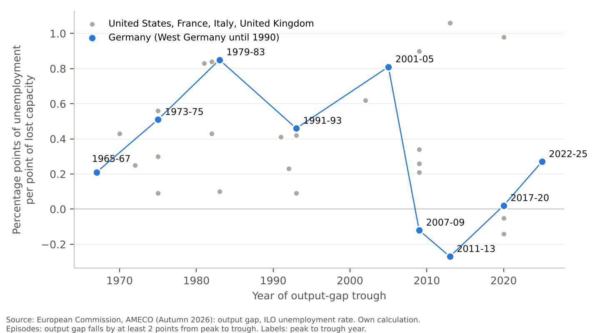

*Written in a personal capacity. The views expressed are the author's own and do not necessarily reflect those of the author's employer.*

**Abstract.** Between 2022 and 2025 German output fell well short of its pre-2019 path, yet registered unemployment rose by only about one point. This paper asks where the adjustment went and what that means for policy. Using the European Commission's output-gap estimates, Federal Employment Agency flow data and national accounts, it shows three things. First, measured against the output gap, the unemployment response was at the low end of earlier German downturns, not outside their range; what is unusual is how much of the shortfall, three to five points of GDP, has been booked as lost potential. Second, the adjustment ran mainly through fewer hirings. Since 2019 the monthly chance of leaving unemployment for a job has fallen by about a quarter in every group, to the lowest value since the series began, while the risk of losing a job is no higher than in 2019; since 2022, rising dismissals add to the rise for prime-age workers. Unlike in 2009, firms did not hoard labour by cutting hours: hours per worker stayed on trend and the shortfall in hours came through employment. The burden fell on labour-market entrants, older jobseekers and foreign nationals. Third, this kind of adjustment sends a weak political signal. In the Bundestag's plenary records since 1949, talk of unemployment rose sharply in every earlier downturn but fell in 2022-25, while talk of competitiveness and Germany as a business location reached a record. A coding of labour-market and social-policy reforms after each downturn shows that core institutions (dismissal protection, unemployment-benefit level and duration, sick pay, pensions) were cut only after strong rises in unemployment. Reform pressure has not disappeared; it has been redirected away from the institutions that protect the core workforce.

**Keywords:** Okun's law, labour hoarding, worker flows, dualisation, crisis and reform, Germany

**JEL:** E24, E32, J63, J65, P16

## 1. Introduction

German output in 2025 was about seven percent below the path it would have followed had potential output kept growing at its 2014-19 pace and the economy run at capacity (European Commission 2026). Registered unemployment, measured as the share of the civilian labour force, rose from 5.3 percent in 2022 to 6.3 percent in 2025 (Bundesagentur für Arbeit 2026a). By the standards of earlier German downturns, in which unemployment rose by several points and rarely fell back, this looks like a labour market that has been insulated from the economy around it. In the public debate the two facts coexist uneasily: Germany is described as the sick man of Europe again, while survey measures of job insecurity stayed close to record lows until late 2025 (Köcher 2023; EY 2026).

This paper asks where the adjustment went, and what the way it happened implies for policy. It makes three contributions.

The first is an accounting. Using a fixed rule to identify downturns, it measures the unemployment response per point of lost capacity in every German downturn since the 1960s and in four comparison countries. Measured against the Commission's output gap, the response in 2022-25 is low but not unprecedented: about 0.4 points of unemployment per point of gap, against 0.3 to 1.1 before 2006. What sets the episode apart is that most of the shortfall, about five of seven points on the Commission's estimate and three to four on alternative estimates, has been reclassified as lost potential rather than idle capacity. Only the United Kingdom shows a comparable write-down among large Western economies.

The second is a decomposition of where the labour market adjusted. Using the Federal Employment Agency's monthly rates of inflow into and outflow from unemployment since 2007, the paper shows that against 2019 the entire rise in steady-state unemployment comes from a lower chance of leaving unemployment for a job. The decline is shared by all groups but is steepest for people under 25, over 55 and foreign nationals. Part of it predates the slump: the job-finding rate had already fallen between 2019 and 2022, a period of labour shortage. From 2022 on, a rising risk of dismissal adds to the increase, and for workers aged 25 to 54 it accounts for most of it. National accounts complete the picture. Unlike in 2009, hours per worker did not fall; the shortfall in hours came through employment, which stalled below its trend. The adjustment ran less through dismissals and short-time work than through hirings that did not happen and, increasingly, through jobs that ended. Its burden fell on entrants and on those already outside work.

The third contribution links this to policy. If governments respond to what voters and parliaments see, and if what they see is unemployment rather than output, an adjustment at the hiring margin should weaken the pressure on the institutions that protect insiders. Two new data sets test this. A count of word fields in all 4,652 plenary records of the Bundestag from 1949 to September 2026 shows that parliamentary attention to unemployment has followed the unemployment rate closely for seventy years, rose in every downturn before 2006, and fell in 2022-25 to its lowest level since the early 1970s, while attention to competitiveness and the business location rose to its highest. A coding of 37 labour-market and social-policy reforms enacted after eight downturns shows that cuts to core institutions came only after strong rises in unemployment (1979-83, 1991-93, 2001-05). In 2022-26, as in other downturns without a strong rise, core institutions were extended or buffered and cuts fell on the margin. The reform signal has not disappeared. It has been redirected towards energy, bureaucracy and taxation, and away from the labour market.

The paper relates to four literatures. It extends work on Okun's law and on the German labour-market response to the Great Recession (Burda and Hunt 2011; Möller 2010; Ball, Leigh and Loungani 2017) to a downturn that is, on official estimates, largely supply-side. It applies the flow decomposition of unemployment (Elsby, Michaels and Solon 2009; Fujita and Ramey 2009; Shimer 2012) to German administrative data for the period since 2019. It adds evidence to the literature on labour-market dualisation (Palier and Thelen 2010; Emmenegger et al. 2012) by showing which groups carry the adjustment when firms retain their core workforce. And it contributes to the political economy of crisis and reform (Drazen and Grilli 1993; Pitlik and Wirth 2003; Høj et al. 2006) by showing, for one country over seven decades, that the trigger for reform of core labour-market institutions has been unemployment rather than lost output.

Section 2 reviews the literature. Section 3 describes the data. Section 4 measures the shortfall and the unemployment response. Section 5 locates the adjustment in flows, hours, sectors and wages. Section 6 discusses why unemployment stayed low. Section 7 turns to the political signal. Section 8 sets out the limits of the evidence and the observations that would refute the argument. Section 9 concludes.

## 2. Related literature

**Okun's law and its German exceptions.** Okun's (1962) rule of thumb links changes in unemployment to deviations of output from potential. Ball, Leigh and Loungani (2017) find that the relation holds well in most advanced economies, with coefficients that differ across countries and are smaller in countries with strong employment protection. Germany has long been a low-coefficient country, and 2009 made it an outlier: output fell by more than five percent and unemployment hardly moved. Burda and Hunt (2011) attribute roughly a third of the adjustment in hours to short-time work and about a sixth to working-time accounts, and stress that firms had hired cautiously in the preceding upswing. Möller (2010) emphasises the narrowness of the shock, concentrated in export manufacturing, and the financial position of firms. Balleer et al. (2016) find that discretionary short-time work saved jobs in 2009. Dustmann et al. (2014) trace Germany's improved labour-market performance before the crisis to decentralised wage bargaining rather than to the Hartz reforms. This paper asks whether the 2022-25 episode repeats the 2009 pattern. It finds that it does not: the instruments of 2009 played a minor role, and the low unemployment response comes from the labour supply and from hiring.

**Flows.** The rise in unemployment in a downturn can come from more people losing jobs or from fewer people finding them. Shimer (2012) argues that in the United States the job-finding rate accounts for most of the cyclical variation; Elsby, Michaels and Solon (2009) and Fujita and Ramey (2009) find a larger role for separations, especially at the onset of recessions. For Germany, Klinger and Rothe (2012) and Hochmuth et al. (2021) study matching efficiency and the effect of the Hartz reforms on job finding. This paper uses the steady-state approximation, u* = s/(s+f), with s the monthly risk of moving from employment into unemployment and f the monthly chance of leaving unemployment for a job, on the Federal Employment Agency's published rates for 2007-2025.

**Dualisation.** Comparative political economy describes how Germany protected its industrial core in the 1990s and 2000s while flexibility grew at the margin: fixed-term, agency and marginal part-time work, and activation of the long-term unemployed (Palier and Thelen 2010; Emmenegger et al. 2012; Hassel 2014). The literature predicts that adjustment will fall on outsiders. This paper measures that directly with flow rates by age and nationality.

**Crisis and reform.** A long line of work asks whether crises cause reform. Drazen and Grilli (1993) model crises as resolving wars of attrition over the distribution of reform costs. Empirical studies find that economic crises, often measured by output or inflation, raise the probability of liberalising reforms (Pitlik and Wirth 2003; Abiad and Mody 2005; Høj et al. 2006). Most of this work uses cross-country panels and treats the crisis as a single variable. This paper distinguishes two channels, lost output and rising unemployment, and asks which one has preceded reform of core labour-market institutions in Germany. Its measure of political attention, word counts in parliamentary debates, follows the broad text-as-data literature; the corpus is that of Fobbe (2026).

## 3. Data

**Output gap and potential.** The European Commission's AMECO database, autumn 2026 vintage, provides the output gap (AVGDGP), potential output (OVGDP), GDP, employment, hours and the unemployment rate for Germany (West Germany until 1990), France, Italy, the United Kingdom and the United States (European Commission 2026). The autumn 2019 vintage, from the AMECO archive, provides the real-time estimates used to check revisions (European Commission 2019). The OECD Economic Outlook supplies an alternative gap and potential for Germany and the series for Japan (OECD 2026).

**Unemployment and flows.** The Federal Employment Agency publishes the registered unemployment rate and, in its series "Chancen und Risiken am Arbeitsmarkt", monthly flow rates since 2007: the risk of becoming unemployed out of employment subject to social insurance, relative to employment in the previous month, and the chance of leaving unemployment for a job on the regular labour market, relative to the stock of unemployed (Bundesagentur für Arbeit 2025). Both are available for the total and by sex, age group (under 25, 25 to 54, 55 and over) and nationality. Annual values are means of monthly rates. Because the December 2025 inflow risk requires January 2026 employment and is not yet published, the paper uses the January-November mean for the inflow risk in every year. New training contracts come from Destatis (2026d), employment by sector from Eurostat (2026).

**Plenary records.** The Corpus der Plenarprotokolle des Deutschen Bundestages (CPP-BT), version of 19 September 2026, contains the full text of all 4,652 plenary sessions from 1949 to that date (Fobbe 2026). Three word fields are counted on the lower-cased text after removing line-end hyphenation, and expressed as hits per million words in each year (Appendix A.3).

**Reforms.** For each downturn, the paper codes the main labour-market and social-policy laws passed during the episode and in the three years after it: 37 measures in total. Each is classified by direction (retrenchment, expansion, buffer, deregulation) and target: the core, meaning rights of incumbent standard employees (dismissal protection, level and duration of unemployment benefit, statutory sick pay, pensions of current contributors), the margin (fixed-term, agency and marginal work, benefits for the long-term unemployed, migrants, new entrants) or the macroeconomic framework. Sources are Bundestag documents, the legal gazette and the IAB's chronicle of labour-market policy; eleven items rest on secondary sources (Appendix A.4).

## 4. How much output was lost, and how little unemployment followed

### 4.1 The shortfall

Had German potential output kept growing at its 2014-19 rate and the economy run at capacity, output in 2025 would be 6.9 log points higher than it is. The shortfall splits into two parts that add up by construction: potential output 5.1 points below its own trend, and an output gap of 1.7 points (Table 2). The split is not sensitive to the trend window (5.1 points with a 2010-19 trend, 4.8 with 1995-2019). Nor is it an artefact of hindsight: against the path the Commission itself projected in autumn 2019, potential output in 2025 is 5.1 points lower.

The write-down is an estimate, and other estimates are smaller. The OECD's potential output is about 4.1 points below its 2014-19 trend. Within the Commission's method, two assumptions drive the result: the labour-force trend, which in 2014-19 includes the migration of 2015-16, and the structural unemployment rate (NAWRU), which the Commission lets rise after 2019. With the labour-force trend of 2010-14 and the NAWRU held at its 2019 level, the write-down falls to about 3.2 points. The paper treats three to five points as the range and the Commission's figure as its upper end.

*Table 2: Output shortfall in 2025 against a closed-gap path of 2014-19 potential (log points)*

| | Lost potential | Output gap 2025 | Total shortfall |
|---|---|---|---|
| Germany | -5.1 | -1.7 | -6.9 |
| France | +2.5 | -0.6 | +1.9 |
| Italy | +3.4 | +0.8 | +4.2 |
| United Kingdom | -4.0 | -0.4 | -4.4 |
| United States | +1.7 | 0.0 | +1.7 |

*Source: European Commission (2026); own calculation. Lost potential = log potential 2025 minus its 2014-19 trend extrapolated from 2019.*

An approximation of the Commission's production function attributes about 2.8 of the five German points to labour: a labour force growing more slowly than in the years of high immigration (1.4 points), a higher NAWRU (1.1) and fewer hours (0.3). Capital contributes 1.2 points and total factor productivity 1.0 (Appendix A.2). The labour part is largely trend extrapolation: the end of an unusual expansion of the labour force rather than a measured loss.

### 4.2 The unemployment response

Table 1 measures every German downturn since the 1960s by the same rule: an episode begins at a local peak of the output gap and ends at the next trough, if the gap falls by at least two points in between. For each episode the table shows the fall in the gap, registered unemployment at the start and the end, and the rise in unemployment per point of lost capacity.

*Table 1: German downturns, 1965-2025*

| Episode | Fall in output gap (points) | Registered unemployment, start → end (%) | Rise per point of gap |
|---|---|---|---|
| 1965-67 | 4.8 | 0.7 → 2.1 | 0.29 |
| 1973-75 | 4.9 | 1.2 → 4.7 | 0.71 |
| 1979-83 | 4.9 | 3.8 → 9.1 | 1.08 |
| 1991-93 | 4.8 | 7.3 → 9.8 | 0.52 |
| 2001-05 | 3.7 | 10.3 → 13.0 | 0.73 |
| 2007-09 | 6.8 | 10.1 → 9.1 | -0.15 |
| 2011-13 | 2.3 | 7.9 → 7.7 | -0.09 |
| 2017-20 | 5.1 | 6.3 → 6.5 | 0.04 |
| 2022-25 | 2.6 | 5.8 → 6.8 | 0.38 |

*Gap: European Commission (2026), West Germany until 1990. Unemployment: registered rate on dependent civilian employees (Bundesagentur für Arbeit 2026a), which runs about half a point above the rate on the whole civilian labour force. The 2005 value includes additional registrations from the Hartz IV reform; between 2006 and 2019 unemployment fell for structural reasons, which overlays the episodes 2007-09 and 2011-13.*

Before 2006, each point of lost capacity added between 0.3 and 1.1 points to unemployment. In 2007-09, 2011-13 and 2017-20 unemployment did not rise at all. 2022-25, at 0.38, sits in the lower part of the pre-2006 range. For German nationals alone the ratio is 0.27; because the unemployment of foreign nationals also responds to the cycle, the true cyclical response lies between the two values. Figure 1 places these episodes among those of France, Italy, the United Kingdom and the United States, using the ILO unemployment rate. German episodes before 2006 lie in the range of the other countries; the three episodes after 2006 lie at its bottom; 2022-25 lies in between.

*Figure 1: Rise in the unemployment rate per point of fall in the output gap, by downturn. Germany in blue. Source: European Commission (2026); own calculation.*

The comparison carries a caveat. Table 1 measures unemployment against the output gap, and the gap is what is left after the write-down of potential. The more of the slump is booked as lost potential, the smaller the gap and the more normal the unemployment response looks. Against the total shortfall of 6.9 points, a one-point rise in unemployment would be the smallest response of any German downturn except those after 2006. Table 1 therefore cannot show that the decline is structural. It shows that, on the Commission's reading, the labour market has not been unusually insulated. The reading is itself uncertain: in real time the Commission put the German gap for 2019 at 0.2 percent; it now puts it at 1.3 (European Commission 2019, 2026).

Japan after 1990 is the closest earlier case of a large write-down with a muted unemployment response. On OECD estimates, Japanese unemployment rose by 0.1 to 0.35 points per point of gap in 1990-94, 1997-99 and 2007-09, while potential output in 1999 was about a fifth below its 1985-90 trend (OECD 2026).

## 5. Where the adjustment happened

### 5.1 Inflows and outflows

Table 3 shows the two flow rates for the total and by group, for 2019, 2022 and 2025, and the result of the steady-state decomposition.

*Table 3: Monthly inflow risk (s) and exit chance (f), and steady-state decomposition*

| | s 2019 | s 2022 | s 2025 | f 2019 | f 2022 | f 2025 | Change in f 2019-25 | Share of f in rise of u*, 2019-25 | Share of f, 2022-25 |
|---|---|---|---|---|---|---|---|---|---|
| All | 0.61 | 0.51 | 0.59 | 7.41 | 6.13 | 5.65 | -24 % | 111 % | 34 % |
| Under 25 | 1.07 | 0.86 | 0.99 | 13.70 | 11.85 | 9.94 | -27 % | 125 % | 55 % |
| 25 to 54 | 0.61 | 0.51 | 0.61 | 7.75 | 6.51 | 6.15 | -21 % | 97 % | 23 % |
| 55 and over | 0.43 | 0.37 | 0.42 | 3.73 | 3.13 | 2.73 | -27 % | 104 % | 54 % |
| Germans | 0.52 | 0.43 | 0.50 | 7.73 | 6.61 | 6.00 | -22 % | 118 % | 40 % |
| Foreigners | 1.25 | 0.96 | 1.06 | 6.59 | 5.18 | 5.05 | -23 % | 211 % | 20 % |

*s: risk of becoming unemployed out of employment subject to social insurance, % per month (January-November mean). f: chance of leaving unemployment for a job on the regular labour market, % per month (annual mean). u* = s/(s+f). Share of f: change in u* when only f moves, divided by the sum of the changes when only s and only f move; above 100 % when s fell. Source: Bundesagentur für Arbeit (2025); own calculation.*

Three facts stand out. First, the chance of leaving unemployment for a job fell by a fifth to more than a quarter in every group between 2019 and 2025. For the total, 5.65 percent a month in 2025 is the lowest value since the series began in 2007, below the 6.08 percent of 2009. For people under 25 it fell from 13.7 to 9.9 percent. Second, the risk of becoming unemployed was no higher in 2025 than in 2019 in any group, and lower for foreign nationals. Measured from 2019, the whole rise in steady-state unemployment comes from fewer exits into work.

Third, the base year matters. The exit chance had already fallen from 7.4 to 6.1 percent between 2019 and 2022, while the inflow risk fell to an unusually low level. 2019-22 was not a downturn on the Commission's gap; it was a period of labour shortage after the pandemic, in which firms held on to staff and hired less. Measured from 2022, the start of the episode in Table 1, rising dismissals account for about two thirds of the rise in steady-state unemployment, and for workers aged 25 to 54 for about three quarters. Fewer exits still account for about half of the rise for those under 25 and over 55.

The adjustment therefore ran in two phases. The hiring margin closed first, before and during the slump; dismissals have followed since 2022, from a low level and without reaching the rates of 2008-09 (0.86 to 0.97 percent a month). The burden of the first phase fell on those seeking entry or re-entry: young people, older jobseekers and foreign nationals, whose exit chance was already lowest. New training contracts, another entry margin, were ten percent below 2019 in 2025 (Destatis 2026d).

*[Länder: decomposition by federal state to follow when the Federal Employment Agency's regional files can be retrieved.]*

### 5.2 Hours, employment and hoarding

If firms had hoarded labour as in 2009, the shortfall in hours would show up in hours per worker rather than in the number of workers. Table 4 splits the change in total hours worked in each episode, relative to the trend of the five years before the peak, into employment and hours per person.

*Table 4: Total hours, employment and hours per person, deviation from pre-episode trend (log points)*

| Episode | Fall in gap | Total hours | Employment | Hours per person | Rise in ILO unemployment (pp) |
|---|---|---|---|---|---|
| 1979-83 | 4.9 | -0.6 | 0.0 | -0.5 | +4.2 |
| 1991-93 | 4.8 | -14.1 | -15.6 | +1.5 | +2.2 |
| 2001-05 | 3.7 | -3.7 | -5.1 | +1.4 | +3.0 |
| 2007-09 | 6.8 | -2.5 | +0.9 | -3.4 | -0.8 |
| 2011-13 | 2.3 | -1.5 | 0.0 | -1.5 | -0.6 |
| 2017-20 | 5.1 | -6.3 | -1.6 | -4.8 | +0.1 |
| 2022-25 | 2.6 | -2.3 | -2.7 | +0.4 | +0.7 |

*Trend: average growth in the five years before the peak; for 2022-25, 2014-19, to exclude the pandemic. 1991-93 compares West German trends with unified Germany and mainly reflects the collapse of East German employment. Source: European Commission (2026), AMECO series NLHT, NETD, NLHA, ZUTN; own calculation.*

The contrast with 2009 is sharp. In 2007-09 employment stayed above its trend and hours per person fell by 3.4 points: firms kept workers and cut their hours, through short-time work and working-time accounts. In 2022-25 hours per person stayed on trend and employment fell 2.7 points below it. Short-time work averaged around 300,000 people in 2024 and 2025 (Bundesagentur für Arbeit 2026d), against more than 1.5 million at its peak in May 2009 (Projektgruppe Gemeinschaftsdiagnose 2009). The adjustment in hours came through the number of people in work.

That does not mean firms shed workers. Employment did not fall; it stopped growing. Between 2022 and 2025 the number of people in work rose by 0.8 percent, against 1.2 percent a year in 2014-19. A shortfall against trend of this kind is what fewer hirings produce. But it also reflects slower growth of the labour force, which the 2014-19 trend overstates because it includes the migration of 2015-16. An accounting of employment in 2025 against its 2014-19 trend attributes 2.2 of 5.4 points to the labour force and 3.2 to the employment rate of the labour force (Appendix A.2). In the total of hours lost per point of gap, 0.9 percent, Germany is not unusual; what is unusual is how little of it became unemployment.

### 5.3 Sectors and wages

The shock was concentrated. Between February 2022 and March 2026, output in Germany's energy-intensive industries fell by 15 percent and their employment by six percent (Destatis 2026a). Between 2019 and 2025 manufacturing lost 511,000 jobs, while public administration, education, health and social care added 1.08 million (Eurostat 2026). The economy kept hiring; the export core did not. Sectoral reallocation of this kind, from a shrinking sector with long tenures to a growing one with different skill requirements, runs through new hires rather than transfers, and is consistent with the fall in the exit chance from unemployment.

Insiders did not pay through wages on balance. Real compensation per employee, deflated by the consumption deflator, was three percent below 2019 in 2023 but two percent above it in 2025; real unit labour costs were 1.6 percent higher (European Commission 2026). The cost of retention fell on margins and measured productivity. Output per hour in 2025 was 4.3 points below its 2014-19 trend. That fall is partly the same fact as hoarding counted a second time, and cannot be read as independent evidence on the size of the industrial decline; France, without German-style retention, shows a larger shortfall in output per hour.

## 6. Why unemployment stayed low

Three features of the episode explain why a large shortfall produced a small rise in unemployment. The data are consistent with each, but cannot rank them.

**Demography.** Over the next fifteen years about 13.4 million people, almost a third of the labour force, will reach retirement age (Destatis 2025a). This works twice. On the supply side, the labour force grew more slowly after 2019, so that a stalling of employment did not produce rising unemployment; this is the 2.2 points of the employment shortfall attributed to the labour force. On the demand side, scarcity makes retention rational: a firm that expects not to be able to hire when demand returns keeps its trained workers and lets the workforce shrink through retirement. Volkswagen's agreement of December 2024 cuts 35,000 jobs in Germany by 2030 without compulsory redundancies; by November 2025 about seven in ten agreed departures were early retirements (Volkswagen 2024; autohaus 2025). Shrinking through retirement is adjustment at the hiring margin by design.

**A narrow shock.** Energy-intensive industry and car manufacturing with its suppliers employ a small share of the workforce, while services and the public sector grew. A narrow shock lets affected firms retain workers without a general collapse in demand, and lets other sectors absorb some of the labour that is released. In 1992-93 the contraction was broad and unemployment rose even though the labour force was shrinking in the East.

**Institutions.** Dismissal protection, works councils and collective agreements make dismissals slow and costly and make negotiated reduction paths the normal way to shrink. Partial retirement, transfer companies and severance turn reductions into scheduled exits. The insolvency of smaller suppliers without such agreements, where adjustment arrives as dismissals, is the exception that confirms the rule.

The three features are complements. Demography makes retention rational, the narrowness of the shock makes it affordable, and institutions turn the dismissals that do come into negotiated exits. Each shifts the adjustment from separations to hirings, and therefore from insiders to outsiders.

## 7. The missing signal

### 7.1 The argument

If a downturn raises unemployment, the costs are concentrated, visible and politically salient. If it lowers hiring, the costs are spread over people who never had the job and are counted, if at all, in a rate few people follow. The literature on crisis and reform treats the crisis as the trigger. The question here is which part of the crisis has triggered reform of the institutions that protect insiders in Germany: lost output, or rising unemployment. If it is unemployment, an adjustment at the hiring margin should produce talk of the economy without talk of unemployment, and reform that leaves the core untouched.

### 7.2 What the Bundestag talks about

Table 5 reports three word fields per million words in the plenary records: unemployment as a problem (U), structural labour-market and social reform (R), and competitiveness and the business location (S).

*Table 5: Parliamentary attention in German downturns (hits per million words)*

| Episode | Rise in unemployment (pp) | Unemployment (U), start → end | Structural reform (R), start → end | Competitiveness and location (S), start → end |
|---|---|---|---|---|
| 1965-67 | +1.4 | 19 → 125 | 4 → 5 | 15 → 19 |
| 1973-75 | +3.5 | 37 → 380 | 26 → 15 | 9 → 14 |
| 1979-83 | +5.3 | 207 → 575 | 22 → 20 | 12 → 47 |
| 1991-93 | +2.5 | 250 → 360 | 45 → 102 | 35 → 198 |
| 2001-05 | +2.7 | 473 → 360 | 127 → 183 | 74 → 182 |
| 2007-09 | -1.0 | 270 → 123 | 98 → 48 | 126 → 77 |
| 2011-13 | -0.2 | 214 → 162 | 40 → 69 | 75 → 80 |
| 2017-20 | +0.2 | 87 → 77 | 36 → 29 | 48 → 51 |
| 2022-25 | +1.0 | 51 → 41 | 31 → 68 | 60 → 266 |

*Start: peak year of the output gap; end: trough year. Word fields in Appendix A.3. Source: Fobbe (2026); own calculation.*

Attention to unemployment tracks the unemployment rate closely. Across 1950-2021, each point of unemployment adds about 36 hits per million words. In every downturn before 2006 attention rose, in 1973-75 tenfold. In 2022-25 it fell, to 41 hits in 2025, lower than in any year since 1973. It is also low relative to the unemployment rate: 150 to 200 hits below what the 1950-2021 relation predicts. That gap is not new; it has been negative since 2004 and averaged about 90 hits in 2006-18, perhaps because the debate on the Hartz reforms moved from unemployment to benefits and activation. About half of the current shortfall predates the slump.

Attention to the economy did not fall. The field for competitiveness and location (Standort Deutschland, Wirtschaftsstandort, Wettbewerbsfähigkeit, Deindustrialisierung, Wirtschaftswende, Bürokratieabbau) reached 266 hits in 2025, the highest value in the series, above the location debate of 1993 (198) and the Agenda years (182 in 2005). The field for structural reform rose from 22 in 2019 to 68 in 2025 but stayed well below 2003 (303). Within it, the term for dismissal protection, Kündigungsschutz, fell to 1.8 hits per million words in 2025, against 72 in 2003. A reading of random samples of hits confirms that the fields capture what they are meant to; nearly all unemployment hits refer to German unemployment and nearly all location hits to German or European competitiveness (Appendix A.3).

Parliament registered the slump. It did so as a problem of location, energy prices and bureaucracy, not as a problem of the labour market.

### 7.3 Which reforms followed

Table 6 summarises the coding of reforms. Cuts to the core came in three episodes: 1979-83, when the Labour Promotion Consolidation Act of 1981 doubled the qualifying period for unemployment benefit and the budget acts of 1983 and 1984 tightened entitlements and cut the benefit rate for claimants without children from 68 to 63 percent; 1991-93, when the first savings act of 1993 cut benefit rates to 67 and 60 percent and the 1996 employment promotion act cut statutory sick pay and narrowed dismissal protection in small firms, partly reversed in 1998; and 2001-05, when the labour-market reform act of 2003 cut the maximum duration of unemployment benefit for older workers from 32 to 18 months and the pension act of 2004 introduced the sustainability factor. In each of these episodes unemployment rose by at least 2.5 points.

*Table 6: Reforms after German downturns*

| Episode | Rise in unemployment (pp) | Cuts to the core | Main measures |
|---|---|---|---|
| 1965-67 | +1.4 | no | Stability and Growth Act 1967; Labour Promotion Act and Sick Pay Act 1969 (expansion) |
| 1973-75 | +3.5 | no | Budget Structure Act 1975: cuts at the margin (training support, suitability rules) |
| 1979-83 | +5.3 | yes | AFKG 1981; budget acts 1983 and 1984 (benefit rate 68 → 63 % for claimants without children); fixed-term contracts eased 1985 (margin) |
| 1991-93 | +2.5 | yes | 1st SKWPG 1993 (benefit rates 67/60 %); 1996 dismissal protection and sick pay, partly reversed 1998 |
| 2001-05 | +2.7 | yes | Benefit duration for older workers 32 → 18 months; sustainability factor; Hartz I-IV (margin) |
| 2007-09 | -1.0 | no | Short-time work up to 24 months (buffer); benefit for over-58s back to 24 months (expansion) |
| 2017-20 | +0.2 | no | Short-time work eased 2020 (buffer) |
| 2022-25 | +1.0 | no (to November 2026) | Pension level of 48 % extended to 2031 (expansion); short-time work up to 24 months (buffer); new basic income support replacing the Bürgergeld (margin); cabinet bill of November 2026 easing dismissal protection only above 1.75 times the contribution ceiling |

*Source: coding in Appendix A.4.*

The exception is 1973-75, when unemployment rose by 3.5 points but the cuts fell on training subsidies and suitability rules rather than on the benefit rate, which had just been raised. In every episode without a strong rise in unemployment, core institutions were extended or buffered. 2022-26 follows this pattern. The cuts of this period fall on the margin: the new basic income support, in force since July 2026, tightens obligations for recipients of the minimum benefit. Core institutions were extended: the pension level was guaranteed at 48 percent until 2031 and short-time work kept at its maximum of 24 months. The labour-law bill adopted by the cabinet in November 2026 would extend fixed-term contracts without objective reason until 2030 and ease dismissal protection only for earners above 1.75 times the pension contribution ceiling, about 177,000 euros a year (BMAS 2026).

### 7.4 Interpretation

With eight episodes, the pattern cannot be tested statistically, and it admits other readings. Governments differ, and cuts to the core may have followed changes of government (1982) or the exhaustion of alternatives (2003) rather than unemployment as such. Still, the three pieces fit. Unemployment, not output, has carried the signal from downturn to reform of core institutions; an adjustment at the hiring margin produces little of it; and in 2022-25 parliamentary attention moved to location and bureaucracy, while reform left the core untouched and fell on those outside it. The reform signal was not weakened so much as redirected.

## 8. Limits and tests

**Revisions.** The write-down of potential and therefore the size of the gap may be revised. If the Commission and other forecasters raise German potential, the gap widens, the unemployment response per point of gap falls, and the episode looks more like 2009. The paper's argument about the hiring margin does not depend on the split, but the comparison in Table 1 does.

**Base years.** The flow evidence depends on the base year. Against 2019, the rise in unemployment is entirely a matter of hiring; against 2022, dismissals contribute more. The paper reports both.

**Composition.** The rise in the unemployment of foreign nationals partly reflects the registration of refugees from Ukraine, who entered unemployment from outside the labour force, not from jobs. Their low exit chance may reflect language and recognition barriers as much as weak demand.

**Text measures.** Word fields are coarse, and language changes. The location vocabulary did not exist in the 1960s; the decline of unemployment talk since 2004 may partly reflect changes in vocabulary after the Hartz reforms. Election years and budget debates inflate single years.

**Coding.** The classification of reforms into core and margin involves judgement, and eight episodes in one country are few. A comparison with other countries, or with regional variation in Germany, would be needed to test the argument formally.

Three observations would refute the argument. If the exit chance from unemployment returns to its 2019 level without a change in policy, the hiring slump was a passing phase. If unemployment rises sharply and core institutions still remain untouched, unemployment is not the trigger the paper claims. And if a reform of dismissal protection, benefit duration or short-time work for the core workforce is passed before the 2029 federal election without a strong rise in unemployment, the signal has not been redirected as the paper claims.

## 9. Conclusion

Germany's 2022-25 slump was large in output and small in unemployment. On the Commission's estimates, most of the shortfall has been booked as lost potential, and against the remaining gap the unemployment response was low but within the range of earlier downturns. The adjustment ran through hiring: the chance of leaving unemployment for a job fell by a quarter, to its lowest level on record, while the risk of losing a job rose only from 2022 and stayed below crisis levels. Unlike in 2009, firms did not keep workers by cutting hours; employment simply stopped growing. The burden fell on those trying to get in.

That matters beyond the labour market. In Germany, rising unemployment, not lost output, has preceded every cut to the institutions that protect the core workforce. An adjustment that runs through hiring produces little unemployment, and therefore little of that signal. Parliament registered the slump as a problem of competitiveness and bureaucracy. Reform followed accordingly: it extended protections for insiders and tightened conditions at the margin. The buffers that kept unemployment low may also have kept the core institutions out of reach of reform.

## Appendix

### A.1 Episode rule

An episode begins in a year in which the output gap is at a local maximum (at least as large as in the previous year and larger than in the following year) and ends in the year in which the gap stops falling. Episodes in which the gap falls by less than two points are dropped. Gaps are from AMECO, autumn 2026 vintage; West Germany until 1990. The same rule is applied to each comparison country. Code: `scripts/okun_episodes_intl.py`, `scripts/table1_rule.py`.

### A.2 Shortfall, potential and employment accounting

Shortfall = (log potential 2025 - log of potential extrapolated from 2019 at its 2014-19 growth rate) + log(1 + gap 2025). Production-function approximation: potential = TFP × K^0.35 × L^0.65, L = labour force × (1 - NAWRU) × hours per person, TFP as residual; the Commission uses trend participation and trend hours, so the split is indicative. Employment accounting: log employment 2025 minus its 2014-19 trend = labour force against its trend + (1 - unemployment rate) against its trend. Alternative write-downs: OECD Economic Outlook potential; Commission potential with the labour-force trend of 2010-14 and NAWRU held at 2019. Code: `scripts/robustness.py`, `scripts/decompose.py`, `scripts/employment_split.py`.

### A.3 Word fields and validation

U: Arbeitslosigkeit, Arbeitslose(n/r), Arbeitslosenzahl(en), Arbeitslosenquote(n), with the prefixes Massen-, Langzeit-, Jugend-, and Erwerbslosigkeit, Erwerbslose(n). Benefit names (Arbeitslosengeld, -hilfe, -versicherung) are excluded so that the renaming of benefits in 2005 does not move the series.
R: Strukturreform, Reformstau, Arbeitsmarktreform, Sozialreform, Agenda 2010, Kündigungsschutz, Lohnnebenkosten, Flexibilisierung, Deregulierung (with inflections).
S: Standort Deutschland, Wirtschaftsstandort, Standortsicherung, Wettbewerbsfähigkeit, Deindustrialisierung, Wirtschaftswende, Bürokratieabbau (with inflections).
Validation: 40 random hits per field for 2003-05 and 2023-25 were read in context (seed 1, `results/plenum_kwic.md`). Line-end hyphenation is removed before counting; hyphenation with a space occurs fewer than 0.5 times per 10,000 words in every year tested. Code: `scripts/plenum_attention.py`, `scripts/plenum_kwic.py`.

### A.4 Reform coding

The full coding with sources, dates and notes is in `coding/reform_coding.yaml`. Eleven of 37 items rest on secondary sources and are marked as such.

## References

Abiad, A. and Mody, A. (2005) 'Financial reform: what shakes it? What shapes it?', *American Economic Review*, 95(1), pp. 66-88.

autohaus (2025) [full reference as in the essay].

Ball, L., Leigh, D. and Loungani, P. (2017) 'Okun's law: fit at 50?', *Journal of Money, Credit and Banking*, 49(7), pp. 1413-1441.

Balleer, A., Gehrke, B., Lechthaler, W. and Merkl, C. (2016) 'Does short-time work save jobs? A business cycle analysis', *European Economic Review*, 84, pp. 99-122.

BMAS (2026) [cabinet bill of 18 November 2026, full reference as in the essay].

Bundesagentur für Arbeit (2025) *Chancen und Risiken am Arbeitsmarkt nach Personengruppen, Deutschland, Dezember 2025*. Nürnberg.

Bundesagentur für Arbeit (2026a) *Arbeitslosigkeit im Zeitverlauf*. Nürnberg.

Bundesagentur für Arbeit (2026d) *Der Arbeitsmarkt im Jahr 2025: Jahresrückblick*. Nürnberg.

Burda, M.C. and Hunt, J. (2011) 'What explains the German labor market miracle in the Great Recession?', *Brookings Papers on Economic Activity*, Spring, pp. 273-319.

Destatis (2025a, 2026a, 2026d) [full references as in the essay].

Drazen, A. and Grilli, V. (1993) 'The benefit of crises for economic reforms', *American Economic Review*, 83(3), pp. 598-607.

Dustmann, C., Fitzenberger, B., Schönberg, U. and Spitz-Oener, A. (2014) 'From sick man of Europe to economic superstar: Germany's resurgent economy', *Journal of Economic Perspectives*, 28(1), pp. 167-188.

Elsby, M.W.L., Michaels, R. and Solon, G. (2009) 'The ins and outs of cyclical unemployment', *American Economic Journal: Macroeconomics*, 1(1), pp. 84-110.

Emmenegger, P., Häusermann, S., Palier, B. and Seeleib-Kaiser, M. (eds) (2012) *The Age of Dualization: The Changing Face of Inequality in Deindustrializing Societies*. Oxford: Oxford University Press.

European Commission (2019) *AMECO database, autumn 2019 vintage*. Brussels.

European Commission (2026) *AMECO database, autumn 2026 vintage*. Brussels.

Eurostat (2026) *Employment by A*10 industry breakdowns (nama_10_a10_e)*. Luxembourg.

EY (2026) [full reference as in the essay].

Fobbe, S. (2026) *Corpus der Plenarprotokolle des Deutschen Bundestages (CPP-BT)*, version 2026-09-19. Zenodo. doi:10.5281/zenodo.22844952.

Fujita, S. and Ramey, G. (2009) 'The cyclicality of separation and job finding rates', *International Economic Review*, 50(2), pp. 415-430.

Hassel, A. (2014) 'The paradox of liberalization: understanding dualism and the recovery of the German political economy', *British Journal of Industrial Relations*, 52(1), pp. 57-81.

Hochmuth, B., Kohlbrecher, B., Merkl, C. and Gartner, H. (2021) 'Hartz IV and the decline of German unemployment: a macroeconomic evaluation', *Journal of Economic Dynamics and Control*, 127, 104114.

Høj, J., Galasso, V., Nicoletti, G. and Dang, T.-T. (2006) 'The political economy of structural reform: empirical evidence from OECD countries', *OECD Economics Department Working Papers*, 501.

Klinger, S. and Rothe, T. (2012) 'The impact of labour market reforms and economic performance on the matching of the short-term and the long-term unemployed', *Scottish Journal of Political Economy*, 59(1), pp. 90-114.

Köcher, R. (2023) [full reference as in the essay].

Möller, J. (2010) 'The German labor market response in the world recession: de-mystifying a miracle', *Zeitschrift für ArbeitsmarktForschung*, 42(4), pp. 325-336.

OECD (2026) *OECD Economic Outlook*, 119. Paris.

Okun, A.M. (1962) 'Potential GNP: its measurement and significance', in *Proceedings of the Business and Economic Statistics Section*. Washington, DC: American Statistical Association, pp. 98-104.

Palier, B. and Thelen, K. (2010) 'Institutionalizing dualism: complementarities and change in France and Germany', *Politics & Society*, 38(1), pp. 119-148.

Projektgruppe Gemeinschaftsdiagnose (2009) *Zögerliche Belebung, steigende Staatsschulden: Gemeinschaftsdiagnose Herbst 2009*. [full reference to check].

Pitlik, H. and Wirth, S. (2003) 'Do crises promote the extent of economic liberalization? An empirical test', *European Journal of Political Economy*, 19(3), pp. 565-581.

Shimer, R. (2012) 'Reassessing the ins and outs of unemployment', *Review of Economic Dynamics*, 15(2), pp. 127-148.

Volkswagen (2024) [full reference as in the essay].
