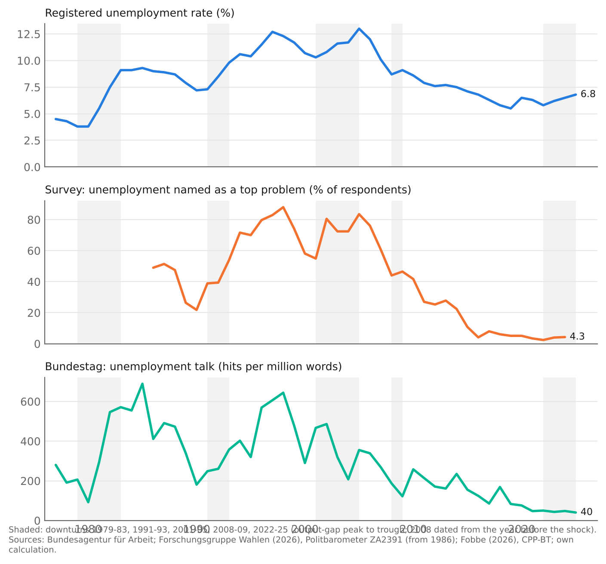
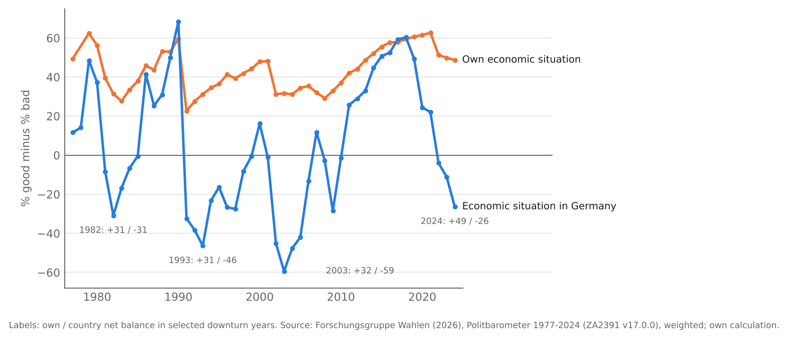
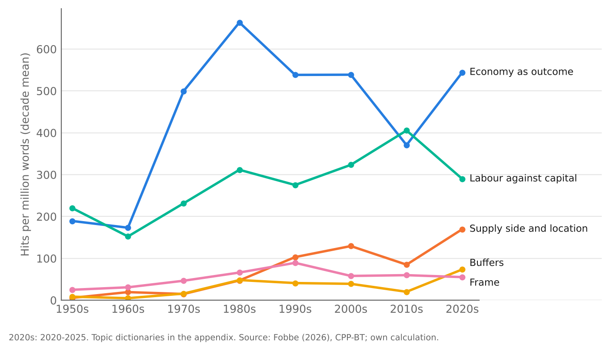

*Written in a personal capacity. The views expressed are the author's own and do not necessarily reflect those of the author's employer.*

**Abstract.** Between 2022 and 2025 German output fell three to seven points short of its pre-2019 path, depending on how much of the loss is booked as lost potential. Yet unemployment rose by one point, people judged their own economic situation almost as well as in boom years, and no core labour-market institution was cut. This paper documents, over 75 years, how the German model's buffers have removed the signal that used to turn downturns into reform. Four measures point the same way. First, the unemployment response to the output gap has halved since 2006, and the adjustment ran through fewer exits from unemployment rather than mass dismissals. Second, in the Politbarometer survey the share naming unemployment as a top problem fell from 84 percent in 2005 to 4 percent in 2024, and in 2024 respondents judged their own situation at a net balance of +49 while judging the country's at -26; in the slumps of 1993 and 2003 their own balance was about +31. Third, in 4,652 Bundestag plenary records, unemployment used to pull debates on wages, social justice, public debt and location with it; since 2003 that link has gone, and in the 2020s debates turned to prices, energy, location and bureaucracy. Fourth, a fixed-window coding of 65 laws after nine downturns shows that core institutions (dismissal protection, unemployment benefit, sick pay, pensions) were cut only in the four episodes in which unemployment rose by at least 2.5 points. At the same time the protected core has shrunk: union density fell from 34 to 14 percent, and only half of employees are covered by a collective agreement. The paper argues that the buffers that make the model socially successful also remove the political trigger for adjusting it to an external shock.

**Keywords:** labour-market institutions, crisis and reform, political attention, dualisation, Germany

**JEL:** E24, J50, J65, P16, D72

## 1. Introduction

Germany has had its sharpest loss of output relative to trend since unification, and it has not felt like a crisis to most of the people living through it. Real GDP fell in 2023 and 2024 and barely grew in 2025. Measured against the path it was on before 2019, German output in 2025 was about seven percent lower, of which the European Commission books five points as lost potential and less than two as idle capacity (European Commission 2026). Registered unemployment rose from 5.3 to 6.3 percent of the civilian labour force (Bundesagentur für Arbeit 2026a). In the Politbarometer survey, only four percent of respondents named unemployment as one of the two most important problems in 2024, against 84 percent in 2005. And while a clear majority judged the country's economic situation as bad, the share judging their own situation as good exceeded the share judging it bad by 49 points, a higher value than in any earlier downturn since the survey began.

This paper argues that these facts are connected, and that they explain a second puzzle: why a slump of this size, accompanied by a widely shared diagnosis of structural decline, has not produced reform of the institutions that govern the German labour market. The argument has three steps.

The first step is about adjustment. The German model protects incumbent workers from the labour-market costs of downturns through a set of buffers: employment protection, works councils and negotiated reduction paths, short-time work, early-retirement routes, and, since the 2010s, demographic scarcity that makes firms keep trained workers. In 2022-25 these buffers worked. The response of unemployment to the output gap was about half as large as before 2006. The adjustment ran through fewer exits from unemployment into work and, from 2022, rising inflows, but not through the mass dismissals of earlier slumps. Its burden fell on entrants and on those already outside work.

The second step is about the signal. Before 2003, rising unemployment did not only raise attention to unemployment. It organised German economic-policy conflict. When unemployment rose, the Bundestag argued more about wages, social justice, public debt and Germany as a business location, and voters ranked unemployment above everything else. The four measures this paper assembles show that this link has broken. In the 2020s, parliament argued about prices, energy, location and bureaucracy. Worker protection, once a central battlefield, has almost vanished from debate. Strikes have returned, but over wages after inflation, not over jobs or reform.

The third step is about reform. A fixed-window coding of labour-market and social-insurance legislation after nine German downturns since the 1960s shows a sharp pattern. Cuts to core institutions came in 1973-75, 1979-83, 1991-93 and 2001-05, the four episodes in which unemployment rose by at least 2.5 points, and in no other. In the other five, including 2022-25, core institutions were extended or buffered and cuts fell on the margin. The budget of the Federal Employment Agency is a rival explanation, but large deficits in 2009 and 2020-21 produced no core cuts.

Taken together, the evidence is consistent with a simple mechanism. Reform of core institutions in Germany has needed visible losers among voters and union members, and the buffers prevent them. When the shock is cyclical, as in 2009, this is a success. When the shock is structural, from energy prices, Chinese competition and an ageing workforce, the same buffers remove the political trigger for adjustment, while the costs accumulate among those outside the protected core. That core is itself shrinking: union density has fallen from 34 percent in 1960 to 14 percent in 2024, and the share of employees covered by a sector agreement from 59 percent in 2003 to 42 percent in 2025 (OECD 2025; IAB 2026).

The paper's contribution is empirical: four independent long-run measures of the link between downturns, attention and reform in one country, assembled from public data and documented in a code repository. Its causal claim is limited. The pattern is clear; the step from "no visible losers" to "no reform coalition" is an interpretation consistent with the data, which the paper does not test against every alternative.

Section 2 reviews the literature. Section 3 describes the data. Section 4 documents the slump and the labour-market adjustment. Sections 5 to 8 present the four measures: what people saw, what parliament debated, how labour and capital fought, and when reform happened. Section 9 discusses the mechanism, section 10 the limits, and section 11 concludes.

## 2. Related literature

**Crisis and reform.** A long line of work asks whether crises cause reform. Drazen and Grilli (1993) model crises as ending wars of attrition over who bears the cost of stabilisation. Empirical studies find that economic crises raise the probability of liberalising reform (Pitlik and Wirth 2003; Abiad and Mody 2005; Høj et al. 2006). Most of this work treats the crisis as a single variable, measured by output, inflation or a financial event, in a cross-country panel. This paper distinguishes the output and the unemployment channel within one country over seven decades and finds that, for core labour-market institutions, only the second has mattered.

**Distributional coalitions and the German model.** Olson (1982) argued that stable societies accumulate organised interests that defend existing arrangements and slow adjustment. The German literature describes a model built on coordinated wage-setting, codetermination and a social-insurance state that protects skilled insiders (Streeck 2009; Hassel 2014), and a growth model led by exports and wage restraint (Baccaro and Pontusson 2016). Streeck (2009) traces the model's gradual erosion from within. This paper adds the observation that the model's protections now work well enough to keep a structural slump out of politics, and that they do so for a shrinking share of the workforce.

**Dualisation.** Comparative political economy shows how Germany protected its industrial core in the 1990s and 2000s while flexibility grew at the margin, through fixed-term, agency and marginal work and the activation of the long-term unemployed (Palier and Thelen 2010; Emmenegger et al. 2012). The literature predicts that adjustment will fall on outsiders. The flow evidence in section 4 and the reform coding in section 8 confirm this for 2022-26.

**Economic judgements.** Voters judge the economy as a whole as well as their own situation (Kinder and Kiewiet 1981). A gap between the two is the survey trace of a crisis that people see but do not feel. Section 5 measures this gap for Germany since 1977.

**Germany in 2009.** The labour-market response to the Great Recession was studied closely. Burda and Hunt (2011) attribute the small rise in unemployment mainly to hiring restraint in the preceding upswing and to wage moderation, with short-time work and working-time accounts absorbing much of the fall in hours per worker. Möller (2010) stresses the narrowness of the shock and the financial strength of firms. Balleer et al. (2016) find that the rule-based component of short-time work saved jobs, while discretionary extensions had no measurable effect. Section 4 shows that 2022-25 differs from 2009: hours per worker did not fall, and short-time work played a minor role.

**Flows.** The rise in unemployment can come from more job losses or fewer job findings. Shimer (2012) finds a dominant role for job finding in the United States; Elsby, Michaels and Solon (2009) and Fujita and Ramey (2009) a larger role for separations at the start of recessions. For Germany, Klinger and Rothe (2012) and Hochmuth et al. (2021) study matching and the effect of the Hartz reforms on job finding.

## 3. Data

**Output and the labour market.** The European Commission's AMECO database (autumn 2026 vintage, and the autumn 2019 vintage for real-time checks) provides the output gap, potential output, employment, hours and unemployment for Germany (West Germany until 1990) and comparison countries; the OECD Economic Outlook provides an alternative gap (European Commission 2019, 2026; OECD 2026). The Federal Employment Agency publishes the registered unemployment rate since 1950 and monthly flow rates since 2007: the risk of becoming unemployed out of employment subject to social insurance, and the chance of leaving unemployment for a job (Bundesagentur für Arbeit 2025, 2026a).

**Survey.** The Politbarometer of Forschungsgruppe Wahlen, in the partial cumulation archived by GESIS, covers 1977-2024 with about 1.1 million interviews (Forschungsgruppe Wahlen 2026). Two items are used. The open question on the most and second most important problem in Germany, asked since 1986 and coded by Forschungsgruppe Wahlen into about 140 categories, is grouped into topics (Appendix A.4). The judgement of the country's and of one's own economic situation on a five-point scale, asked since 1977, is summarised as a net balance: the share answering good or very good minus the share answering bad or very bad. Weights correct for the East German oversample.

**Plenary records.** The Corpus der Plenarprotokolle des Deutschen Bundestages (Fobbe 2026), version of 19 September 2026, contains the full text of all 4,652 plenary records since 1949. Nineteen topic dictionaries are counted on the lower-cased text after removing line-end hyphenation, and expressed as hits per million words per year. Precision was checked by reading 1,170 random hits in context: overall 95 percent of hits refer to the intended topic; the lowest values are 75 percent for unemployment in 2023-25 (where unemployment abroad intrudes), inflation in 1990-2005 and strikes in 2019-25 (Appendix A.3).

**Conflict.** Days lost through strikes and lockouts come from the ILO (1950-56), the Comparative Political Data Set (1960-83) and the Federal Employment Agency's strike statistics (1984-2025), which undercount short warning strikes; union density and bargaining coverage from the OECD/AIAS database; coverage by collective agreements from the IAB Establishment Panel (1996-2025) (Armingeon et al. 2022; Bundesagentur für Arbeit 2026f; OECD 2025; IAB 2026).

**Reforms.** For each of the nine downturns identified in section 4, all federal laws passed by the Bundestag between 1 January of the peak year and 31 December of the third year after the trough that change dismissal protection, unemployment benefit, statutory sick pay, statutory pensions for current contributors, short-time work, fixed-term, agency or marginal work, minimum income support for the unemployed, or funding for active labour-market policy are coded by direction (cut, expansion, buffer, deregulation) and target (core or margin). Overlapping windows are assigned to the earlier episode. The coding has 65 items, 48 of which are confirmed in the cited source and 42 of those from primary sources (Bundestag printed papers and plenary records, the Federal Law Gazette, official statistics). The budget of the Federal Employment Agency since 1965 comes from the Statistical Yearbooks, Bundestag papers and the Finance Ministry (Appendix A.5).

## 4. The slump and the labour market

### 4.1 How much output was lost

Had potential output kept growing at its 2014-19 rate and the economy run at capacity, German output in 2025 would be 6.9 log points higher than it is: 5.1 points of lost potential and an output gap of 1.7 points. The write-down is not hindsight. Against the path the Commission itself projected in autumn 2019, potential output in 2025 is also about five points lower. Other estimates are smaller: the OECD's potential is about four points below its trend, and with a labour-force trend that excludes the migration of 2015-16 and structural unemployment held at its 2019 level, the Commission's method gives about three. This paper treats three to five points as the range. Among large Western economies only the United Kingdom shows a comparable write-down.

### 4.2 How little unemployment followed

Table 1 measures every German downturn since the 1960s by one rule: an episode runs from a local peak of the output gap to the next trough, if the gap falls by at least two points.

*Table 1: German downturns, 1965-2025*

| Episode | Fall in output gap (points) | Registered unemployment, start → end (%) | Rise per point of gap |
|---|---|---|---|
| 1965-67 | 4.8 | 0.7 → 2.1 | 0.29 |
| 1973-75 | 4.9 | 1.2 → 4.7 | 0.71 |
| 1979-83 | 4.9 | 3.8 → 9.1 | 1.08 |
| 1991-93 | 4.8 | 7.3 → 9.8 | 0.52 |
| 2001-05 | 3.7 | 10.3 → 13.0 | 0.73 |
| 2007-09 | 6.8 | 10.1 → 9.1 | -0.15 |
| 2011-13 | 2.3 | 7.9 → 7.7 | -0.09 |
| 2017-20 | 5.1 | 6.3 → 6.5 | 0.04 |
| 2022-25 | 2.6 | 5.8 → 6.8 | 0.38 |

*Gap: European Commission (2026), West Germany until 1990. Unemployment: registered rate on the dependent civilian labour force (Bundesagentur für Arbeit 2026a), about half a point above the rate on the whole civilian labour force used in the text. With the peaks of 2007-09 and 2017-20 moved to the year before the shock (2008, 2019), their ratios are 0.06 and 0.21.*

Episode ratios rest on two small differences and depend on dating. An annual regression is more robust. Regressing the change in the registered unemployment rate on the current and lagged change in the output gap, 1962-2025, the cumulative response is -0.55 points of unemployment per point of gap before 2006 (standard error 0.09), -0.29 in 2007-21 (0.10), and -0.35 in 2022-25 (0.07) when 2022-25 is allowed to differ from the base by one common shift; the difference to the base is 0.20 (0.12). With the OECD gap the values are -0.56, -0.29 and -0.29, the difference 0.27 (0.09) (Appendix A.1). Since 2006 unemployment has responded about half as strongly to the gap as before, and 2022-25 continues that pattern.

The comparison carries a caveat: the gap is what remains after the write-down of potential, and the Commission's structural unemployment rate feeds into potential. The more of the slump is booked as structural, the smaller the gap and the more normal the unemployment response looks. Against the total shortfall of seven points, a one-point rise would be the smallest response of any German downturn except those after 2006.

### 4.3 Where the adjustment ran

The Federal Employment Agency's flow rates show where the labour market adjusted (Table 2). The monthly chance of leaving unemployment for a job was 5.65 percent in 2025, the lowest value since the series began in 2007, below the 6.08 percent of 2009. Against the 2015-18 average it fell by 19 percent, against the 2019 peak by 24 percent, with similar falls for women and men, a smaller fall for foreign nationals (11 percent), and the steepest for people under 25 (from 13.0 percent in 2015-18 to 9.9) and over 55. The monthly risk of becoming unemployed out of employment, which includes the expiry of fixed-term contracts and quits as well as dismissals, was 0.59 percent in 2025, below its 2015-18 average and far below 2008-09.

*Table 2: Monthly inflow risk (s) and exit chance (f), %, and steady-state decomposition*

| | s 2015-18 | s 2022 | s 2025 | f 2015-18 | f 2022 | f 2025 | Rise of u* from f, vs 2015-18 | Share of f in rise of u*, 2022-25 |
|---|---|---|---|---|---|---|---|---|
| All | 0.65 | 0.51 | 0.59 | 6.99 | 6.13 | 5.65 | +1.8 | 34 % |
| Under 25 | 1.16 | 0.86 | 0.99 | 12.96 | 11.85 | 9.94 | +2.2 | 55 % |
| 25 to 54 | 0.63 | 0.51 | 0.61 | 7.30 | 6.51 | 6.15 | +1.4 | 23 % |
| 55 and over | 0.47 | 0.37 | 0.42 | 3.42 | 3.13 | 2.73 | +2.6 | 54 % |

*s: risk of becoming unemployed out of employment subject to social insurance (January-November mean; December 2025 not yet published). f: chance of leaving unemployment for a job on the regular labour market (annual mean). u* = s/(s+f), a two-state steady-state index. Rise of u* from f: change in u* if only f had moved. Source: Bundesagentur für Arbeit (2025); own calculation.*

The base year matters. Against 2015-18, the whole rise in steady-state unemployment comes from fewer exits; the inflow risk fell. Against 2022, an unusually calm year, rising inflows account for about two thirds of the rise, and for workers aged 25 to 54 for about three quarters. The adjustment ran in two phases: the exit margin closed first, from 2020 on; inflows rose from 2022, from a low level and without reaching the rates of 2008-09. Exits into training, measures and inactivity fell too, from 19 to 14 percent of the stock per month between 2019 and 2025, so the rise in the stock of unemployed reflects fewer exits of every kind rather than more entries: total inflows were lower in 2025 than in 2019 (Appendix A.2).

National accounts show the difference to 2009. In 2007-09, employment stayed above its pre-crisis trend while hours per person fell 3.4 points below it: firms kept workers and cut their hours. In 2022-25 hours per person stayed on trend, and employment fell 2.7 points below its 2014-19 trend. Short-time work averaged around 300,000 people in 2024 and 2025, against a peak of about 1.4 million in spring 2009 (Bundesagentur für Arbeit 2026d; Börsen-Zeitung 2020). Employment did not fall; it stopped growing. About half to two thirds of the shortfall reflects slower growth of the labour force, depending on whether the trend includes the migration of 2015-16 (46 or 70 percent; Appendix A.2).

### 4.4 Who carried it

The cost of the adjustment fell on those seeking entry: young people, whose exit chance fell most; older jobseekers, whose exit chance was already lowest; and the unemployed generally, who stayed unemployed longer. New training contracts were ten percent below 2019 in 2025 (Destatis 2026d). Manufacturing lost 511,000 jobs between 2019 and 2025, while public administration, education, health and social care added 1.08 million (Eurostat 2026). Real compensation per employee was three percent below 2019 in 2023 but two percent above it in 2025 (European Commission 2026). Incumbent workers in the protected core, on balance, did not pay.

## 5. What people saw

Figure 1 shows the share of Politbarometer respondents who named unemployment as one of the two most important problems, against the registered unemployment rate. The two move together almost perfectly (correlation 0.97, 1986-2024). Unemployment was named by more than half of respondents in every year from 1993 to 2007, by up to 88 percent (1998). Since 2015 it has been named by fewer than one in ten. In 2022 and 2023 prices and energy were the most-named problem, by 34 and 25 percent; in 2024 the economic situation (18 percent). Unemployment, at four percent, did not return.

*Figure 1: Unemployment as a problem, in the survey and in parliament, and the unemployment rate, 1977-2025. Sources: Forschungsgruppe Wahlen (2026); Fobbe (2026); Bundesagentur für Arbeit (2026a); own calculation.*

Figure 2 shows the net balance of judgements on the country's and on one's own economic situation. In every downturn the country is judged worse than oneself. What differs is the level of one's own situation. In the slumps of 1982, 1993 and 2003 the own balance stood at +31, +31 and +32, while the country's fell to -31, -46 and -59. In 2024 the country stood at -26, and the own balance at +49. In 2020-23 the own balance never fell below +50. People see the crisis; most of them do not feel it.

*Figure 2: Judgement of the country's and one's own economic situation, net balance (% good minus % bad), 1977-2024. Source: Forschungsgruppe Wahlen (2026); own calculation.*

*Table 3: Economic judgements in German downturns (net balance, % good minus % bad)*

| Year | Unemployment rate (%) | Country | Own | Unemployment named as top problem (%) |
|---|---|---|---|---|
| 1982 | 7.5 | -31 | +31 | |
| 1993 | 9.8 | -46 | +31 | 54 |
| 2003 | 11.6 | -59 | +32 | 72 |
| 2009 | 9.1 | -29 | +33 | 46 |
| 2024 | 6.5 | -26 | +49 | 4 |

*The problem question starts in 1986. Source: Forschungsgruppe Wahlen (2026); Bundesagentur für Arbeit (2026a); own calculation.*

## 6. What parliament debated

The plenary records allow the same question for the political class. Figure 3 groups the nineteen topic dictionaries by decade: the economy as outcome (unemployment, inflation, public debt, growth, energy prices, skills shortage), the supply-side and location agenda (location, competitiveness, bureaucracy), labour against capital (strikes, codetermination, collective bargaining, wages, working time, worker protection), buffers (short-time work, early retirement) and the frame (social market economy, social justice).

*Figure 3: Economic-policy topics in Bundestag plenary debates by decade, hits per million words. Source: Fobbe (2026); own calculation.*

Three findings stand out.

First, attention to unemployment follows the unemployment rate closely in every period (correlation 0.81 before 2003, 0.85 after). But before 2003 unemployment also pulled other debates with it. Across 1950-2002, the correlation of the unemployment rate with talk of wages is 0.63, with social justice 0.61, with public debt 0.58 and with location 0.52 (Table 4). After 2003 these correlations are close to zero or negative: wages -0.14, social justice 0.14, public debt -0.04, location -0.06. Unemployment no longer organises the conflict around it.

*Table 4: Correlation of topic attention with the unemployment rate, annual levels*

| Topic | 1950-2002 | 2003-2025 |
|---|---|---|
| Unemployment | +0.81 | +0.85 |
| Wages | +0.63 | -0.14 |
| Social justice | +0.61 | +0.14 |
| Public debt | +0.58 | -0.04 |
| Location | +0.52 | -0.06 |
| Competitiveness | +0.51 | +0.22 |
| Collective bargaining | +0.44 | +0.04 |
| Worker protection | +0.34 | +0.19 |

*Source: Fobbe (2026); Bundesagentur für Arbeit (2026a); own calculation. Correlations across years show co-movement, not causation.*

Second, in 2022-25 the debate turned to other subjects. In 2022, energy prices drew 454 hits per million words and inflation 417, against 50 for unemployment. From 2023 location, competitiveness and bureaucracy rose: the three together reached 303 hits in 2025, and in the 2020s the supply-side agenda is at its highest decade average in the series. The narrow location vocabulary (Standort Deutschland, Wirtschaftsstandort, Deindustrialisierung, Wirtschaftswende) peaked at 117 in 2024, below the location debate of 1993 (143).

Third, the labour market's own institutions have almost left the debate. The worker-protection dictionary (dismissal protection, sick pay, fixed-term and agency work) drew 109 hits per million words in 2003 and 12 in 2025; dismissal protection alone, excluding tenancy law, 72 in 2003 and 0.9 in 2025. A dictionary of labour-market and social-insurance reform terms drew 206 hits in 2003 and 19 in 2025.

The break does not start in 2022. Since the Hartz reforms, parliamentary attention to unemployment has been lower than the unemployment rate alone would predict (on average by about 105 hits per million words in 2003-21 and 173 in 2022-25), and in none of the downturns after 2001 did it rise. 2022-25 is the clearest case of a pattern that began two decades ago.

## 7. Labour against capital

If the buffers have taken unemployment out of politics, has the conflict between labour and capital gone with it? Not entirely. Days lost through strikes and lockouts were very high in the 1970s and 1980s: 166 per 1,000 workers in 1971 and 199 in 1984, when the metalworkers' strike for the 35-hour week and the employers' lockouts cost 6.5 million working days (Comparative Political Data Set, labour-force denominator). On the official count per 1,000 employees they fell to 4.7 in 2003 and 0.5 in 2005, and revived to 14.0 in 2023 and 11.2 in 2024; the union-affiliated WSI's estimates run two to three times higher (Armingeon et al. 2022; Bundesagentur für Arbeit 2026f).

The revival is a conflict over wages after the inflation of 2022-23. It is not a conflict over jobs, dismissal protection or reform. The 1984 dispute was about who would bear the cost of rising unemployment, through shorter working time; the disputes of 2023-24 were about who would bear the cost of rising prices.

At the same time the protected core has shrunk. Union density fell from 33.9 percent in 1960 and 30.0 percent in 1993 to 14.1 percent in 2024 (OECD 2025). Coverage by a sector-level collective agreement fell from 62 to 43 percent of employees in western Germany and from 43 to 34 percent in the east between 2003 and 2025; half of all employees now work in establishments without any collective agreement (IAB 2026). The institutions that buffer the core reach a smaller share of the workforce each decade. The buffers have not made conflict disappear; they have narrowed the group in whose name it is fought.

## 8. When reform happened

Table 5 summarises the coding of laws in the nine downturns. Cuts to core institutions came in four episodes.

*Table 5: Labour-market and social-insurance legislation after German downturns*

| Episode (window) | Rise in unemployment (pp) | Items | Core cut | Main measures |
|---|---|---|---|---|
| 1965-67 (1965-70) | +1.4 | 2 | no | Labour Promotion Act and Sick Pay Act 1969 (expansion) |
| 1973-75 (1973-78) | +3.5 | 5 | yes | Tighter suitability rule 1975; sanction days deducted from benefit 1977; fixed pension increases 1978 |
| 1979-83 (1979-86) | +5.3 | 9 | yes | Qualifying period doubled 1981; benefit duration tied to contributions 1982; benefit rate for childless claimants 68 → 63 % 1983; benefits denied in indirect strike lay-offs 1986 |
| 1991-93 (1991-96) | +2.5 | 8 | yes | Benefit rates 68/63 → 67/60 % 1993; dismissal-protection threshold 5 → 10 employees and sick pay 100 → 80 % 1996 |
| 2001-05 (2001-08) | +2.7 | 15 | yes | Pension formula 2001 and 2004; benefit duration cut to 12/18 months and dismissal protection for new hires 2003; retirement at 67 in 2007 |
| 2007-09 (2009-12) | -1.0 | 6 | no | Short-time work up to 24 months 2009 (buffer); cuts to basic income support and ALMP 2010-11 (margin) |
| 2011-13 (2013-16) | -0.2 | 5 | no | Pension package 2014 (expansion); agency work re-regulated 2016 |
| 2017-20 (2017-23) | +0.2 | 10 | no | Pension floor 2018; short-time work 2020 (buffer); Bürgergeld 2022 |
| 2022-25 (2024-28) | +1.0 | 5 | no (to November 2026) | Pension level of 48 % extended; short-time work up to 24 months; cuts to basic income support 2024 and 2026 (margin) |

*Window: 1 January of the peak year to 31 December of the third year after the trough; overlapping years go to the earlier episode. A labour-law bill adopted by the cabinet on 18 November 2026 would ease dismissal protection for earners above 1.75 times the pension contribution ceiling; it is pending and not coded. Source: coding in Appendix A.5.*

The four episodes with core cuts are exactly the four in which unemployment rose by at least 2.5 points; in the other five it rose by at most 1.4 points. The 1973-75 cuts were modest, coming after the benefit rate had just been raised to 68 percent; those of 1979-86, 1991-96 and 2001-08 were substantial. In every episode without a strong rise in unemployment, the core was extended or buffered, and cuts, where they came, fell on minimum income support and active labour-market policy.

A rival explanation is the budget of the Federal Employment Agency, which goes into deficit when unemployment rises. Cuts would then follow from the books, not from political pressure. The data do not rule this out: the agency needed federal money in 1975-76, 1980-83, 1992-99 and 2001-05. But deficits were not sufficient. The agency ran deficits of 13.8 billion euros in 2009 and of 27.3 and 21.7 billion in 2020 and 2021, covered by federal loans and grants, with no core cut. And several core cuts came in surplus years (the sanction rule of 1977, the strike-neutrality rule of 1986) or concerned pensions, which the agency does not fund. The difference between 2009-21 and the earlier deficits is that the later ones were caused by short-time work, which kept unemployment from rising.

## 9. Mechanism and discussion

The four measures point to one mechanism. Reform of core labour-market institutions in Germany has required visible losers: people who had lost their jobs or feared losing them, in numbers large enough to make unemployment the first concern of voters, the organising theme of parliamentary conflict and a cost that unions and employers fought over. When unemployment rose by several points, as in 1975, 1982, 1993 and 2003, the losers were visible, governments changed course or fell, and the core was cut. When the buffers kept unemployment from rising, as in 2009, 2020 and 2022-25, the losers were invisible, scattered among people who were not hired, and the core was extended.

This is the model working as intended. The social market economy promised security against the labour-market risks of the business cycle, and for most workers it now delivers it. In the survey, people in 2024 judged their own situation better than in any earlier downturn. In that sense the old adversary, mass unemployment, has been defeated. But the same success removes the trigger for adjustment when the shock is not cyclical. A model that absorbs a structural decline in energy-intensive industry, a loss of export markets to China and a shrinking labour force by keeping incumbents, slowing hiring and extending pensions does not have to choose; it postpones.

Pressure has not disappeared. It has been redirected. Parliament argues about location, energy prices and bureaucracy, and the reforms of 2024-26 follow: planning acceleration, procurement reform, tax incentives for working pensioners, tighter conditions for recipients of minimum income support. These are reforms around the core, not of it. The labour-market institutions that protect insiders are not on the agenda, because nobody with a vote or a union card is visibly losing from them.

Two developments make this equilibrium unstable. The first is that the protected core is shrinking. With half of employees outside any collective agreement and union density at 14 percent, the buffers protect a minority that is still large enough to set the political agenda but no longer represents the workforce. The second is demography. Retirements will peak in the early 2030s. When labour becomes scarce, unemployment falls further. A model whose reform trigger is unemployment may then never be triggered again, even if the structural decline continues. Japan after 1990, where firms kept their core workers through a long stagnation and potential output ended about a fifth below its earlier trend, is the closest precedent (OECD 2026).

## 10. Limits and tests

**Few episodes.** Nine downturns in one country cannot establish causation. The match between core cuts and unemployment rises of at least 2.5 points is perfect in this sample, but changes of government (1982, and the red-green coalition's Agenda in 2003) coincide with two of the four episodes. A cross-country test, using reform databases against unemployment rises and output losses separately, would be the next step.

**Measures.** Word counts are coarse, and political vocabulary changes; the location vocabulary did not exist before the 1990s. Hand-coded precision is high on average but lower for three cells. The survey's problem categories were recoded over time; the reform group starts in 2003, and 1986-88 allowed three answers. Correlations across years show co-movement, not causation.

**Measurement of the slump.** The write-down of potential output, and therefore the output gap, may be revised. The argument about the signal does not depend on the split, but the comparison of unemployment responses does.

**Coding.** The reform coding is the author's, with 17 of 65 items not confirmed in a cited source. The core/margin distinction involves judgement, especially for pensions and for laws that combine both.

**The causal step.** That the absence of visible losers prevents a reform coalition is an interpretation. Alternatives include party competition (the rise of the AfD may make governing parties avoid unpopular reforms regardless of unemployment), the constitutional debt brake, and the fragmentation of the Bundestag.

The argument would be refuted by three observations. If a cut to dismissal protection, unemployment benefit, sick pay or the pension level for current contributors is passed before the 2029 election without a strong rise in unemployment, the trigger is not what this paper claims. If unemployment rises sharply and core institutions remain untouched, the trigger no longer works. And if parliamentary attention to unemployment rises with unemployment again, as before 2003, the decoupling was temporary.

## 11. Conclusion

Germany's model was built to keep the costs of downturns away from workers. In 2022-25 it largely succeeded: unemployment rose little, the adjustment fell on those not yet hired, and most people judged their own situation as good while judging the country's as bad. The same success removed the signal that used to turn downturns into reform. Before 2003, rising unemployment organised economic-policy conflict in parliament, dominated voters' concerns and preceded every cut to the institutions that protect the core workforce. Since then it has done none of this. The pressure of the present structural shock has been redirected towards energy, location and bureaucracy, while the core institutions were extended. Meanwhile the core itself has shrunk. The buffers that cushion the slump may also be what keeps the model from adjusting to it.

## Appendix

### A.1 Episode rule and Okun regressions

An episode begins in a year in which the output gap is at a local maximum and ends in the year in which it stops falling; episodes with a fall of less than two points are dropped. Annual regression: Δu_t = a + b0 Δgap_t + b1 Δgap_t-1 + period interactions (2007-21; 2022-25) + e_t, HAC standard errors (2 lags), 1962-2025, the 1991-92 changes dropped because they span the West German and unified series. The unrestricted 2022-25 interaction has four observations for three parameters; the restricted model allows one common shift in both slopes. Code: `scripts/okun_inference.py`, `scripts/table1_rule.py`.

### A.2 Flows and employment accounting

Two-state steady state u* = s/(s+f) from the Federal Employment Agency's published monthly rates. All inflows and outflows from the agency's annual counts: stock 2.27 million (2019) and 2.95 million (2025); inflows 7.24 and 6.91 million; exits into a job 2.01 and 1.99 million; monthly exit rate into a job 7.4 and 5.6 percent, other exits 19.2 and 13.6 percent. Employment accounting: employment 2025 against a counterfactual of the labour force on its pre-2019 trend and the unemployment rate at its 2019 level; supply share 70 percent with the 2014-19 labour-force trend, 46 percent with 2010-14. Code: `scripts/flows_groups.py`, `scripts/employment_split.py`, `scripts/okun_hours.py`.

### A.3 Plenary dictionaries and validation

Dictionaries in `scripts/plenum_topics.py` and `scripts/plenum_attention.py`. Dismissal-protection hits within 100 characters of tenancy vocabulary are dropped; hyphenated coordinations such as "Arbeitslosen- und Sozialhilfe" are excluded from the unemployment field. Precision from hand-coding of random hits: unemployment 0.88 (1980-83), 0.94 (2003-05), 0.76 (2023-25); 18 other topics 0.75 to 1.00 in 1990-2005 and 2019-25, overall 0.95 (`results/plenum_kwic_precision.md`, `results/plenum_topics_precision.md`).

### A.4 Politbarometer

Topic groups from the FGW problem codes (v33, v34): unemployment 14, 90; economy 13, 95, 115, 117; prices and energy 5, 76, 93, 110; reform 96, 98 (from 2003); labour and capital 7, 8, 9, 79, 105; social justice 2, 77. Weights dwght where positive, else pwght. Data are not redistributed; code: `scripts/politbarometer.py`.

### A.5 Reform coding and agency budget

`coding/reform_coding_v2.yaml` (rules, items, sources, pending bills, laws outside the windows) and `coding/ba_budget.csv`. Federal transfers to the agency in 1981-83, 1988-89, 1992-99 and 2001-05 are derived from deficits and reserve changes and are marked as such.

## References

Abiad, A. and Mody, A. (2005) 'Financial reform: what shakes it? What shapes it?', *American Economic Review*, 95(1), pp. 66-88.

Armingeon, K., Engler, S., Leemann, L. and Weisstanner, D. (2022) *Comparative Political Data Set 1960-2020*. Zurich and Lucerne: University of Zurich and University of Lucerne. [authors and version to check]

Baccaro, L. and Pontusson, J. (2016) 'Rethinking comparative political economy: the growth model perspective', *Politics & Society*, 44(2), pp. 175-207.

Balleer, A., Gehrke, B., Lechthaler, W. and Merkl, C. (2016) 'Does short-time work save jobs? A business cycle analysis', *European Economic Review*, 84, pp. 99-122.

Börsen-Zeitung (2020) 'Kurzarbeiterzahl steigt auf Rekordhoch'. Available at: https://www.boersen-zeitung.de/konjunktur-politik/kurzarbeiterzahl-steigt-auf-rekordhoch.

Bundesagentur für Arbeit (2025) *Chancen und Risiken am Arbeitsmarkt nach Personengruppen, Deutschland, Dezember 2025*. Nürnberg.

Bundesagentur für Arbeit (2026a) *Arbeitslosigkeit im Zeitverlauf*, reporting month October 2026. Nürnberg.

Bundesagentur für Arbeit (2026d) 'Jahresrückblick 2025', press release, 7 January 2026. Nürnberg.

Bundesagentur für Arbeit (2026f) *Streikstatistik, Dezember 2025*. Nürnberg.

Burda, M.C. and Hunt, J. (2011) 'What explains the German labor market miracle in the Great Recession?', *Brookings Papers on Economic Activity*, Spring, pp. 273-319.

Destatis (2026d) *Neu abgeschlossene Ausbildungsverträge*, table 21211-0004, GENESIS-Online. Wiesbaden.

Drazen, A. and Grilli, V. (1993) 'The benefit of crises for economic reforms', *American Economic Review*, 83(3), pp. 598-607.

Elsby, M.W.L., Michaels, R. and Solon, G. (2009) 'The ins and outs of cyclical unemployment', *American Economic Journal: Macroeconomics*, 1(1), pp. 84-110.

Emmenegger, P., Häusermann, S., Palier, B. and Seeleib-Kaiser, M. (eds) (2012) *The Age of Dualization: The Changing Face of Inequality in Deindustrializing Societies*. Oxford: Oxford University Press.

European Commission (2019) *AMECO database, autumn 2019 vintage*. Brussels.

European Commission (2026) *AMECO database, autumn 2026 vintage*. Brussels.

Eurostat (2026) *Employment by A*10 industry breakdowns (nama_10_a10_e)*. Luxembourg.

Fobbe, S. (2026) *Corpus der Plenarprotokolle des Deutschen Bundestages (CPP-BT)*, version 2026-09-19. Zenodo. doi:10.5281/zenodo.22844952.

Forschungsgruppe Wahlen (2026) *Politbarometer 1977-2024 (Partielle Kumulation)*. GESIS, Köln. ZA2391 Datenfile Version 17.0.0. doi:10.4232/1.14611.

Fujita, S. and Ramey, G. (2009) 'The cyclicality of separation and job finding rates', *International Economic Review*, 50(2), pp. 415-430.

Hassel, A. (2014) 'The paradox of liberalization: understanding dualism and the recovery of the German political economy', *British Journal of Industrial Relations*, 52(1), pp. 57-81.

Hochmuth, B., Kohlbrecher, B., Merkl, C. and Gartner, H. (2021) 'Hartz IV and the decline of German unemployment: a macroeconomic evaluation', *Journal of Economic Dynamics and Control*, 127, 104114.

Høj, J., Galasso, V., Nicoletti, G. and Dang, T.-T. (2006) 'The political economy of structural reform: empirical evidence from OECD countries', *OECD Economics Department Working Papers*, 501.

IAB (2026) *Daten zur Tarifbindung und betrieblichen Interessenvertretung* (IAB-Betriebspanel). Nürnberg. Available at: https://iab.de/daten/daten-zur-tarifbindung-und-betrieblichen-interessenvertetung/.

Kinder, D.R. and Kiewiet, D.R. (1981) 'Sociotropic politics: the American case', *British Journal of Political Science*, 11(2), pp. 129-161.

Klinger, S. and Rothe, T. (2012) 'The impact of labour market reforms and economic performance on the matching of the short-term and the long-term unemployed', *Scottish Journal of Political Economy*, 59(1), pp. 90-114.

Möller, J. (2010) 'The German labor market response in the world recession: de-mystifying a miracle', *Zeitschrift für ArbeitsmarktForschung*, 42(4), pp. 325-336.

OECD (2025) *OECD/AIAS ICTWSS database: trade union density and collective bargaining coverage*. Paris. [version to check]

OECD (2026) *OECD Economic Outlook*, 119. Paris.

Olson, M. (1982) *The Rise and Decline of Nations: Economic Growth, Stagflation, and Social Rigidities*. New Haven: Yale University Press.

Palier, B. and Thelen, K. (2010) 'Institutionalizing dualism: complementarities and change in France and Germany', *Politics & Society*, 38(1), pp. 119-148.

Pitlik, H. and Wirth, S. (2003) 'Do crises promote the extent of economic liberalization? An empirical test', *European Journal of Political Economy*, 19(3), pp. 565-581.

Shimer, R. (2012) 'Reassessing the ins and outs of unemployment', *Review of Economic Dynamics*, 15(2), pp. 127-148.

Streeck, W. (2009) *Re-Forming Capitalism: Institutional Change in the German Political Economy*. Oxford: Oxford University Press.
