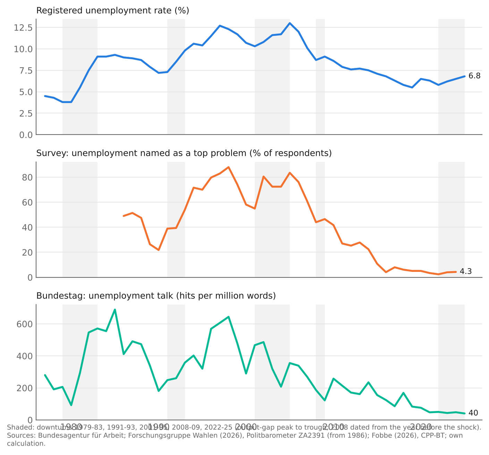
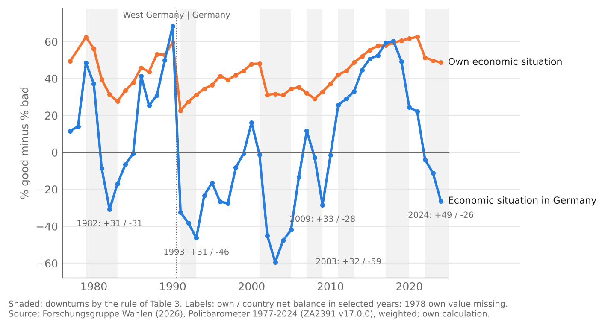
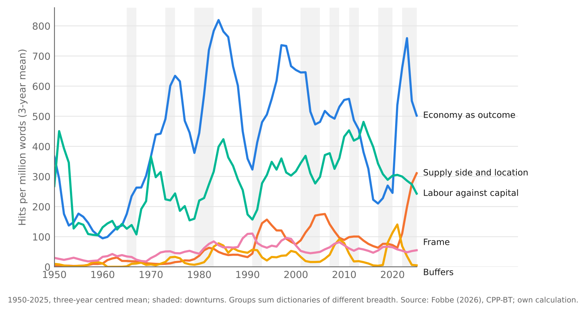

*Written in a personal capacity. The views expressed are the author's own and do not necessarily reflect those of the author's employer.*

**Abstract.** Germany's post-war political economy was organised around the fight against unemployment, and from the 1970s to the early 2000s rising unemployment was what moved the core of its labour-market institutions. This paper documents that link and its disappearance. In an annual coding of labour-market and social-insurance legislation since 1968, cuts to dismissal protection, unemployment benefit, sick pay and short-time work were passed in ten of twelve cut years after unemployment had risen; pension cuts, by contrast, came as often in years of falling as of rising unemployment. Since the mid-2000s unemployment has fallen to levels last seen around 1980, through the Hartz reforms, labour scarcity and, in 2022-25, an adjustment that ran through fewer hirings rather than mass dismissals. In the 2022-25 slump output fell five to seven percent short of its pre-2019 path, but registered unemployment rose by one point. In the Politbarometer survey, unemployment was named among the two most important problems by 84 percent in 2005 and by 4 percent in 2024, a level the unemployment rate largely explains. In 4,652 Bundestag plenary records, parliamentary attention to unemployment has become less responsive to changes in unemployment since 2003, and in 2022-25 parliament argued about energy prices, inflation, location and bureaucracy rather than the labour market. Legislated change since then has extended the core and tightened conditions at the margin, while collective-bargaining coverage has eroded without legislation. The paper argues that the defeat of mass unemployment removed the trigger through which the core of German labour-market institutions used to adjust.

**Keywords:** crisis and reform, unemployment, political attention, labour-market institutions, institutional drift, Germany

**JEL:** E24, J50, J65, P16, D72

## 1. Introduction

Mass unemployment was the defining economic problem of the Federal Republic for three decades. Registered unemployment rose from under one percent in the mid-1960s to 9 percent in 1983, 12.7 percent in 1997 and 13 percent in 2005 (Bundesagentur für Arbeit 2026a). In the Politbarometer survey, more than half of respondents named it among the two most important problems in every year from 1993 to 2007, up to 88 percent in 1998 (Forschungsgruppe Wahlen 2026). It was the background of the Kohl government's consolidation of the unemployment-insurance system, the location debate of the 1990s and the Agenda 2010.

That enemy has been defeated. Registered unemployment fell from 13 percent in 2005 to 5.5 percent in 2019. In 2022-25 Germany went through its sharpest loss of output relative to its earlier path since unification: in 2025 output was about seven percent below the path it would have taken had potential output kept growing at its 2014-19 rate and the economy run at capacity, of which the European Commission books five points as lost potential (European Commission 2026); on more cautious estimates of the write-down the shortfall is about five points. Unemployment rose by one point. By 2024 only four percent of Politbarometer respondents named it as a top problem.

This paper argues that the defeat of mass unemployment has removed the mechanism through which German labour-market institutions used to adjust, and documents the argument with four long-run measures assembled from public data.

The first is legislation. An annual coding of labour-market and social-insurance laws since 1968 shows that cuts to the core institutions of the labour market, those that protect incumbent employees against the risk of job loss, came almost only after unemployment had risen. Of twelve years with such cuts, ten followed a rise in registered unemployment over the previous three years; excluding the 1986 strike-neutrality rule, the mean rise in the eleven cut years was 2.3 points, against a fall of 0.2 points in other years (permutation p < 0.001). Pension cuts are different: of seven pension-cut years, four came with falling unemployment (1978, 1989, 2001, 2007); pensions respond to demography and contribution rates.

The second is the labour market itself. Since 2006 the response of unemployment to the output gap has been weaker than before, and in 2022-25 the adjustment ran through fewer exits from unemployment and, from 2022, more inflows, but not through the mass dismissals of earlier slumps. Slower growth of the labour force accounts for about half or more of the shortfall in employment. Unemployment stayed low because labour was scarce and firms stopped hiring, not because classic buffers such as short-time work absorbed the shock.

The third is what people saw. Survey salience of unemployment tracks its level almost perfectly. At the unemployment rates of the 2020s, unemployment is not a top problem, and the 2022-25 slump did not change this. Respondents judged the country's economic situation as bad, but their own situation better than in any earlier year in which the country was judged bad.

The fourth is what parliament debated. Before 2003, changes in unemployment moved parliamentary attention to unemployment closely; since 2003 much less (correlation of annual changes 0.59 against 0.17; p ≈ 0.06 for the difference). In 2022-25 parliament argued about energy prices, inflation and Germany as a business location; worker protection almost vanished from the debate.

Together these measures describe a political economy in which the old trigger for labour-market reform, rising unemployment, no longer fires, while the pressure of a structural shock is redirected towards a supply-side agenda that leaves the labour market's core institutions untouched. Meanwhile those institutions change by drift rather than by legislation: union density has fallen from 34 percent in 1960 to 14 percent in 2024, and half of employees now work in establishments without any collective agreement (OECD and AIAS 2025; IAB 2026).

The causal claims are limited. The reform pattern is strong in annual data but rests on one country and a coding by the author; the link from low unemployment to the absence of reform is consistent with all four measures but could also reflect partisanship, party competition or the type of shock. Section 10 discusses these alternatives and states what would refute the argument. A cabinet bill of November 2026 that eases dismissal protection for high earners is the first test.

Section 2 reviews the literature, section 3 the data. Section 4 documents when core cuts happened. Section 5 shows how unemployment was defeated and why the 2022-25 slump did not revive it. Sections 6 to 8 present the survey, parliamentary and conflict evidence. Section 9 discusses the mechanism, section 10 its limits, section 11 concludes.

## 2. Related literature

**Crisis and reform.** A large literature asks whether crises cause reform. Drazen and Grilli (1993) model crises as ending wars of attrition over the cost of stabilisation; Rodrik (1996) reviews why reform tends to follow crises. Empirical studies find that some crises raise the probability of liberalisation: Pitlik and Wirth (2003) for economic liberalisation, Høj et al. (2006) for OECD structural reforms; Abiad and Mody (2005) find that balance-of-payments crises spur financial liberalisation while banking crises set it back. Most of this work treats the crisis as one variable in a cross-country panel. This paper distinguishes output and unemployment within one country over seven decades and finds that, for the labour market's core institutions, unemployment has been the trigger.

**Insiders, outsiders and drift.** Insider-outsider accounts predict that parties and unions representing protected employees resist cuts to their protection unless the insiders themselves are threatened (Rueda 2007). The dualisation literature shows how Germany protected its industrial core while flexibility grew at the margin (Palier and Thelen 2010; Emmenegger et al. 2012; Hassel 2014). Institutions can also change without legislation, when their reach erodes while their rules stay the same (Hacker 2004; Streeck and Thelen 2005). Streeck (2009) argues that the German model was liberalised largely in this way, through the decline of bargaining coverage and the disorganisation of employers' associations, and Thelen (2014) places Germany's path among varieties of liberalisation. Dustmann et al. (2014) locate Germany's labour-market turnaround in decentralised bargaining rather than in legislation. This paper's finding that legislated cuts have stopped is therefore not evidence of no change; section 8 documents the drift.

**Attention and salience.** Most-important-problem questions measure what is salient, not necessarily what people think matters most, and issues crowd each other out (Wlezien 2005). Agenda-setting research shows that political attention shifts in bursts as problems are redefined (Baumgartner and Jones 1993). Voters judge the national economy as well as their own situation, and sociotropic judgements weigh more in vote choice than personal ones (Kinder and Kiewiet 1981); personal experience is often filtered through perceptions of the collective (Mutz 1998). The German survey evidence in section 6 is consistent with this: the country's economy is judged bad and political pressure exists, but it is not directed at the labour market.

**Distributional coalitions.** Olson (1982) argued that stable societies accumulate organised interests that slow adjustment, while encompassing organisations, such as German peak-level bargaining, can internalise the costs. Olson saw upheavals that destroy coalitions, not unemployment, as the occasions for reform. The mechanism here is narrower: what has disappeared is not the organisations but the condition under which they used to accept cuts.

**The German labour market.** Burda and Hunt (2011) attribute the small rise in unemployment in 2008-09 mainly to hiring restraint in the preceding upswing and to wage moderation, with working-time accounts and short-time work absorbing much of the fall in hours per worker. Balleer et al. (2016) find that the rule-based component of short-time work saved jobs, while discretionary extensions had no measurable effect. Möller (2010) stresses the narrowness of the 2009 shock. For the decline of unemployment after 2005, Hochmuth et al. (2021) evaluate the Hartz reforms and Klinger and Rothe (2012) matching. The flow decomposition follows Elsby, Michaels and Solon (2009), Fujita and Ramey (2009) and Shimer (2012); the Okun relation, Okun (1962) and Ball, Leigh and Loungani (2017).

## 3. Data

**Legislation.** Federal laws passed by the Bundestag that change dismissal protection, unemployment benefit (level, duration, eligibility), statutory sick pay, short-time work, statutory pensions for current contributors, fixed-term, agency or marginal work, minimum income support for the unemployed, or funding for active labour-market policy are coded by date of passage, direction (cut, expansion, buffer, deregulation) and target. "Core" denotes the first five areas, which protect incumbent standard employees; the others are "margin". The coding was built around nine downturns (windows from the peak year to three years after the trough) and extended to laws outside these windows, giving 75 items from 1965 to 2026, 48 of the 65 window items confirmed in the cited source, 42 of them from primary sources (Bundestag printed papers and plenary records, the Federal Law Gazette, official statistics). Pending bills are listed separately; laws identified but not yet coded (among them the early-retirement act of 1984, the employment promotion act of 1994 and the short-time work laws of 2020-22) are listed in the coding file. The budget of the Federal Employment Agency since 1965 comes from the Statistical Yearbooks, Bundestag papers and the Finance Ministry (Appendix A.5).

**Output and the labour market.** AMECO (European Commission 2019, 2026) provides the output gap, potential output, employment and hours for Germany (West Germany until 1990); the OECD Economic Outlook an alternative gap (OECD 2026). The Federal Employment Agency publishes the registered unemployment rate since 1950, here on the dependent civilian labour force, and monthly flow rates since 2007 (Bundesagentur für Arbeit 2025, 2026a).

**Survey.** The Politbarometer partial cumulation (Forschungsgruppe Wahlen 2026) covers 1977-2024 with about 1.1 million interviews; West Germany only until 1990. The open question on the most and second most important problem, asked since 1986 and coded by Forschungsgruppe Wahlen into about 140 categories (codebook, variable v33), is grouped into topics (Appendix A.4). Judgements of the country's and one's own economic situation are summarised as net balances: the share answering good or very good minus the share answering bad or very bad. Weights correct for the East German oversample.

**Plenary records.** The Corpus der Plenarprotokolle des Deutschen Bundestages (Fobbe 2026), version of 19 September 2026, contains 4,652 plenary records from 1949. Nineteen topic dictionaries are counted on lower-cased text after removing line-end hyphenation, as hits per million words per year. Precision was checked by reading 1,170 random hits: 92 percent refer to the intended topic; four cells fall below 80 percent (unemployment 2023-25 and the labour-reform field 1980-83, both 76 percent; inflation 1990-2005 and strikes 2019-25, both 75 percent) (Appendix A.3).

**Conflict.** Days lost through strikes and lockouts come from the Comparative Political Data Set (1960-2020, per 1,000 workers; Armingeon, Engler and Leemann 2022) and the Federal Employment Agency's strike statistics (per 1,000 employees from 1995, as published by Destatis 2026b; the agency notes that it undercounts short warning strikes); union density and bargaining coverage from the OECD/AIAS database (OECD and AIAS 2025); coverage by collective agreements from the IAB Establishment Panel (1996-2025; IAB 2026).

## 4. When core institutions were cut

Table 1 lists every year since 1968 in which the Bundestag passed a cut to a core institution, with the rise in registered unemployment over the previous three years.

*Table 1: Years with enacted cuts to core institutions, 1968-2026*

| Year | Law | Area | Δu over three years (pp) |
|---|---|---|---|
| 1975 | Budget Structure Act: stricter suitability rule for benefit claimants | Unemployment benefit | +3.6 |
| 1977 | 4th amendment to the Labour Promotion Act: sanction days deducted from benefit | Unemployment benefit | +1.9 |
| 1978 | 21st Pension Adjustment Act: fixed instead of formula increases | Pensions | -0.4 |
| 1981 | Labour Promotion Consolidation Act: qualifying period doubled | Unemployment benefit | +1.2 |
| 1982 | Budget Accompanying Act 1983: duration tied to contributions | Unemployment benefit | +3.7 |
| 1983 | Budget Accompanying Act 1984: benefit for claimants without children 68 → 63 % | Unemployment benefit | +5.3 |
| 1984 | Longer sanction period | Unemployment benefit | +3.6 |
| 1986 | § 116 Labour Promotion Act: no benefit in indirect strike lay-offs | Short-time work and benefit in strikes | -0.1 |
| 1989 | Pension Reform Act 1992 | Pensions | -1.1 |
| 1993 | Consolidation acts: benefit 68/63 → 67/60 %; stricter short-time work | Unemployment benefit, short-time work | +2.6 |
| 1996 | Employment Promotion Act: dismissal-protection threshold 5 → 10, sick pay 100 → 80 %; pension credits cut | Dismissal protection, sick pay, pensions | +1.7 |
| 1997 | Labour Promotion Reform Act; Pension Reform Act 1999 (contents not re-read) | Unemployment benefit, pensions | +2.1 |
| 2001 | Pension formula (AVmEG) | Pensions | -2.0 |
| 2002 | End of benefit indexation (Hartz I; unconfirmed) | Unemployment benefit | -0.9 |
| 2003 | Labour Market Reform Act: benefit duration 12/18 months, dismissal protection for new hires; Hartz III | Unemployment benefit, dismissal protection | +0.9 |
| 2004 | Pension sustainability factor | Pensions | +1.4 |
| 2007 | Retirement age 67 | Pensions | -1.6 |

*Δu: registered unemployment rate (dependent civilian labour force) in the year of passage minus three years earlier. Source: coding in Appendix A.5; Bundesagentur für Arbeit (2026a); own calculation.*

Two patterns stand out. Cuts to the labour-market core (dismissal protection, unemployment benefit, sick pay, short-time work) came in years after unemployment had risen: in ten of the twelve such years, the exceptions being the strike-neutrality rule of 1986, which is industrial-conflict law, and the unconfirmed end of benefit indexation in 2002, which preceded the large cuts of 2003. Pensions were cut in seven years, four of them years of falling unemployment (1978, 1989, 2001, 2007). Pensions follow demography and contribution rates, not the labour market.

Table 2 tests the pattern. Across 59 years, the rise in unemployment over the previous three years averaged 2.1 points in years with a labour-market core cut and -0.2 points in other years; under 10,000 random relabellings of the cut years, a difference this large never occurred (p < 0.001). In a logit, the rise in unemployment predicts a labour-market core cut with a coefficient of 0.89 (standard error 0.27), and 0.95 (0.34) controlling for the fall in the output gap, a change of government and an SPD-led government. Including pensions weakens but does not remove the pattern (p = 0.003).

*Table 2: Core cuts and the rise in unemployment, annual data 1968-2026*

| Definition of core cut | Cut years | Mean Δu, cut years | Mean Δu, other years | Permutation p | Logit coefficient on Δu (s.e.) | With gap fall, new government, SPD-led (s.e.) |
|---|---|---|---|---|---|---|
| All core cuts | 17 of 59 | +1.29 | -0.13 | 0.003 | +0.47 (0.18) | +0.59 (0.26) |
| Without pensions | 12 of 59 | +2.13 | -0.19 | < 0.001 | +0.89 (0.27) | +0.95 (0.34) |
| Without pensions and the strike rule | 11 of 59 | +2.34 | -0.19 | < 0.001 | +1.00 (0.30) | +1.04 (0.38) |

*Source: Appendix A.5; own calculation (`scripts/reform_years.py`).*

The episode view tells the same story with its limits. Of the nine downturns since 1965 identified in section 5, four had labour-market core cuts within three years after the trough (1973-75, 1979-83, 1991-93, 2001-05): the four with a rise in unemployment of 2.5 to 5.3 points. The other five, with rises of at most 1.4 points, had none. This holds for windows of one, two or three years after the trough and for either assignment of overlapping years. With pensions included, the 2007 retirement-age reform falls into the 2007-09 episode under some assignments, a core cut in an episode in which unemployment fell. With nine episodes, a perfect split is not strong evidence on its own (one in 126 under random assignment of four cut labels), which is why the annual analysis matters more.

Two rival explanations deserve attention. The first is the budget of the Federal Employment Agency, which goes into deficit when unemployment rises; cuts would then follow from the books. The agency needed federal money in 1975-76, 1980-83, 1988-89, 1992-99 and 2001-05 (for 1981-2005 mostly derived from deficits and changes in reserves). But deficits were not sufficient for cuts: the agency ran a deficit of 13.8 billion euros in 2009, covered from its reserve, and of 27.3 and 21.7 billion in 2020 and 2021, covered from its reserve, a federal loan of 6.9 billion and a federal grant of 16.9 billion, without any core cut. In both episodes short-time work kept the rise in unemployment small (0.4 points in 2009, 1.0 in 2020) and short-lived. The second is partisanship. Labour-market core cuts came under SPD-FDP (1975-82), CDU-FDP (1982-97) and SPD-Greens (2003) governments alike; section 4.1 tests this and other political explanations formally.

The pending test is concrete. On 18 November 2026 the cabinet adopted a labour-law bill that would allow employers to end employment against severance for earners above 1.75 times the pension contribution ceiling, about 177,000 euros a year, and extend fixed-term contracts without objective reason (BMAS 2026). It is a change to dismissal protection without a strong rise in unemployment. It affects a small group of top earners, far from the core of the 1996 and 2003 cuts, but if it passes it is a counter-example, and section 10 treats it as such.

## 5. How the enemy was defeated, and why 2022-25 did not revive it

### 5.1 The long fall of unemployment

Registered unemployment fell from 13.0 percent in 2005 to 5.5 percent in 2019, the lowest value since 1981. The literature attributes the fall mainly to the Hartz reforms' effect on job finding (Hochmuth et al. 2021) and to decentralised wage setting since the 1990s (Dustmann et al. 2014); from the late 2010s the slowing growth of the labour force added labour scarcity.

### 5.2 The 2022-25 slump

Table 3 measures every German downturn since the 1960s by one rule: an episode runs from a local peak of the output gap to the next trough, if the gap falls by at least two points.

*Table 3: German downturns, 1965-2025*

| Episode | Fall in output gap (points) | Registered unemployment, start → end (%) | Rise per point of gap |
|---|---|---|---|
| 1965-67 | 4.8 | 0.7 → 2.1 | 0.29 |
| 1973-75 | 4.9 | 1.2 → 4.7 | 0.71 |
| 1979-83 | 4.9 | 3.8 → 9.1 | 1.08 |
| 1991-93 | 4.8 | 7.3 → 9.8 | 0.52 |
| 2001-05 | 3.7 | 10.3 → 13.0 | 0.73 |
| 2007-09 | 6.8 | 10.1 → 9.1 | -0.15 |
| 2011-13 | 2.3 | 7.9 → 7.7 | -0.09 |
| 2017-20 | 5.1 | 6.3 → 6.5 | 0.04 |
| 2022-25 | 2.6 | 5.8 → 6.8 | 0.38 |

*Gap: European Commission (2026), West Germany until 1990. Unemployment: registered rate on the dependent civilian labour force (Bundesagentur für Arbeit 2026a), about half a point above the rate on the whole civilian labour force. With the peaks of 2007-09 and 2017-20 moved to the year before the shock (2008, 2019), their ratios are 0.06 and 0.21.*

Episode ratios rest on small differences and depend on dating. In annual regressions of the change in the registered unemployment rate on the current and lagged change in the output gap, 1967-2025 (57 observations; the gap starts in 1965 and the 1991-92 changes, which span the West German and unified series, are dropped), the cumulative response is -0.55 points of unemployment per point of gap before 2006 (s.e. 0.09) and -0.29 in 2007-21 (0.10), the period of short-time work in 2009 and 2020. Allowing 2022-25 one common shift, its response is -0.35 (0.07), about 64 percent of the pre-2006 value; the difference is 0.20 (0.12), p ≈ 0.10. With the OECD gap, available from 1991 so that the base period is only 1993-2006, the 2022-25 response is -0.29 against -0.56 (difference 0.27, s.e. 0.09) (Appendix A.1). The unemployment response in 2022-25 was weaker than before 2006, though the difference is imprecisely estimated.

The comparison against the gap understates how unusual the episode is, because the gap is what remains after the write-down of potential. Had potential output kept growing at its 2014-19 rate, output in 2025 would be 6.9 log points higher: 5.1 points of lost potential and an output gap of 1.7 points (rounded components). The write-down is not hindsight; against the Commission's own projection of autumn 2019 it is the same. Smaller estimates exist: about four points on OECD potential, about three with a labour-force trend that excludes the migration of 2015-16 and structural unemployment held at its 2019 level. The total shortfall is thus about five to seven points.

### 5.3 Where the adjustment ran

The Federal Employment Agency's flow rates show where the labour market adjusted (Table 4). The monthly chance of leaving unemployment for a job was 5.65 percent in 2025, the lowest value since the series began in 2007. Against the 2015-18 average it fell by 19 percent, against the 2019 peak by 24 percent; for people under 25 from 13.0 to 9.9 percent. The monthly risk of entering unemployment out of employment, which includes the expiry of fixed-term contracts and quits as well as dismissals, was 0.59 percent in 2025, below its 2015-18 average and far below 2008-09, but above the unusually low level of 2022.

*Table 4: Monthly inflow risk (s) and exit chance (f), %, and steady-state decomposition*

| | s 2015-18 | s 2022 | s 2025 | f 2015-18 | f 2022 | f 2025 | Rise of u* from f, vs 2015-18 | Share of f in rise of u*, 2022-25 |
|---|---|---|---|---|---|---|---|---|
| All | 0.65 | 0.51 | 0.59 | 6.99 | 6.13 | 5.65 | +1.8 | 34 % |
| Under 25 | 1.16 | 0.86 | 0.99 | 12.96 | 11.85 | 9.94 | +2.2 | 55 % |
| 25 to 54 | 0.63 | 0.51 | 0.61 | 7.30 | 6.51 | 6.15 | +1.4 | 23 % |
| 55 and over | 0.47 | 0.37 | 0.42 | 3.42 | 3.13 | 2.73 | +2.6 | 54 % |

*s: risk of becoming unemployed out of employment subject to social insurance (January-November mean). f: chance of leaving unemployment for a job on the regular labour market (annual mean). u* = s/(s+f), a two-state steady-state index that excludes flows to and from non-participation and therefore lies above the registered rate. Source: Bundesagentur für Arbeit (2025); own calculation.*

The base year matters, and both views belong in the account. Against 2015-18, the whole rise in steady-state unemployment comes from fewer exits; the inflow risk fell. Against 2022, inflows account for about two thirds of the rise, and for workers aged 25 to 54 for about three quarters. The exit margin closed first, from 2020 on; inflows rose from 2022, from a low level and without reaching the rates of 2008-09. Exits into training, measures and inactivity fell too, from 19 to 14 percent of the stock per month between 2019 and 2025; total inflows were slightly lower in 2025 than in 2019, inflows from a job about the same (Appendix A.2).

Classic buffers played a minor role. In 2007-09 employment stayed above its pre-crisis trend while hours per person fell 3.4 points below it. In 2022-25 hours per person stayed on trend, employment fell 2.7 points below its 2014-19 trend, and short-time work involved around 300,000 people a year in 2024 and 2025 (Bundesagentur für Arbeit 2026b), against a peak of about 1.4 million in spring 2009 (Börsen-Zeitung 2020). Slower growth of the labour force accounts for 46 to 70 percent of the shortfall in employment, depending on whether the trend includes the migration of 2015-16 (Appendix A.2). Unemployment stayed low because labour supply stopped growing and firms stopped hiring.

The cost fell on those seeking entry: young people, whose exit chance fell most; older jobseekers, whose exit chance was already lowest; and, from 2022, prime-age workers losing jobs. New training contracts were ten percent below 2019 in 2025 (Destatis 2026a). Manufacturing lost 511,000 jobs between 2019 and 2025, while public administration, education, health and social care added 1.08 million (Eurostat 2026). Real compensation per employee was three percent below 2019 in 2023 but two percent above it in 2025 (European Commission 2026).

## 6. What people saw

Figure 1 shows the share of Politbarometer respondents naming unemployment among the two most important problems, together with the unemployment rate and parliamentary attention. Survey salience tracks the level of unemployment closely (correlation 0.97, 1986-2024). In a regression on the unemployment rate, its annual change and the shares naming migration and prices, each point of unemployment adds about 12 points of salience (s.e. 0.7); the change in unemployment adds nothing once the level is controlled for. Competing issues matter when they are large: the migration coefficient implies that the migration debate of 2015 lowered unemployment salience by about ten points (Appendix A.4). At the unemployment rate of 2024 the model predicts that about eleven percent would name unemployment; four percent did. Unemployment was even less salient than its level implies.

*Figure 1: Unemployment as a problem in the survey and in parliament, and the unemployment rate, 1977-2025. Shaded: downturns by the rule of Table 3. Sources: Forschungsgruppe Wahlen (2026); Fobbe (2026); Bundesagentur für Arbeit (2026a); own calculation.*

Other issues took its place. Migration was named by 66 percent in 2015 and 58 percent in 2016, prices and energy by 34 percent in 2022 and 25 percent in 2023, migration again by 28 percent and the economic situation by 18 percent in 2024.

Figure 2 shows the judgements of the country's and one's own economic situation. In every year in which the country's balance was below -20 (a descriptive threshold), the own balance lay between +23 and +41, with one exception: 2024, when the country stood at -26 and the own balance at +49. In the slumps of 1993 and 2003 the own balance stood at +31 and +32. The level of own judgements is partly a legacy of the long upswing (it rose from 2008 to +63 in 2021), but it fell only modestly in the slump.

*Figure 2: Judgement of the country's and one's own economic situation, net balance (% good minus % bad), 1977-2024. West Germany until 1990. Source: Forschungsgruppe Wahlen (2026); own calculation.*

This is not the absence of pressure. On the sociotropic logic of Kinder and Kiewiet (1981), a country balance of -26 should produce political pressure, and it did: the governing coalition collapsed in November 2024 and the economy was a central issue of the February 2025 election. What the survey shows is that the pressure had no labour-market object. People did not experience the slump as a threat to their jobs, and they did not name unemployment as the problem.

## 7. What parliament debated

The plenary records show the same shift in the political class. Table 5 reports, for all nineteen topic dictionaries, the correlation of the annual change in attention with the annual change in the unemployment rate, before and after 2003. First differences remove the long trends that dominate correlations of levels.

*Table 5: Correlation of annual changes in topic attention with annual changes in the unemployment rate*

| Topic | 1951-2002 | 2003-2025 |
|---|---|---|
| Unemployment | +0.59 | +0.17 |
| Growth | +0.37 | +0.25 |
| Wages | +0.33 | -0.08 |
| Public debt | +0.22 | +0.04 |
| Competitiveness | +0.21 | +0.30 |
| Social justice | +0.20 | -0.14 |
| Working time | +0.19 | +0.36 |
| Location | +0.18 | +0.22 |
| Short-time work | +0.11 | +0.30 |
| Early retirement | +0.09 | -0.16 |
| Bureaucracy | +0.07 | +0.36 |
| Worker protection | +0.01 | +0.09 |
| Strikes | 0.00 | +0.12 |
| Codetermination | -0.01 | +0.08 |
| Collective bargaining | -0.03 | +0.04 |
| Energy prices | -0.09 | -0.22 |
| Social market economy | -0.14 | 0.00 |
| Skills shortage | -0.22 | -0.36 |
| Inflation | -0.30 | -0.22 |

*Source: Fobbe (2026); Bundesagentur für Arbeit (2026a); own calculation. With about 23 annual changes after 2003, correlations below about 0.4 in absolute value are not distinguishable from zero at conventional levels.*

Before 2003, a rise in unemployment raised parliamentary attention to unemployment (correlation of annual changes 0.59). After 2003 attention to unemployment responds much less (0.17); the difference is marginally significant (Fisher test, p ≈ 0.06). No other topic clearly took over this role: after 2003 no correlation exceeds 0.4 in absolute value, and the differences between periods for the other topics are not significant. The agenda shift shows in the levels. In 2022, energy prices drew 454 hits per million words and inflation 417, against 50 for unemployment; location, competitiveness and bureaucracy together reached 303 hits in 2025, the highest value in the series. The worker-protection dictionary (dismissal protection, sick pay, fixed-term and agency work) drew 109 hits in 2003, 147 in 2015 during the minimum-wage and agency-work debates, and 12 in 2025; dismissal protection alone, excluding tenancy law, 72 in 2003 and 0.9 in 2025.

The break is not specific to 2022-25. Parliamentary attention to unemployment fell even during 2001-05, the episode with the largest cluster of core cuts, as the debate moved from unemployment to its remedies. And low attention relative to the unemployment rate is not unique to the present either: it was also low in the early 1950s. What is new since 2003 is the combination of low unemployment, low responsiveness and a supply-side agenda that absorbs the economic pressure.

*Figure 3: Economic-policy topics in Bundestag plenary debates, five groups, hits per million words, three-year centred moving average. Groups sum dictionaries of different number and breadth, so levels are comparable over time within a group, not across groups. Source: Fobbe (2026); own calculation.*

## 8. Labour, capital and drift

The conflict between labour and capital has not disappeared, but it has changed its object. Days lost through strikes and lockouts were very high in the 1970s and 1980s: 166 per 1,000 workers in 1971 and 199 in 1984 (Comparative Political Data Set), when the metalworkers' strike for the 35-hour week, a response to unemployment through shorter working time, and the employers' lockouts cost 6.5 million working days on the Federal Employment Agency's count. Per 1,000 employees, strike days fell to 4.7 in 2003 and 0.5 in 2005 and revived to 14.0 in 2023 and 11.2 in 2024 (Bundesagentur für Arbeit 2026c; Destatis 2026b). The revival followed the inflation of 2022-23 and was about wages and working time, not about jobs or dismissal protection.

At the same time the institutions that protect the core reach a shrinking share of the workforce. Union density fell from 33.9 percent in 1960 and 30.0 percent in 1993 to 14.1 percent in 2024 (OECD and AIAS 2025). Coverage by a sector-level collective agreement fell from 62 to 43 percent of employees in western Germany and from 43 to 34 percent in the east between 2003 and 2025; half of all employees now work in establishments without any collective agreement (IAB 2026). This is institutional change by drift (Hacker 2004; Streeck and Thelen 2005; Streeck 2009). It happens without legislation and without the visible losers that legislated cuts require. Legislation since 2005 has, by contrast, extended the core (the pension level, short-time work), introduced a minimum wage (2014) and tightened conditions at the margin (minimum income support in 2024 and 2026).

## 9. Mechanism and discussion

The four measures fit a simple account. In the Federal Republic, legislated cuts to the labour market's core institutions needed rising unemployment. Rising unemployment made the labour market the first concern of voters and the organising theme of parliamentary conflict, and it gave governments of every colour a reason that unions and the parties close to them could accept: jobs. The cuts of 1975-84, 1993-97 and 2003 all followed this path.

The defeat of mass unemployment removed the trigger. With unemployment at five to seven percent and labour scarce, a slump no longer produces large numbers of insiders who lose their jobs, and its costs are spread over people who are not hired. The survey shows that the public did not experience the 2022-25 slump as a labour-market problem; parliament shows that the economic pressure went into a supply-side agenda of energy, location and bureaucracy. The reforms of 2024-26 follow that agenda (planning and procurement, tax incentives for working pensioners, stricter minimum income support) and leave the core institutions untouched or extended: the pension level was guaranteed at 48 percent until 2031 and short-time work extended to 24 months.

In the model's own language: the social market economy reached its goal. It promised security against unemployment, and by the 2020s it delivers it for most people. But an economy that absorbs a structural shock (expensive energy, competition in its core industries, an ageing workforce) by keeping incumbents, hiring fewer people and extending pensions postpones the question of how its labour-market institutions should change. The pressure goes elsewhere: legislation extends the core and tightens the margin, and the core itself changes only by drift, without political decision and without anyone deciding who pays.

The equilibrium may be stable rather than temporary. About 13.4 million people, close to a third of the labour force, will reach retirement age over the next fifteen years (Destatis 2025), which will keep labour scarce into the 2030s, so unemployment is unlikely to return as a mass problem even if the structural decline continues. A political economy whose reform trigger is unemployment may then not be triggered again. Japan after 1990, where unemployment rose by only 0.1 to 0.35 points per point of output gap in three downturns while potential output fell about a fifth below its 1985-90 trend, a trend inflated by the bubble, shows how long such a state can last (OECD 2026).

## 10. Limits and tests

**One country, author's coding.** The legislative pattern rests on one country and on a coding by the author, with 17 of 65 window items not confirmed in a cited source and some areas (pensions, strike law) open to classification choices. Table 2 shows the pattern under several definitions; a second coder and a cross-country test using existing reform databases would be the next steps.

**Alternatives.** The decline of legislated core cuts since 2005 coincides with grand coalitions (2005-09, 2013-21), with the rise of the AfD, which may make governing parties avoid unpopular reforms, and with a shock (energy prices) whose rational policy response lies outside the labour market. The annual analysis controls for government change and party, but not for party competition or the type of shock.

**Measures.** Word counts are coarse, vocabulary changes (the location vocabulary did not exist before the 1990s), and four cells have a precision below 80 percent. Correlations of annual changes after 2003 rest on about 23 observations. The survey's problem categories change over time, the series is West German until 1990, and 1986-88 allowed three answers.

**The slump.** The write-down of potential output may be revised; the comparison of unemployment responses depends on it, the argument about the trigger does not.

Three observations would refute the argument. If the November 2026 labour-law bill, or another cut to dismissal protection, unemployment benefit, sick pay or short-time work, passes before the 2029 election without a strong rise in unemployment, the trigger is not what this paper claims; the bill's narrow scope (earners above about 177,000 euros) would make it a weak counter-example, a broader cut a strong one. If unemployment rises sharply and core institutions remain untouched, the trigger no longer works. And if parliamentary attention to unemployment and to distributional topics again moves with changes in unemployment, the decoupling was temporary.

## 11. Conclusion

From the 1970s to the early 2000s, rising unemployment was the trigger that moved the core of Germany's labour-market institutions: in ten of twelve years with core cuts, unemployment had risen. Since the mid-2000s, mass unemployment has been defeated, and the 2022-25 slump, large in output, did not revive it. Unemployment rose little, the adjustment ran through hirings that did not happen, the public did not name unemployment as a problem, and parliament argued about energy, location and bureaucracy. The pressure of a structural shock has been redirected: legislation extends the core and tightens the margin, and the core changes only by drift. The success of the social market economy against its old enemy may be what keeps it from adjusting to the new one.

## Appendix

### A.1 Episode rule and Okun regressions

An episode begins in a year in which the output gap is at a local maximum and ends in the year in which it stops falling; episodes with a fall of less than two points are dropped. Annual regression: Δu_t = a + b0 Δgap_t + b1 Δgap_t-1 + period interactions (2007-21; 2022-25) + e_t, HAC standard errors (2 lags), 1967-2025 (N = 57). The unrestricted 2022-25 interaction has four observations for three parameters; the restricted model allows one common shift in both slopes. Code: `scripts/okun_inference.py`, `scripts/table1_rule.py`.

### A.2 Flows and employment accounting

Two-state steady state u* = s/(s+f) from the agency's published monthly rates. All flows from the agency's annual counts: stock 2.27 million (2019) and 2.95 million (2025); inflows 7.24 and 6.92 million, of which from a job 2.63 and 2.64 million; exits into a job 2.01 and 1.99 million; monthly exit rate into a job 7.4 and 5.6 percent, other exits 19.2 and 13.6 percent. Employment accounting: employment in 2025 against a counterfactual of the labour force on its pre-2019 trend and the unemployment rate at its 2019 level; supply share 70 percent with the 2014-19 labour-force trend, 46 percent with 2010-14. Code: `scripts/flows_groups.py`, `scripts/employment_split.py`, `scripts/okun_hours.py`.

### A.3 Plenary dictionaries and validation

Dictionaries in `scripts/plenum_topics.py` and `scripts/plenum_attention.py`. Dismissal-protection hits within 100 characters of tenancy vocabulary are dropped; hyphenated coordinations such as "Arbeitslosen- und Sozialhilfe" are excluded from the unemployment field. Hand-coded precision: 450 hits for unemployment, labour reform and location (0.76 to 1.00) and 720 hits for 18 other topics (0.75 to 1.00); 1,081 of 1,170 relevant (92 percent) (`results/plenum_kwic_precision.md`, `results/plenum_topics_precision.md`).

### A.4 Politbarometer

Topic groups from the problem codes (v33, v34): unemployment 14, 90; economy 13, 95, 115, 117; prices and energy 5, 76, 93, 110; migration 51-54; reform 96, 98 (from 2003; code 98 carries another item in 1989); labour and capital 7, 8, 9, 79, 105; social justice 2, 77. Weights dwght where positive, else pwght. Regression of unemployment salience (%), 1986-2024, HAC s.e.: unemployment rate +11.95 (0.69), its change -0.18 (1.36), migration -0.16 (0.08), prices and energy -0.15 (0.11); R² 0.95. Data are not redistributed; code: `scripts/politbarometer.py`.

### A.5 Reform coding and agency budget

`coding/reform_coding_v2.yaml` (rules, items, sources, pending bills, laws outside the windows, leads not coded) and `coding/ba_budget.csv`. Annual tests and episode variants: `scripts/reform_years.py`, `results/reform_years.md`. Uncoded leads in the 1965-67 and 1991-96 windows (Finance Amendment Act 1967, pension measures 1966-69, First Labour Law Adjustment Act 1969, Employment Promotion Act 1994, Unemployment Assistance Reform Act 1996) are listed in the coding file.

## References

Abiad, A. and Mody, A. (2005) 'Financial reform: what shakes it? What shapes it?', *American Economic Review*, 95(1), pp. 66-88.

Armingeon, K., Engler, S. and Leemann, L. (2022) *Comparative Political Data Set 1960-2020*. Zurich: Department of Political Science, University of Zurich.

Balleer, A., Gehrke, B., Lechthaler, W. and Merkl, C. (2016) 'Does short-time work save jobs? A business cycle analysis', *European Economic Review*, 84, pp. 99-122.

Ball, L., Leigh, D. and Loungani, P. (2017) 'Okun's law: fit at 50?', *Journal of Money, Credit and Banking*, 49(7), pp. 1413-1441.

Baumgartner, F.R. and Jones, B.D. (1993) *Agendas and Instability in American Politics*. Chicago: University of Chicago Press.

BMAS (2026) 'Kabinett beschließt Arbeitsrechtspaket', press release, Bundesministerium für Arbeit und Soziales, Berlin, 18 November 2026.

Bundesagentur für Arbeit (2025) *Chancen und Risiken am Arbeitsmarkt nach Personengruppen, Deutschland, Dezember 2025*. Nürnberg.

Börsen-Zeitung (2020) 'Kurzarbeiterzahl steigt auf Rekordhoch'. Available at: https://www.boersen-zeitung.de/konjunktur-politik/kurzarbeiterzahl-steigt-auf-rekordhoch.

Bundesagentur für Arbeit (2026a) *Arbeitslosigkeit im Zeitverlauf*, reporting month October 2026. Nürnberg.

Bundesagentur für Arbeit (2026b) 'Jahresrückblick 2025', press release, 7 January 2026. Nürnberg.

Bundesagentur für Arbeit (2026c) *Streikstatistik, Dezember 2025*. Nürnberg.

Burda, M.C. and Hunt, J. (2011) 'What explains the German labor market miracle in the Great Recession?', *Brookings Papers on Economic Activity*, Spring 2011, pp. 273-319.

Destatis (2025) '13,4 Millionen Erwerbspersonen erreichen in den nächsten 15 Jahren das gesetzliche Rentenalter', press release, Wiesbaden, September 2025.

Destatis (2026a) *Neu abgeschlossene Ausbildungsverträge*, table 21211-0004, GENESIS-Online. Wiesbaden.

Destatis (2026b) *Qualität der Arbeit: Streiks* (indicator 5.3, days lost per 1,000 employees). Wiesbaden.

Drazen, A. and Grilli, V. (1993) 'The benefit of crises for economic reforms', *American Economic Review*, 83(3), pp. 598-607.

Dustmann, C., Fitzenberger, B., Schönberg, U. and Spitz-Oener, A. (2014) 'From sick man of Europe to economic superstar: Germany's resurgent economy', *Journal of Economic Perspectives*, 28(1), pp. 167-188.

Elsby, M.W.L., Michaels, R. and Solon, G. (2009) 'The ins and outs of cyclical unemployment', *American Economic Journal: Macroeconomics*, 1(1), pp. 84-110.

Emmenegger, P., Häusermann, S., Palier, B. and Seeleib-Kaiser, M. (eds) (2012) *The Age of Dualization: The Changing Face of Inequality in Deindustrializing Societies*. Oxford: Oxford University Press.

European Commission (2019) *AMECO database, autumn 2019 vintage*. Brussels.

European Commission (2026) *AMECO database, autumn 2026 vintage*. Brussels.

Eurostat (2026) *Employment by A*10 industry breakdowns (nama_10_a10_e)*. Luxembourg.

Fobbe, S. (2026) *Corpus der Plenarprotokolle des Deutschen Bundestages (CPP-BT)*, version 2026-09-19. Zenodo. doi:10.5281/zenodo.22844952.

Forschungsgruppe Wahlen, Mannheim (2026) *Politbarometer 1977-2024 (Partielle Kumulation)*. GESIS, Köln. ZA2391 Datenfile Version 17.0.0. doi:10.4232/1.14611.

Fujita, S. and Ramey, G. (2009) 'The cyclicality of separation and job finding rates', *International Economic Review*, 50(2), pp. 415-430.

Hacker, J.S. (2004) 'Privatizing risk without privatizing the welfare state: the hidden politics of social policy retrenchment in the United States', *American Political Science Review*, 98(2), pp. 243-260.

Hassel, A. (2014) 'The paradox of liberalization: understanding dualism and the recovery of the German political economy', *British Journal of Industrial Relations*, 52(1), pp. 57-81.

Hochmuth, B., Kohlbrecher, B., Merkl, C. and Gartner, H. (2021) 'Hartz IV and the decline of German unemployment: a macroeconomic evaluation', *Journal of Economic Dynamics and Control*, 127, 104114.

Høj, J., Galasso, V., Nicoletti, G. and Dang, T.-T. (2006) 'The political economy of structural reform: empirical evidence from OECD countries', *OECD Economics Department Working Papers*, 501.

IAB (2026) *Daten zur Tarifbindung und betrieblichen Interessenvertretung* (IAB-Betriebspanel 1996-2025), 2 April 2026. Nürnberg. Available at: https://iab.de/daten/daten-zur-tarifbindung-und-betrieblichen-interessenvertetung/.

Kinder, D.R. and Kiewiet, D.R. (1981) 'Sociotropic politics: the American case', *British Journal of Political Science*, 11(2), pp. 129-161.

Klinger, S. and Rothe, T. (2012) 'The impact of labour market reforms and economic performance on the matching of the short-term and the long-term unemployed', *Scottish Journal of Political Economy*, 59(1), pp. 90-114.

Möller, J. (2010) 'The German labor market response in the world recession: de-mystifying a miracle', *Zeitschrift für ArbeitsmarktForschung*, 42(4), pp. 325-336.

Mutz, D.C. (1998) *Impersonal Influence: How Perceptions of Mass Collectives Affect Political Attitudes*. Cambridge: Cambridge University Press.

OECD (2026) *OECD Economic Outlook*, 119. Paris.

OECD and AIAS (2025) *OECD/AIAS ICTWSS database: trade union density and collective bargaining coverage*, via OECD Data Explorer (DF_TUD, DF_CBC), accessed November 2026. Paris and Amsterdam.

Okun, A.M. (1962) 'Potential GNP: its measurement and significance', in *Proceedings of the Business and Economic Statistics Section*. Washington, DC: American Statistical Association, pp. 98-104.

Olson, M. (1982) *The Rise and Decline of Nations: Economic Growth, Stagflation, and Social Rigidities*. New Haven: Yale University Press.

Palier, B. and Thelen, K. (2010) 'Institutionalizing dualism: complementarities and change in France and Germany', *Politics & Society*, 38(1), pp. 119-148.

Pitlik, H. and Wirth, S. (2003) 'Do crises promote the extent of economic liberalization? An empirical test', *European Journal of Political Economy*, 19(3), pp. 565-581.

Rodrik, D. (1996) 'Understanding economic policy reform', *Journal of Economic Literature*, 34(1), pp. 9-41.

Rueda, D. (2007) *Social Democracy Inside Out: Partisanship and Labor Market Policy in Advanced Industrialized Democracies*. Oxford: Oxford University Press.

Shimer, R. (2012) 'Reassessing the ins and outs of unemployment', *Review of Economic Dynamics*, 15(2), pp. 127-148.

Streeck, W. (2009) *Re-Forming Capitalism: Institutional Change in the German Political Economy*. Oxford: Oxford University Press.

Streeck, W. and Thelen, K. (eds) (2005) *Beyond Continuity: Institutional Change in Advanced Political Economies*. Oxford: Oxford University Press.

Thelen, K. (2014) *Varieties of Liberalization and the New Politics of Social Solidarity*. Cambridge: Cambridge University Press.

Wlezien, C. (2005) 'On the salience of political issues: the problem with "most important problem"', *Electoral Studies*, 24(4), pp. 555-579.
